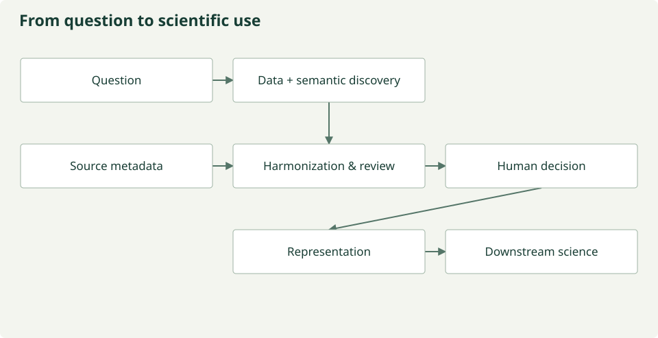

# AI-ready biological and environmental datasets

Finding data is only the first discovery problem. The second is discovering what
the data mean. Scientific variety contains information: community definitions and
source distinctions must survive synthesis.

A research prototype for human-governed dataset creation: discover observations,
preserve source metadata and semantic evidence, review scientific harmonization
recipes, then stream approved harmonized outputs
into machine representations with source and decision lineage.

**AI chooses among tested scientific operations. It does not invent the analysis.**

VERDE interprets, selects, parameterizes, compares and proposes within a versioned
JSON backbone. A closed operation registry owns the scientific computation.
Schema/scientific validation and human review govern execution; approved recipes
run with the model off. [Model trust boundary](docs/architecture/model-trust.md).



[Research website](https://cu-esiil.github.io/AI_ready_datasets/) ·
[Documentation](docs/documentation/index.md) · [Current status](docs/PROTOTYPE_STATUS.md) ·
[Architecture audit](docs/architecture/current-state.md)

## Run offline

```sh
python -m venv .venv
source .venv/bin/activate
python -m pip install -e '.[dev,embeddings]'
prototype run --all-tracks --output run/offline
prototype mosaiks-demo --output run/mosaiks-example
prototype operation-demo --output run/operation-trust-example
pytest -q
mkdocs build --strict
```

Fixtures and MOSAIKS demonstration inputs are explicitly generated. No source data
or models are downloaded by these commands. MOSAIKS consumes harmonized rasters,
fits empirical filters on bounded training-only references, and produces numeric
shards, compact lineage, separate labels and held-out diagnostics with baselines.
Derived texture diagnostics do not establish ecological validity or native LLM understanding.

## Work with the modules

Package code lives in `src/dataset_prototype/`; offline tests in `tests/`;
small synthetic fixtures in `data/fixtures/`; scientific track configuration in
`tracks/`; website and technical documentation in `docs/`.

- [Discovery & access](docs/discovery.md): scientific requests → source metadata and explicit access plans.
- [Harmonization & review](docs/review/index.md): evidence → frozen recipes, scoped findings, deterministic QA and human decisions.
- [Representation](docs/mosaiks-embeddings.md): reviewed harmonized raster streams → MOSAIKS vectors and verification.

The orchestrator composes typed, independently callable modules. Food and water
tracks share immutable source/core resources while retaining separate assumptions
and product identities. The third track remains disabled.

Discovery now records **data + metadata + semantic evidence** using typed source
annotations and concept candidates. Module 2 owns mapping and harmonization. The
project composes community semantic resources rather than replacing them with a
universal ontology. See the [Semantics resource](docs/semantics/index.md) and
[ontology research framework](docs/semantics/ontology-benchmarking.md),
[dataset benchmarking](docs/semantics/dataset-benchmarking.md) and
[working metadata diagnostics](docs/semantics/benchmark.md).
Automatic ontology composition and evidence-reviewed dataset potential/diversity
remain planned research, separate from implemented evidence preservation.

## Live integration status

Sentinel STAC metadata and bounded COG access are implemented. Historical tiny real
pixel reads and real model proposals exist; rejected Sentinel reviews have **not**
produced an approved real MOSAIKS dataset. New real-data paths stream bounded
windows without persisting raw or harmonized rasters, including tests.

The isolated OpenClaw 2026.5.18 / Verde adapter provides JSON-only specialist
inference with no model tools or fallback. `review-metadata` adds evidence-bound
semantic, calibration, support, rights, integrity and quality reviews plus QA synthesis.
Review eligibility never bypasses existing consensus, veto or human gates.
NEON metadata and authenticated-access boundaries exist; normalized observation
processing remains pending. MESA is an explicit unavailable adapter, not a live integration.

[Live setup](docs/openclaw-verde.md) · [Streaming](docs/streaming-harmonization.md) ·
[Sentinel case study](docs/development/sentinel-review-refactor.md) · [Sources and rights](docs/data-sources.md)

## Maintain the documentation

```sh
python scripts/generate_figures.py
python scripts/generate_reference.py
python scripts/generate_semantics.py
mkdocs build --strict
```

Markdown is the source of truth; generated SVG figures and JSON Schemas live beside
it. Preserve Material and the existing Pages workflow. See [AGENTS.md](AGENTS.md)
for scientific, streaming and source-rights governance and [design decisions](docs/development/decisions.md)
for the reasoning behind the implementation.

## External environmental execution backend

[CubeDynamics](https://github.com/CU-ESIIL/cubedynamics) is an external ESIIL dependency,
accessed through seven registered capabilities rather than model-written Python.
Install `.[dev,cubedynamics]` under Python 3.12 and run
`prototype cubedynamics-demo --output run/cubedynamics-example` for generated lazy
windows → harmonization → real CubeDynamics → MOSAIKS. Core semantic review remains
independent of this optional package. [Integration and limits](docs/cubedynamics.md).
