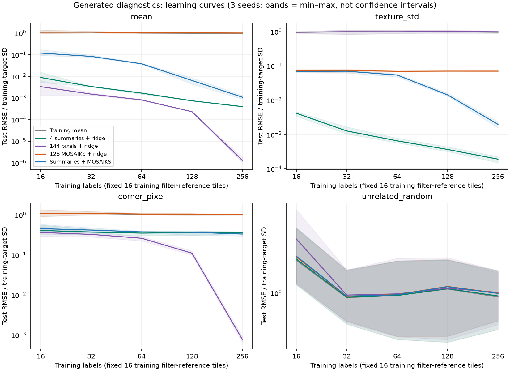

# Embedding utility analysis

Status: **UNDER ANALYSIS** — separate analysis subproject, 20 November 2026.
Initial generated diagnostics are **WORKING**. Agent utility and independent
scientific validation remain untested.

The core question is whether a materialized embedding layer is worth its costs
when agents can work with source data through tools. The primary comparison gives
the same agent direct access, embedding consumers or both, with deterministic
references. Measure verified task success, full preparation/refresh costs, first-query
latency and repeated-use savings. Agent competence is a hypothesis to test.

MOSAIKS prediction is one supporting case. Exact queries, changing questions and
information-loss cases are also needed; other modalities need separate protocols.
Raw access still requires scientifically correct calibration and review. Models
select registered operations; deterministic code computes.

Existing [MOSAIKS verification](../mosaiks-embeddings.md) demonstrates integrity and
numerical consumption on generated texture, not independent ecological validity.
This analysis changes no pipeline design, science tracks or review gates.

- [Analysis workspace](https://github.com/CU-ESIIL/AI_ready_datasets/tree/main/reports/embedding_utility)
- [Agent-versus-embedding framework](https://github.com/CU-ESIIL/AI_ready_datasets/blob/main/reports/embedding_utility/protocol/agent-versus-embedding.md)
- [Supporting raster protocol](https://github.com/CU-ESIIL/AI_ready_datasets/blob/main/reports/embedding_utility/protocol/study-plan.md)
- [Unapproved case template](https://github.com/CU-ESIIL/AI_ready_datasets/blob/main/reports/embedding_utility/cases/TEMPLATE.md)

Next: define one independently labeled task, credible baselines, actual support,
sampling units and practical-benefit threshold. Dataset choice, label rights,
margins and precision requirements remain open scientific decisions.

## Initial benchmarks

An offline three-seed benchmark tests 16–256 labels and 16/64/128 MOSAIKS features
on generated brightness, texture, corner-pixel and unrelated-noise tasks. MOSAIKS
helps a linear head predict texture compared with a linear head on pixels, but an
explicit standard-deviation summary does better still. Brightness and exact-pixel
queries favor direct inputs. These targets are derived diagnostics, not ecological
labels, and no agents have been evaluated.

[Results and compact run evidence](https://github.com/CU-ESIIL/AI_ready_datasets/blob/main/reports/embedding_utility/results/first-benchmarks.md)
include learning/size curves and separate assumed-cost scenarios. At assumed setup
cost 120 and per-query costs 3 direct versus 1 embedding, costs tie at 60 queries;
embedding first becomes cheaper at 61. Those units are illustrative, not measurements.

Three-seed mean curves; bands show min–max, not confidence intervals. Filters see
training tiles only. No generated geographic support represents real sites.

[Mathematics and classic graph guide](https://github.com/CU-ESIIL/AI_ready_datasets/blob/main/reports/embedding_utility/protocol/benchmark-math.md)
covers learning curves, accuracy–cost frontiers, cumulative break-even, representation
size, transfer, scaling and risk–coverage. A runner and tested analysis helpers were
added; production contracts, source gates and architecture remain unchanged.

## Proposed Fire VASE case

The study now has a [Fire VASE implementation plan](https://github.com/CU-ESIIL/AI_ready_datasets/blob/main/reports/embedding_utility/fire_vase/implementation-plan.md)
and a pinned [upstream audit](https://github.com/CU-ESIIL/AI_ready_datasets/blob/main/reports/embedding_utility/fire_vase/upstream-audit.md).
The primary comparison varies direct histories, interpretable developmental
profiles, training-only statistical embeddings and adaptive access, crossed with
controlled metadata views and agent policies. Existing Fire VASE summaries support
case selection; they are not new benchmark results or independent test artifacts.

Start with exact queries and retrospective developmental tasks. Prefix forecasting
needs a new reviewed definition that excludes completed-fire normalization and
future information. Code-writing agents are deferred under the current prohibition
on runtime model-authored scientific computation. All proposed operations remain
subject to deterministic validation and scientific review. No new fire observations
were ingested, upstream files changed or agents invoked during this planning step.

## Implemented Fire VASE milestone

The [deterministic Fire VASE benchmark](fire-vase-benchmark.md) is **WORKING** on
synthetic histories: R0 observations, R1 normalized profiles and R2 training-only
PCA, with M0/M1/M2 isolation, independent keys, explicit abstention and measured
preparation/query/cache costs. Real fire-data evaluation and agents remain planned.
This is a separate analysis implementation, not production integration or evidence
for metadata effectiveness. See its technical page for reproduction and limitations.

The [controlled Fire VASE agent harness](fire-vase-agents.md) now implements fixed
and adaptive access, M0/M1/M2 projections, budgeted proposals, evidence-backed
answers and strong deterministic baselines. Complete mock runs validate the
experimental wiring; no real LLM evidence for the utility hypotheses is claimed.
