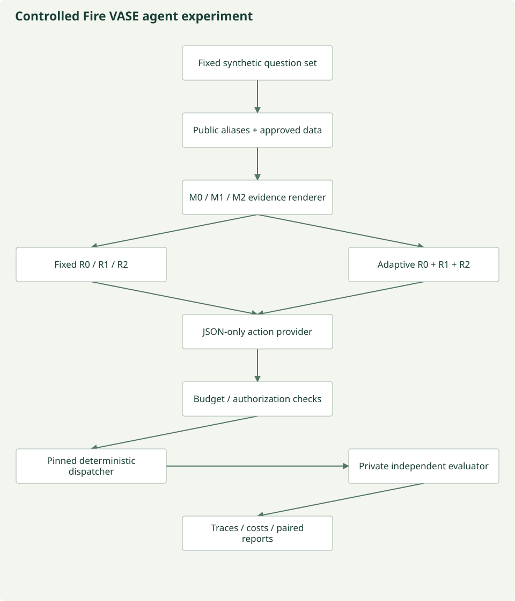

# Fire VASE controlled-agent benchmark

Status: **WORKING** protocol and complete **MOCKED** provider matrix. Real-model
smoke and scientific model evidence remain **PLANNED**. The underlying
[deterministic benchmark](fire-vase-benchmark.md) remains unchanged.



This milestone tests the infrastructure needed to ask whether scientific metadata
improves operation selection, recognition of information loss and adaptive access.
The simulator ignores metadata; its performance does not answer those hypotheses.
No real fires, neural models, prospective forecasts or scientific programming by a
runtime model are introduced.

## Two experimental regimes

- Fixed: one of R0 observations, R1 normalized features or R2 PCA coordinates, crossed
  with M0/M1/M2: 29 questions × 3 interfaces × 3 metadata conditions = 261 cells.
- Adaptive: all three interfaces available, crossed with M0/M1/M2: 87 cells.

The frozen mock run has 348 cells × 3 deterministic repetitions = 1,044 episodes.
A separate 348-episode matrix evaluates fixed deterministic consumers and an explicit
operation-contract router. Repetitions are not independent scientific samples or
stochastic language-model samples. Only one application-cache regime is used; caches
start cold per episode, and original preparation costs are retained separately.

## Information isolation

The renderer passes only the original scientific question, requested entities/dates,
anonymized IDs, authorized data and the chosen evidence view. It never serializes a
`Task` into a prompt. Task IDs, family labels, answerability, grading tolerance,
required-observation lists, reference answers and expected operations stay private.

Common information includes representation formats, argument types, units, alias
identifiers, null semantics, safety constraints and identical operation IDs/budgets.
These necessary parsing semantics are not hidden from M0. M1 adds descriptive
science; M2 adds general operation preconditions and representation limitations.
No condition gains extra observations, executable code or scientific permissions.
Original public question wording sometimes names missing/zero conditions; that is
an acknowledged development-case limitation, not a hidden generalization benchmark.

Full scientific error messages stay private. A model receives only the same generic
rejection codes across conditions, or a tool value/no-result with declared unit,
approximation flag and opaque evidence receipts. Inspecting a view cannot reveal
another representation or source files. Retained source-ID counts and validated
consecutive eligibility legitimately support sequence length in R1/R2.

## Model proposals and deterministic execution

Typed actions support select, inspect, call, answer and abstain. The model has no
native tools, filesystem, network, shell, SQL or Python permissions. It returns an
inert JSON proposal. The synthetic controller validates it before invoking the
existing pinned deterministic worker. It fixes source IDs to the offered case and
accepts only registered operations and schema-permitted arguments.

A final numeric answer must select a returned result and cite its evidence IDs.
Optional copied values must exactly match; unsupported answers are rejected even
if accidentally correct. New scientific numbers are never taken on model authority.
Wrong operations/arguments cannot receive coincidental numerical credit. Invalid
requests can be corrected by a new proposal within budget; malformed responses
are preserved, never silently repaired. This fixture controller grants no real-data
scientific approval and clears no existing veto.

Independent evaluation distinguishes selection errors, invalid arguments, operation
insufficiency, misinterpretation, justified/incorrect abstention and correct answers.
First proposed and final supported operation accuracy are separate. Forced fixed
view insufficiency is not an avoidable routing error; adaptive error requires an
authorized sufficient alternative. Diagnostics use independent keys for temporal
semantics, normalization, approximate geometry and provenance. Free-text reasons
are retained but not assumed scientifically true or used as self-grading.

## Providers and budgets

- `MockProvider`: deterministic public-question parser, first allowed interface and
  receipt copying. Explicit simulator; no token measurement or LLM capability claim.
- `RuleProvider`: scientific operation requirements and supplied data preconditions
  choose suitable interfaces or abstention. It sees no task IDs or evaluator labels.
  Construction/maintenance labor is unmeasured and reported as such.
- `OpenClawProvider`: optional verified 2026.5.18 task transport with provider-qualified
  Verde routing, returned identity checks, unique isolated sessions and no fallback.
  This session did not establish reachable authorized inference; no real call ran.

The plugin transports JSON objects; full action validation belongs to the controller,
allowing scientifically invalid JSON proposals to receive uniform rejection/recovery.
Its normalized JSON is not raw provider text. Unexposed snapshot/usage/cost fields
remain null. Known reported tokens are budgeted; unknown usage is not claimed zero
or an exactly enforceable total. Step, request, output, prompt-byte and time limits
are also fixed. A live smoke requires explicit access and verified no-external-charge
permission; this adapter does not preauthorize arbitrary paid API usage.

## Execute and rebuild

Use the dependencies and pinned source-only checkout described in the
[deterministic reproduction guide](fire-vase-benchmark.md). From the repository root:

```sh
python -m dataset_prototype.embedding_study.agent_runner \
  --config reports/embedding_utility/fire_vase/config/agent-mock-frozen-v2.json \
  --upstream run/fire-vase-code --upstream-python "$(command -v python)" \
  --output run/embedding_utility/fire_vase/agent-new-run
```

No credentials or model connection are needed for that explicit mock run. An absent
scientific worker fails, not falls back to copied operations. Output directories
must be new. Reports rebuild without provider calls:

```sh
python -m dataset_prototype.embedding_study.agent_runner --report RUN_DIRECTORY
FIRE_VASE_ROOT=run/fire-vase-code FIRE_VASE_PYTHON="$(command -v python)" \
  python -m pytest tests/test_fire_vase_agents.py -q
```

Outputs include full compressed episode/decision/tool traces, rejected responses,
private grader results, exact prompts/schema/metadata hashes, source/encoder/code
identities, actual usage availability, preparation and paired task-level reports.
Private evaluator IDs in trace bookkeeping are not included in model-facing prompts.
The same public question set and dataset are immutable across metadata conditions.
Historical milestone-1 outputs remain read-only.

The report presents correctness, abstention, operation/representation choices,
costs, deterministic comparisons and representative failures. Repetitions are first
collapsed within task for paired metadata contrasts. No population confidence
intervals or significance claims are justified by these selected synthetic cases.
A metadata-invariant simulator is an isolation control, not evidence of no metadata
value. Local policy CPU time is not LLM latency or billed inference cost.

[Milestone 2 report](https://github.com/CU-ESIIL/AI_ready_datasets/blob/main/reports/embedding_utility/fire_vase/milestone-2-report.md) ·
[Frozen protocol](https://github.com/CU-ESIIL/AI_ready_datasets/blob/main/reports/embedding_utility/fire_vase/agent-protocol-v2.md) ·
[Model access check](https://github.com/CU-ESIIL/AI_ready_datasets/blob/main/reports/embedding_utility/fire_vase/model-access-check-v1.json).

The first live smoke and a genuinely held-out event/template configuration are
explicitly disabled pending access, cost authorization and new independently
reviewed inputs. The 29 public cases are not relabeled as unseen scientific data.

The [expanded V3 pilot](fire-vase-pilot.md) adds separate synthetic cohorts, 120 frozen
model-unseen evaluation questions, optimized/cached direct rivals and measured-cost
selection diagnostics. Historical M2 results above remain unchanged. Real-model
metadata evidence and expert adjudication remain pending.
