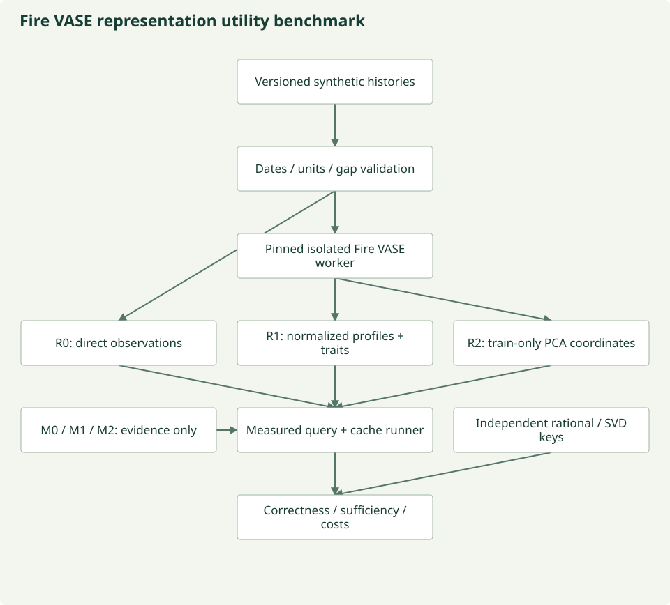

# Fire VASE representation utility benchmark

Status: **WORKING** deterministic synthetic milestone. Real fire-data evaluation,
independent scientific analog labels, neural encoders and agents remain **PLANNED**.
The [broader study](embedding-utility.md) remains **UNDER ANALYSIS**.



The implementation lives in `src/dataset_prototype/embedding_study/`. It is an
analysis-only consumer, separate from production harmonization, MOSAIKS and science
tracks. No production scientific gate, prior veto or permission is changed.

## Inputs and scientific definitions

The versioned `FireHistory` contract preserves source IDs, dated cumulative area,
source units, derived daily increments, quality flags, source/version/rights,
checksum scope and observation availability. It rejects unordered/duplicate dates,
negative or decreasing cumulative areas, inconsistent increments, unsupported
units and missing observations represented as numeric zero. Original dates are
never sorted or imputed silently.

A daily increment is accepted only for an evidenced one-calendar-day difference
from a previous available observation or explicit baseline. A longer interval can
supply total interval growth, not the unobserved daily trajectory. Unknown baseline
means unknown first daily increment. `available` describes an observed versus
missing record; `available_at` separately records knowledge availability, or stays
unknown. This milestone makes no operational forecast claims.

Only explicitly synthetic datasets can execute in this runner. The canonical
history type can describe source evidence, but a real-data loader is pending.
In particular, a real adapter must verify how upstream `ring_area_km2` relates to
its cumulative field; field names do not establish equivalence. Declining source
areas or revisions are rejected for this contract, never silently repaired.

The tiny fixture has 24 training and 10 evaluation fires: constant, early/late,
multiple-pulse, zero-growth, explicit missing-day, omitted-day, unknown-baseline and
zero-total cases. Equal-shape/different-size and equal-total/different-order pairs
expose information loss. All numbers are generated, with no real spatial support.

## Representations and upstream isolation

| Interface | Retained data | Scope |
| --- | --- | --- |
| R0 | Original validated dated histories | Exact area/date/growth queries and on-demand reviewed developmental operations |
| R1 | 20-bin normalized profile and declared shape traits | Shape queries; no hidden source-value fallback |
| R2 | Three frozen standardized-PCA coordinates | Declared PCA geometry and explicitly approximate profile-neighbor diagnostics |

Fire VASE at `2e20e15a42610f77cdd0583bb5a43fcc6f6c8959` supplies the actual
`growth_summary`, `shape_traits`, `pulse_counts` and `fit_pca` definitions. A separate
worker imports only its SHA-256-verified `analysis_v2.py`. It exposes fixed
`features`, `pulses` and `fit_pca` dispatch, not arbitrary functions, Python, SQL or
shell expressions. No upstream code is copied or modified, and the root process
does not import its `cubedynamics` namespace. No service or model fallback exists.

No reusable complete fitted upstream artifact was adopted: historical tables are
not assumed to carry compatible training-only preprocessing. The benchmark fits
once on the 24 declared synthetic training fires, never per query or on evaluation
fires. Artifact identity binds feature order, training IDs/history digests, training
feature digest, means/scales, component loadings, explained variance, upstream code
and dependency versions. Reloads validate identity and integrity. Coordinates are
written/reloaded with their dataset/artifact identities and checksums.

Normalization intentionally removes size and native dates. The provenance sidecar
retains source observation IDs and validated primary eligibility, so their count
supports the declared consecutive-sequence length query for R1/R2. This is retained
metadata, not information recovered from the vector. R2 cannot recover the
exact 20-bin profile. For neighbor fidelity it backprojects frozen coordinates to
original profile units, then computes approximate Euclidean distances; it does not
silently substitute standardized PC distance for full-profile distance. Reconstructed
values are not claimed to be valid probability profiles and are not clipped.
A separate exact task explicitly requests the declared PC-space metric.

## Tasks, reference answers and metadata

Twenty-nine machine-readable questions cover A: exact scientific queries,
B: developmental construction/traits, and C: geometry/neighbor diagnostics.
Each declares IDs/observations, operation, answer type/unit, tolerance, scientific
constraints, expected lineage and answerability per interface. Independent analog
relevance remains pending; all interfaces must abstain on that question.

Reference code independently differences cumulative observations, integrates
allocation over rational interval overlaps, uses analytic pulse locations and fits
PCA reference geometry by SVD. It never calls the upstream worker or reads the
representation answers. It tests exact arithmetic/geometry, not expert ecological
judgment. Same-profile/different-size fires supply an explicit collision that
prevents unique size recovery from shape alone.

M0 supplies parsing/schema necessities; M1 adds scientific descriptions; M2 adds
complete/gap/provenance/normalization semantics and answerability preconditions.
All conditions share the same input digest, operation names/signatures, resource
budgets and execution permissions. Evidence cannot add tools. Automatic isolation
checks run before execution. The deterministic consumer does not interpret metadata;
identical answers are an isolation check, not evidence that metadata is ineffective.

Scoring separates `correct`, `incorrect`, `correct_abstention`,
`incorrect_abstention`, `invalid_scientific_operation` and `execution_failure`.
Answerability, numerical error, unsupported-answer flags and provenance completeness
are separate fields. A valid approximate geometric operation can fail the reference
fidelity tolerance. `scientific_validity` concerns the declared synthetic evidence,
units and operation scope; it does not certify ecological validity or human approval.

## Run and reproduce

Use Python 3.11 for the pinned worker dependency set. Install root dependencies:

```sh
python -m pip install -e '.[dev,fire-vase-benchmark]'
python -m pip install -r reports/embedding_utility/fire_vase/config/requirements-worker.txt
```

Use an explicitly selected trusted checkout at the pinned commit. If unavailable,
fetch only the operation source with this explicit code-acquisition step (no data
lake or observation archive):

```sh
git clone --filter=blob:none --no-checkout https://github.com/CU-ESIIL/fire_vase.git run/fire-vase-code
git -C run/fire-vase-code sparse-checkout set --no-cone /src/cubedynamics/analysis_v2.py
git -C run/fire-vase-code checkout 2e20e15a42610f77cdd0583bb5a43fcc6f6c8959
```

From the repository root, with the same environment supplying the minimal worker
dependencies, run:

```sh
python -m dataset_prototype.embedding_study.runner \
  --config reports/embedding_utility/fire_vase/config/benchmark.json \
  --upstream run/fire-vase-code \
  --upstream-python "$(command -v python)" \
  --output run/embedding_utility/fire_vase/new-run
```

A separate worker interpreter is supported and was used in the initial run. No
source observations are downloaded. The runner refuses an existing output directory.
A missing/incompatible upstream checkout fails explicitly and leaves a failed run
manifest; it never substitutes fixture operations. Main-package offline tests can
run without upstream; replay tests require an explicit installation:

```sh
FIRE_VASE_ROOT=run/fire-vase-code FIRE_VASE_PYTHON="$(command -v python)" \
  python -m pytest tests/test_fire_vase_benchmark.py -q
python -m pytest -q
mkdocs build --strict
```

The CI replay job sparsely checks out the same source pin and installs the explicit
worker requirements before running the benchmark tests. This is configured CI,
not a claim that a new remote workflow has completed.

## Artifacts and accounting

- `results.jsonl.gz`: full task/interface/metadata/cache/repeat records with answers,
  references, statuses, lineages, runtime, memory, logical input bytes and IPC counts.
- `preparation.json`: source load, feature construction, PCA fit/artifact load,
  coordinate construction/reload and every warm-cache prefill cost.
- `pca_artifact.json`, `coordinates.json`, `features.json`: synthetic derived artifacts.
- `metadata_views.json`, `summary.json`, `report.md`, `manifest.json`: evidence views,
  scoped findings, input/code/output hashes, versions and deterministic result digest.

Cold/warm refers to application query caches. R1/R2 materializations remain resident;
OS caches are not cleared. Both direct operations and derived views cache query
results. Every warm cell receives its own measured prefill, avoiding metadata-order
advantages. File bytes are serialized bytes read, not physical disk I/O. Python
traced peak allocations and worker cumulative high-water RSS are different memory
measures. Worker startup/dependencies, fitting and preprocessing are not free.

Timings are instrumented local measurements on a tiny synthetic workload. Do not
compare mixed-task medians as an equal-capability frontier. Use the per-task correct
query timings and preparation attribution to estimate workload-specific break-even.
Metadata creation labor, real remote access, agent/token costs and operational refresh
are not measured here. Replays verify identical deterministic result digests locally;
cross-platform numerical results need tolerance-based comparison, while timing and
memory are expected to vary.

[Initial retained report](https://github.com/CU-ESIIL/AI_ready_datasets/blob/main/reports/embedding_utility/fire_vase/results/milestone-1-v1/report.md) ·
[Next agent milestone](https://github.com/CU-ESIIL/AI_ready_datasets/blob/main/reports/embedding_utility/fire_vase/agent-experiment.md).

## Controlled agent extension

The [milestone 2 harness](fire-vase-agents.md) adds fixed/adaptive JSON proposal
loops, strict public evidence projections, independent evaluation and a complete
mock-provider matrix. It does not change these milestone-1 scientific answers or
artifacts. Real-model evidence remains pending and is not inferred from mock scores.
