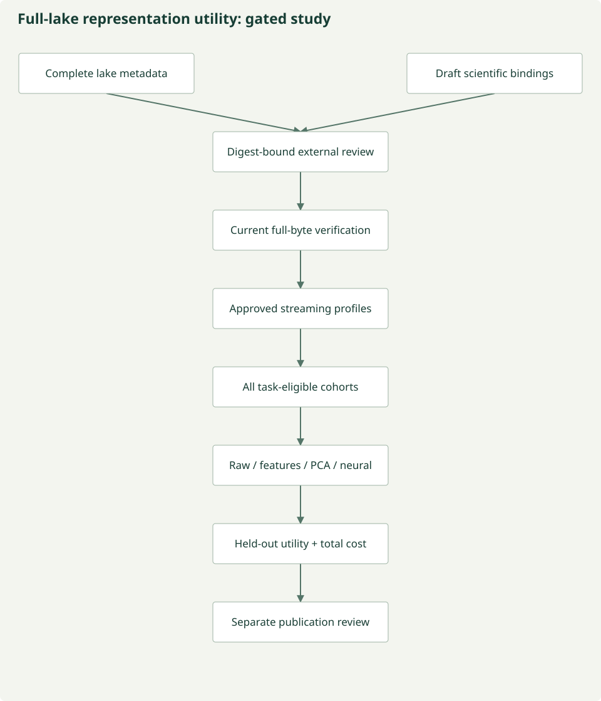

# Fire VASE full-lake representation utility

**PROTOTYPE / UNDER ANALYSIS.** Milestone 7 expands the proposed study to all
scientifically eligible fires. Real-row execution still requires explicit external
review; it has not begun. The M6 512-row audit limit is not a future full-study cap.

The metadata catalog contains 646 files totaling 40,318,194,810 bytes. Historical
manifest values were 642 files / 40,318,128,369 bytes. Four additional SQLite runtime
sidecars and six stat-size differences are reported without inferring data changes.
Metadata schemas were inspected for 330 NetCDF, 16 Parquet and two GeoPackage
containers; other schemas remain uninspected. Full current checksums, population
counts, rights and task eligibility remain unverified. No real rows or arrays read.

The [review amendment](https://github.com/CU-ESIIL/AI_ready_datasets/blob/main/reports/embedding_utility/fire_vase/milestone-7/authorization-amendment.md)
proposes ten independently gated scopes, from byte verification to publication.
All are unapproved. Reviewed bindings and scientifically meaningful effect sizes
are missing; no human receipt has been invented.

The [scientific protocol](https://github.com/CU-ESIIL/AI_ready_datasets/blob/main/reports/embedding_utility/fire_vase/milestone-7/protocol.md)
specifies whole-fire comparisons, overlapping task-specific cohorts, training-only
PCA/SVD and temporal encoders, independent holdouts, uncertainty and cost accounting.
Planned graphs include learning/dimension curves, transfer matrices, calibration,
retrieval relevance, stress responses and empirical cost–accuracy frontiers.

Working offline modules provide bounded streaming, native evidence preservation,
exact supported windows, supervised/SSL/multitask kernels and statistical/cost helpers.
Generated wiring checks establish software behavior only. Full real-data training
orchestration, reviewed scientific labels, geometry/environment associations and
measured full-lake computational scaling remain incomplete.

See the [M7 report and evidence index](https://github.com/CU-ESIIL/AI_ready_datasets/blob/main/reports/embedding_utility/fire_vase/milestone-7/report.md)
for exact implementation limits. Real-fire utility, counts, curves and manuscript
results are pending; earlier synthetic findings retain their original scope.
