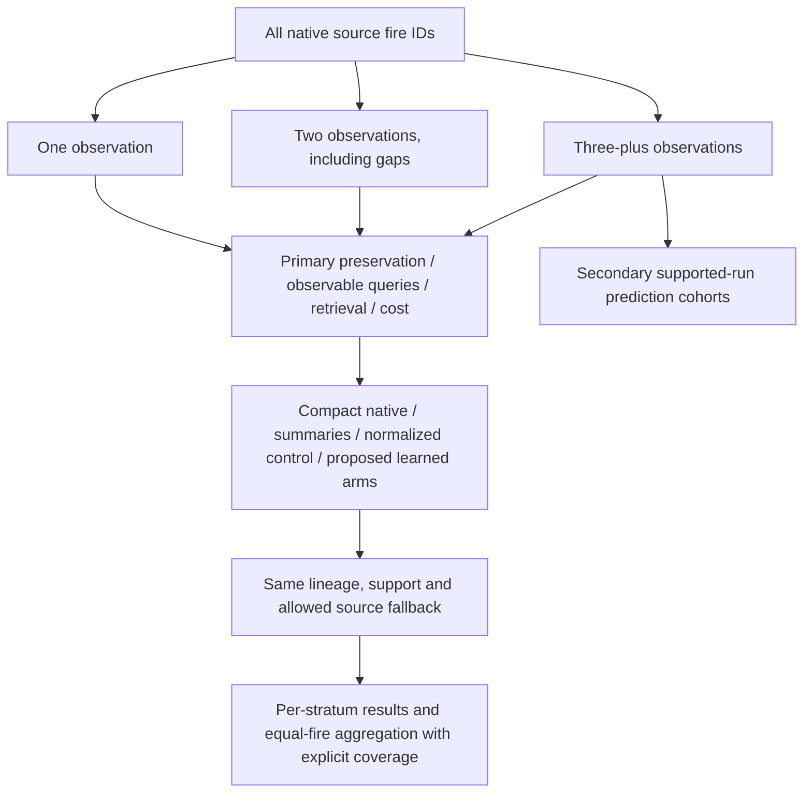

# Fire VASE: the full observed population

**Current benchmark emphasis:** all native fire IDs, with one-, two- and three-plus-
observation strata. Long-history prediction is a secondary selected-cohort study.
Observed history length is not independently established physical fire duration.

The primary question is whether learned representations improve on compact native
records and minimal interpretable scientific states for common tasks. Count,
absolute observed area, original support/provenance, observable-property retrieval
and computational reuse do not require long prediction windows. Shape/order tasks
need appropriate support; one-observation shape is NOT_APPLICABLE rather than an
invented flat trajectory. Gappy histories remain present with their original dates.

A deterministic real-source audit streams the native daily source and checks short-
history state preservation, normalization loss, complete JSON interface sizes and
small indexed-source fallback. A separate cached-native scalar-property search
diagnostic uses the full candidate training gallery and independent ranking oracle.
It fits no PCA/neural/predictive models and evaluates
no agents. Byte footprints and lookup diagnostics are not empirical learned-model
utility or a complete cost frontier. Numeric-only shapes and retained source-access
interfaces are separate conditions; provenance survives all representations.

The internal design and diagnostics are retained under
`reports/embedding_utility/fire_vase/full-population-v1/`. The previous census and
its exact depth/horizon matrix remain intact. An additional depth1/2 eligibility
matrix removes the old three-input restriction for secondary forecasting; it
preserves the difference between a short prefix with a future observation and a
completed one-observation record with no observed future. Future model arms must support the
short strata explicitly; the earlier minimum-three-input TCN does not cover them.
Classical/learned comparisons, comparative representation retrieval and representative workload
costs remain PLANNED. Source uncertainty, QA and actual availability stay unknown.

See [census scope](fire-vase-population.md), [tests](../testing.md) and
[decisions](../development/decisions.md).
