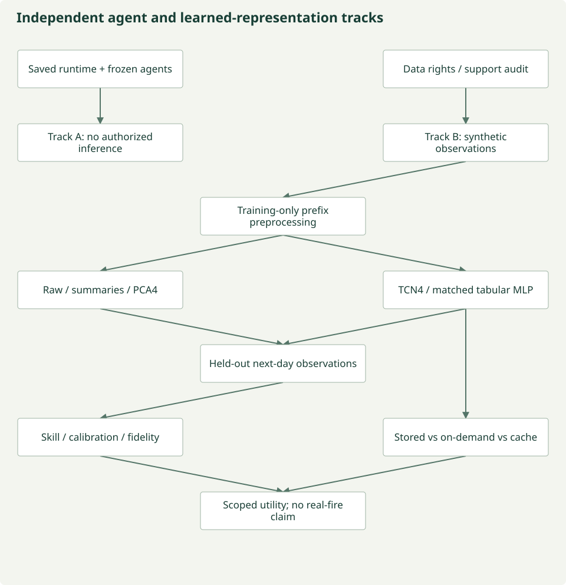
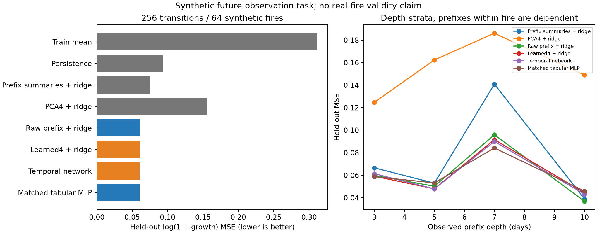
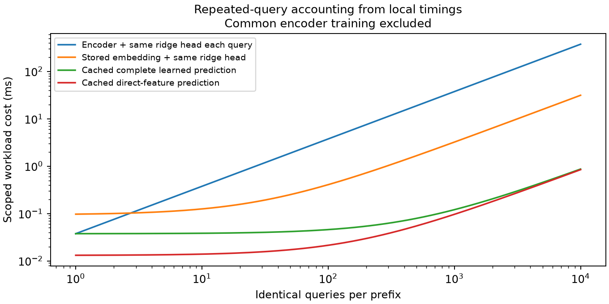

# Learned representation utility

**WORKING synthetic learning experiment. Real-agent and real-fire evidence pending.**

The [Milestone 4 report](https://github.com/CU-ESIIL/AI_ready_datasets/blob/main/reports/embedding_utility/fire_vase/milestone-4-report.md)
compares a small temporal embedding with raw-prefix ridge, interpretable summaries,
training-only PCA, persistence and a similarly sized tabular neural predictor.
It tests prediction of a subsequent observed day, not reconstruction of PCA or a
completed normalized history. Synthetic outcomes test software and statistical
mechanisms; they do not establish ecological validity.



## What the synthetic evidence says

The learned four-dimensional representation improves on the tested PCA and prefix
summary baselines, but its ridge probe is slightly worse than raw-prefix ridge on
held-out log-growth MSE. The end-to-end temporal and tabular networks give very
similar errors. These small descriptive differences establish no general superiority
or significance. Statistical fitting and additional nonlinear capacity must be
separated from the value of storing an embedding.



The cohort has 128 training, 48 validation and 64 test synthetic fires, with prefixes
at 3/5/7/10 observed days. All prefixes of a fire stay together. Seed selection and
interval calibration use separate validation fires; no test data fit encoders,
preprocessing, PCA or prediction heads. Original dates, source IDs, support and
availability precede the next-day outcome. There is no completed-fire normalization.

## Materialization is a different question

The same frozen encoder and same prediction head give identical predictions when
embeddings are stored. Stored lookup reduces repeated encoder computation, but cached
complete predictions are faster for identical fixed-head requests. Training, storage
construction, reads/writes and cache identities are recorded separately. Refresh
frequency, real storage costs and maintenance labor are unmeasured.



These curves evaluate a formula using local measured costs; they are not executed
10,000-query workloads. They do not compare methods at an independently approved
real-fire accuracy threshold. Full utility remains a vector of error, coverage,
provenance and lifecycle costs, not one universal score.

## What remains blocked

Real FIRED/Parquet files exist at documented legacy roots. Only schemas/footers were
inspected, with no observation rows ingested. Experiment-specific rights, native
ring/daily support, source identity and operational availability remain unresolved.
Code licensing does not relicense data. The typed real-input evidence contract is
an interface, not access permission or a working real-data adapter.

Track A retains the existing frozen smoke and pilot. Recorded prompts fit the saved
adapter byte bound; no framework change is needed for those requests. This session
cannot reach the gateway and access/no-charge authorization is unverified. No real
inference, metadata benefit or real-agent representation choice has been measured.

## Reproduce

The experiment needs NumPy and the repository contracts, with no neural framework,
network, source-data download or inference service. Use a new output directory:

```bash
OPENBLAS_NUM_THREADS=1 OMP_NUM_THREADS=1 MKL_NUM_THREADS=1 PYTHONPATH=src \
python -m dataset_prototype.embedding_study.learned_experiment \
  --config reports/embedding_utility/fire_vase/config/learned-synthetic-m4-v1.json \
  --output run/embedding_utility/fire_vase/my-new-learning-run
```

Regenerate static figures from recorded outputs:

```bash
python scripts/generate_fire_vase_learning_figures.py \
  --results reports/embedding_utility/fire_vase/results/milestone-4-learning-v1
```

The [frozen protocol](https://github.com/CU-ESIIL/AI_ready_datasets/blob/main/reports/embedding_utility/fire_vase/learned-protocol-m4-v1.md),
[evidence table](https://github.com/CU-ESIIL/AI_ready_datasets/blob/main/reports/embedding_utility/fire_vase/evidence-table-m4.md)
and [unsupported claims](https://github.com/CU-ESIIL/AI_ready_datasets/blob/main/reports/embedding_utility/fire_vase/unsupported-claims-m4.md)
separate mathematical statements, synthetic observations, missing real evidence and
unmeasured costs. Previous [deterministic](fire-vase-benchmark.md),
[controlled-agent](fire-vase-agents.md) and [expanded](fire-vase-pilot.md) results
remain unchanged.

The [M5 task-transfer study](fire-vase-transfer.md) preserves this frozen encoder and
adds independent future targets, joint/specific training, retrieval, property probes
and heterogeneous reuse. It separates A-only transfer from added supervision and
continues to withhold real-fire and real-agent claims.
