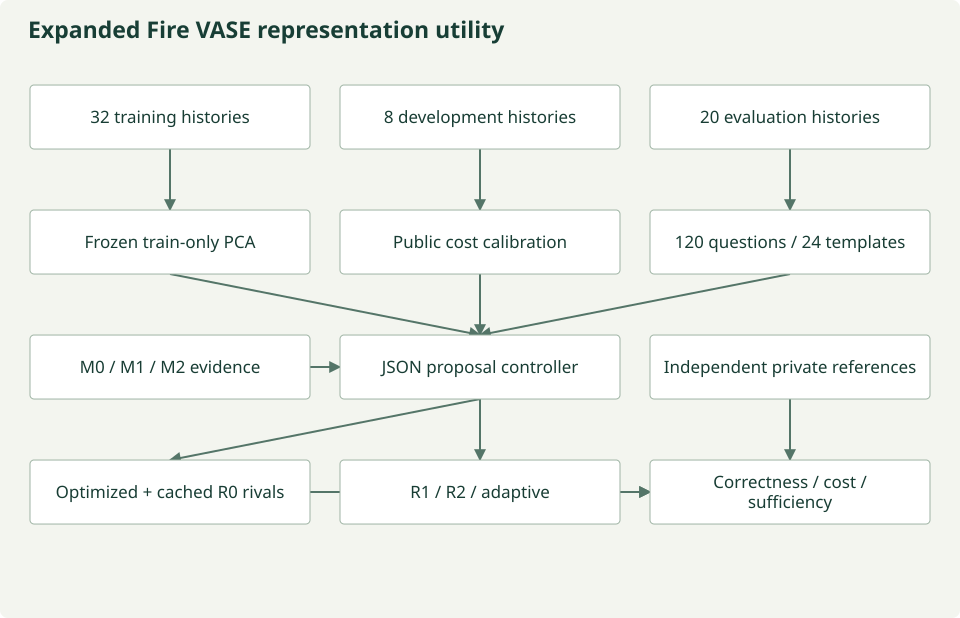

# Expanded Fire VASE representation-utility pilot

**WORKING** deterministic synthetic benchmark; **MOCKED** agent evidence;
**PLANNED** real inference and expert adjudication of draft scientific rubrics.

The question is whether a complete representation system improves scientific answers
or cost compared with strong raw-data computation. Neither embeddings nor adaptive
agents are presumed to win. [Milestone 3 report](https://github.com/CU-ESIIL/AI_ready_datasets/blob/main/reports/embedding_utility/fire_vase/milestone-3-report.md)
and [frozen protocol](https://github.com/CU-ESIIL/AI_ready_datasets/blob/main/reports/embedding_utility/fire_vase/agent-protocol-m3-v1.md)
contain the audit, limits and measured synthetic results. Historical
[deterministic](fire-vase-benchmark.md) and [controlled-agent](fire-vase-agents.md)
studies remain intact.



## What changed

Thirty-two training histories supply a fresh, training-only three-PC artifact.
Eight development histories support 30 development cases and public timing
calibration. Twenty new evaluation histories support 120 frozen questions across
24 templates. Histories, date ranges and template IDs are separated. These are
model-unseen cases visible to implementers, not a blinded external benchmark.
Question count is coverage, not statistical power or number of independent fires.

Fifteen registered operations cover native area and support, paired absolute
growth, developmental allocation and pulses, full/profile/PC geometry, reconstruction
error, rank stability, retained provenance and draft evidence-scope assessments.
Independent rational integration, cumulative differences, SVD and exhaustive
prominence references cross-check deterministic outputs before model proposals.
Assistant-authored scientific rubrics remain drafts, never human gold.

R0 uses indexed native lookup and targeted front/late allocation integrals. Scalar
allocation no longer pays for all upstream traits. Exact-query caching applies to
every view. R1 and R2 must earn any advantage against these alternatives.

## What theory permits

Let observations be X and a deterministic representation T(X). A quantity g(X) is
exactly answerable from T precisely when g is constant on each fiber
`{X′ : T(X′) = T(X)}`. Uniformly scaling a growth history preserves normalized
allocation but changes absolute area: scale cannot be recovered without other
evidence. The complete interface matters: retained identifiers and validated
consecutive support can still determine interval count.

R0 can derive R1 and R2, so adaptive access adds no information over R0. It can
reduce work if preparation, reuse, fidelity and routing justify it. A 20-bin
unit-sum profile has 19 affine degrees of freedom; a rank-three projection leaves
at least 16 local degrees of freedom undetermined. Exact inversion is generally
impossible. PC-space distance is a different target from full-profile distance.

For full profiles a,b and reconstructions â,b̂, the reverse triangle inequality gives

`| ||a−b||₂ − ||â−b̂||₂ | ≤ ||a−â||₂ + ||b−b̂||₂`.

Coordinates alone do not contain the discarded residual norms. A coordinate-only
system therefore cannot certify a full-profile error bound using this inequality
unless separately validated residual evidence is supplied. That would be a changed
interface requiring its own evaluation. Geometric agreement never establishes
independent ecological analog relevance.

## Costs and classic plots

For N identical queries the accounting scenario is

`C_r(N) = unpaid preparation_r + cold query_r + (N−1) × cached query_r`.

Add measured routing/controller cost when an agent is used. Report first-use,
already-prepared and cached alternatives separately. If cached direct and cached
feature queries cost the same, additional identical reuse cannot repay a persistent
preparation difference. Routing can dominate these small local operations.

The [measured diagnostic figures](https://github.com/CU-ESIIL/AI_ready_datasets/blob/main/reports/embedding_utility/fire_vase/milestone-3-report.md#figures)
show local cold/warm cost comparisons and amortization curves. The latter evaluate
this formula with measured inputs; they are not executed 10,000-query experiments.
Public timing hints are calibrated only on development cases. Per-evaluation-task
cost, sufficiency and Pareto minima stay private to grading. Time includes resident
Python/worker boundaries, not global raster throughput or cold physical storage.
Unknown model tokens and costs remain null.

## Reproduce and inspect

```bash
PYTHONPATH=src python -m dataset_prototype.embedding_study.pilot_runner \
  --output run/embedding_utility/fire_vase/m3-new-run \
  --upstream ../fire_vase --upstream-python ../fire_vase/.venv/bin/python
```

The output directory must be new. Defaults select the frozen V3 evaluation fixture,
two repetitions, four access regimes and three evidence conditions: 2,880 mock
episodes. A separate deterministic router has 360 episodes. Seven cold/warm
measurements per evaluation task/view give 2,520 pairs. Do not run competing test or
benchmark processes during retained timing collection. Source installation and
[worker requirements](https://github.com/CU-ESIIL/AI_ready_datasets/blob/main/reports/embedding_utility/fire_vase/config/requirements-worker.txt)
remain explicit; unavailable upstream execution never falls back to a substitute.

```bash
FIRE_VASE_ROOT=../fire_vase FIRE_VASE_PYTHON=../fire_vase/.venv/bin/python \
  python -m pytest -q
python scripts/generate_reference.py
python scripts/generate_figures.py
mkdocs build --strict
```

The default is always mock. The optional `--live-config` branch requires frozen input
hashes, explicit access/no-external-charge authorization, verified smoke evidence,
matching model identity and a finite global invocation cap. The supplied
[real-pilot config](https://github.com/CU-ESIIL/AI_ready_datasets/blob/main/reports/embedding_utility/fire_vase/config/agent-live-pilot-m3-v1.json)
is disabled. Positive spending caps are rejected because the installed transport
cannot enforce a monetary cap with unknown usage. The pre-existing smoke protocol
remains separate. No paid request, infrastructure change or fallback is implicit.

The latest [read-only access check](https://github.com/CU-ESIIL/AI_ready_datasets/blob/main/reports/embedding_utility/fire_vase/model-access-check-m3-v1.json)
records session reachability and authorization limits. No real-model capability,
metadata effect, independent ecological validity or population significance has
been measured. Draft evidence rubrics need expert review before confirmatory
scientific interpretation.

## Reproduce the offline matrix

Use the trusted pinned checkout and its isolated compatible interpreter, as in the
[original benchmark setup](fire-vase-benchmark.md). From the repository root:

```bash
PYTHONPATH=src python -m dataset_prototype.embedding_study.pilot_runner \
  --fixture data/fixtures/embedding_utility/milestone-3-v3 \
  --output run/embedding_utility/fire_vase/my-new-m3-run \
  --upstream ../fire_vase --upstream-python ../fire_vase/.venv/bin/python \
  --repetitions 2
```

Existing output directories are rejected. `--split development --repetitions 1`
runs the 30-case development matrix. No live provider is selected by default.
`--check-access /tmp/fire-vase-access.json` performs a read-only runtime/connection
check without inference or credential logging. `--live-config` requires explicit
verified access/no-charge authorization, checked frozen smoke evidence and matching
input hashes; the committed real configuration is disabled.

To regenerate static diagnostics without inference:

```bash
python scripts/generate_fire_vase_pilot_figures.py \
  --results reports/embedding_utility/fire_vase/results/milestone-3-v1
```

`pilot_runner.report(output, summary)` regenerates a recorded report without provider
calls. Source modules separate versioned contracts, generation, closed operations,
independent references, public rendering and execution/accounting. The shared
[controlled-agent loop](fire-vase-agents.md) retains defaults for historical M2
contracts while V3 supplies its static validator/serializer hooks.

View-construction/indexing, physical I/O, heterogeneous query reuse, pre-controller
rendering and authoring/maintenance costs are not fully attributed in this resident
microbenchmark. The [delivery report](https://github.com/CU-ESIIL/AI_ready_datasets/blob/main/reports/embedding_utility/fire_vase/milestone-3-report.md)
keeps these limits alongside the measured curves. No complete production cost or
real-agent competence conclusion follows from these measurements.

[Milestone 4](fire-vase-learning.md) preserves these frozen agent cases and adds an
independent synthetic prefix-learning experiment. It records current inference/data
access blockers, conventional/capacity baselines and stored/on-demand/cache costs;
no real-model or real-fire results are substituted by synthetic controls.
