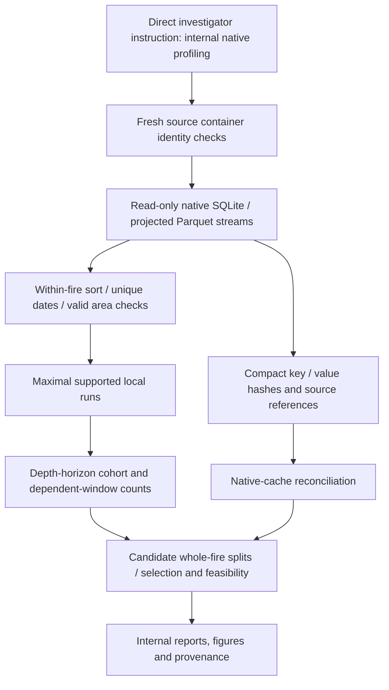

# Fire VASE native population census

**WORKING — read-only real-source census.** This supersedes the execution status of
the earlier, explicitly dated preparation milestones. Direct investigator instructions
authorized internal native-value profiling and superseded the separate-receipt
requirement for this scope. No fictitious external receipt or scientific PASS findings
were created. Model training and publication were not performed.

The implementation hash-verifies the relevant native daily/event and cached daily/
trait containers, streams every record, reconciles native/cache keys and values,
partitions maximal exact-calendar local runs, and counts all seven input depths by
three future horizons. No 512-row cap applies. Missing days never become zero growth.
Native measurement QA, uncertainty and operational availability remain unknown.

`population_profile` stores compact cohort summaries, evidence hashes and source
references, not raw/harmonized daily measurements or prediction tensors. SQLite
sorting uses in-memory temporary storage with an explicit heap cap; source streams
and per-fire buffers are bounded. Completed stages support restart. A full independent
replay verifies deterministic results. The nine figure families use measured real
cohort summaries; no synthetic substitute enters their data.

Internal results live in
`reports/embedding_utility/fire_vase/milestone-7-3-execution/`, including the census,
reconciliation, selection/feasibility reports, complete matrix, task summaries,
run/split Parquet indexes, resource/provenance records, PDF/SVG figures and logs.
Source-linked SQLite/Parquet indexes are excluded from Git. Internal results are
not registered in the public catalog or cleared for external redistribution.

The existing Milestone 7 external-review contracts remain unchanged for their
historical workflow. The separately named native census entrypoint records the
later direct instruction without silently converting old unreviewed findings.
Candidate mathematical support is distinct from scientific target validity,
predictive performance, ecological analog relevance and publication permission.

See [tests](../testing.md), [status](../PROTOTYPE_STATUS.md) and
[implementation modules](../reference/modules.md).
