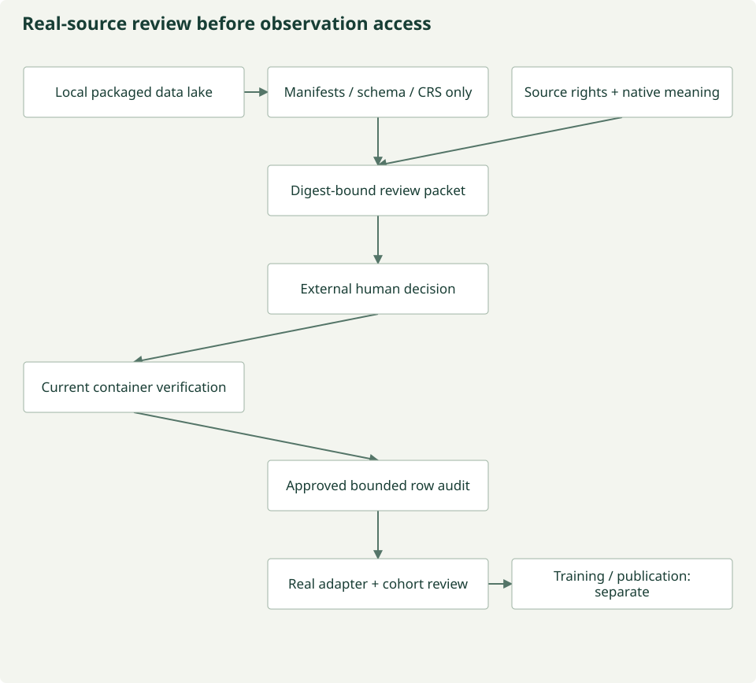

# Real-source scientific review

**WORKING metadata inventory and precondition tests. PENDING human review before
observation reads, real adapter, cohort or model execution.**

The user's local lake at `fire_vase/data_lake/fire-vase-data-lake-v0.1/files/`
contains the selected native FIRED GeoPackages and derived Parquet products. There
is no need to upload them to GitHub, download another archive or rebuild the lake.
Fresh metadata confirms their presence and inventory sizes. Historical checksums
are recorded, but current full data bytes have not been reverified.

The [M6 approval packet](https://github.com/CU-ESIIL/AI_ready_datasets/blob/main/reports/embedding_utility/fire_vase/milestone-6/approval-packet.md)
identifies exact files, expected hashes, scientific transformations, uncertainties,
source-use conditions, bounded validation and publication implications. It requests
review of a small retrospective native-value audit—not training, scientific mapping
approval or a prospective forecast claim.

## Evidence is available; scientific meaning still needs review

Upstream code copies native `dy_ar_km2` into cached `ring_area_km2`, and separately
constructs cumulative sums. A different product uses a same-named cumulative field
from catalog totals. Names alone cannot resolve those meanings. Corrected v2 code
requires exact calendar-day transitions and rejects duplicates; gaps are not zeros.
These implementation facts support a proposed mapping, not a new source equivalence.

Native feature tables use custom SRS100000. An EPSG4326 entry elsewhere in the
GeoPackage is not evidence that features have that CRS. No geometry is read or
reprojected. Climate availability flags are not native burned-area quality evidence.
Uncertainty and missing QA remain unknown rather than zero.

The [scientific contract](https://github.com/CU-ESIIL/AI_ready_datasets/blob/main/reports/embedding_utility/fire_vase/milestone-6/scientific-contract.md)
separates observed daily-bin area, reconstructed sums, catalog endpoints, spatial/
temporal support, event boundaries, missingness, uncertainty, rights and availability.
Source dates do not prove when observations became available. Never assign the
synthetic midnight timestamps used in earlier experiments to real records.

## What the implementation does

New typed contracts bind source identities, proposed recipes, review jurisdictions,
claim mode and a 512-total-row/16-fire/batch128 audit scope. Pure validators check
calendar support, missing/zero distinctions, review digests and actual versus unknown
availability. They contain **no source reader, adapter, training entrypoint or approval
authority**. Generated unit cases validate those preconditions, not real FIRED values.

All seven scientific review statuses remain NEEDS_EVIDENCE in the draft. Human approval,
current complete-container verification and scientific evidence must remain separate.
The supplied template is an inert review record, not a runtime HumanDecision.
A changed packet invalidates previous review. No observation row, model or new
synthetic benchmark was run in M6.

## Subsequent empirical work

After review, first validate a small bounded source/cache sample independently; one
Parquet row group contains the whole table, so row-group reads are not a sample bound.
No raw/harmonized persistence. A separately approved cohort protocol must quantify
selection/exclusions, group all fire prefixes, block real years/regions, avoid
completed-fire normalization and use training-only preprocessing. Real availability
may permit only retrospective reconstructed prediction; that distinction must be
explicitly reviewed rather than silently changing the claim.

The [cohort and evaluation plan](https://github.com/CU-ESIIL/AI_ready_datasets/blob/main/reports/embedding_utility/fire_vase/milestone-6/cohort-and-evaluation-plan.md)
keeps mean/persistence/raw/summary/PCA/small-TCN/matched-MLP baselines, A–E transfer,
calibration and real-workload cost accounting pending. Synthetic performance from
[M4](fire-vase-learning.md) and [M5](fire-vase-transfer.md) is not evidence that those
results persist on real fires.

Historical upstream aggregate reports demonstrate strong observation selection:
only about3.68% of that catalog met its ≥3 consecutive-history criterion. This is
not the count of newly evaluated prospective examples. Current M6 cohort size and
performance remain unmeasured.

The [M6 report](https://github.com/CU-ESIIL/AI_ready_datasets/blob/main/reports/embedding_utility/fire_vase/milestone-6/report.md)
and manuscript evidence taxonomy preserve what is known, unknown and blocked at review.
