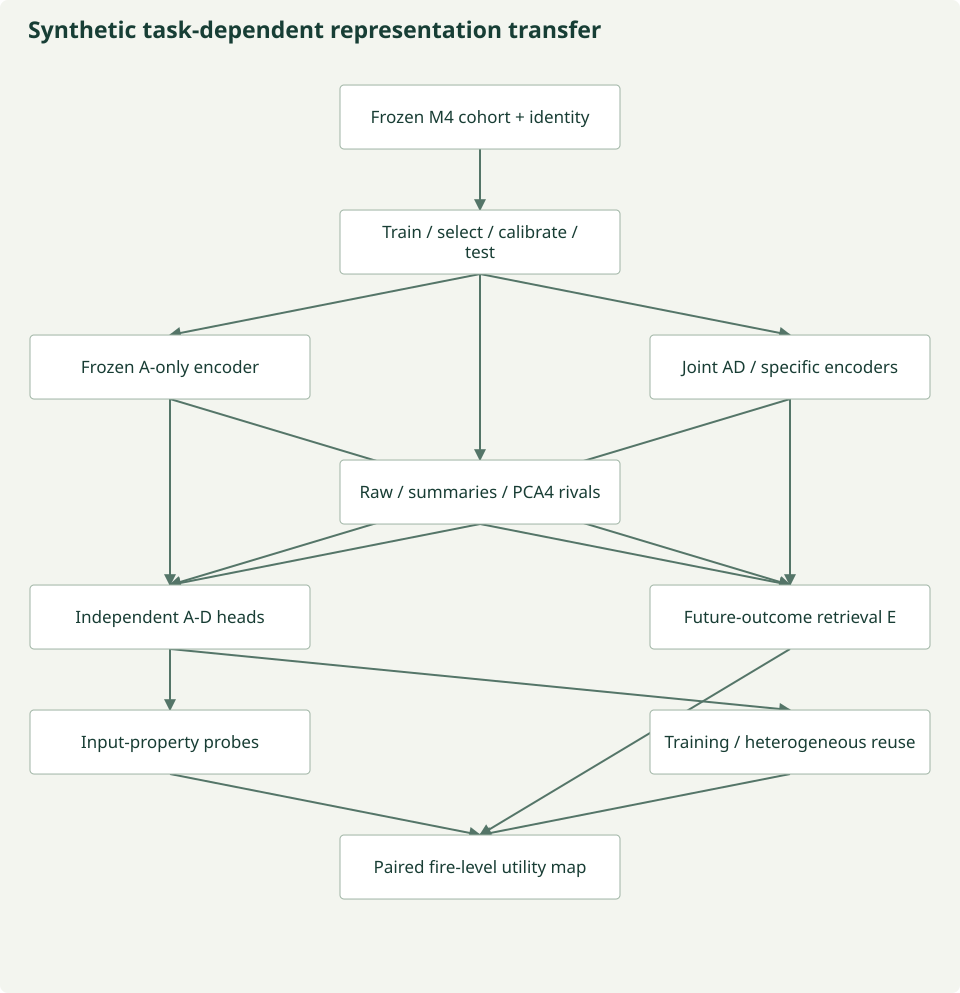
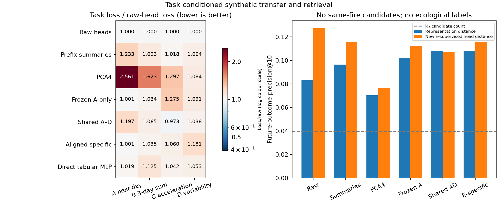
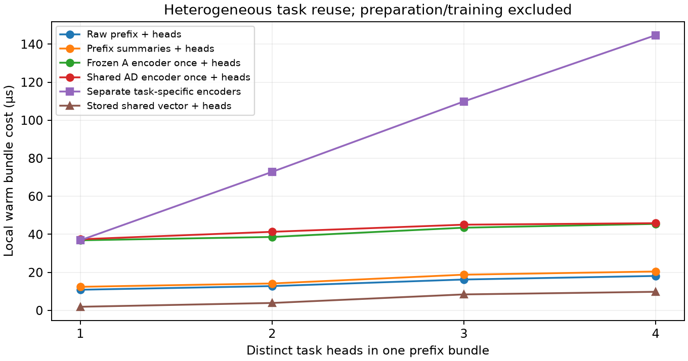

# Scientific representation transfer across tasks

**WORKING synthetic experiment; no real-fire or real-agent evidence.**

This study tests whether a next-day-trained embedding helps other tasks, whether
joint training changes the result, and whether several task heads justify shared
encoding. The [Milestone 5 report](https://github.com/CU-ESIIL/AI_ready_datasets/blob/main/reports/embedding_utility/fire_vase/milestone-5-report.md)
links the frozen protocol, full tables, task-dependent utility map and unsupported
claims. Historical [Milestone 4](fire-vase-learning.md) artifacts remain unchanged.



## What transfers and what does not

The exact M4 next-day encoder is frozen. New lightweight heads predict a three-day
total, a future-versus-recent mean comparison and future variability. A separate
encoder learns all four tasks jointly; separate small encoders and conventional
raw/summary/PCA/capacity baselines provide strong alternatives. Original frozen
transfer, extra supervision and task-specific retraining are distinct strategies.

Raw-data heads outperform frozen A-only features on all three new predictive tasks
in this run. Joint training improves the acceleration comparison but worsens the
original next-day task. Separate task-specific training does not consistently help.
These are task-conditioned synthetic results, not universal architecture rankings.



Learned distances retrieve similar future patterns better than raw input distances.
When raw data get an outcome-trained retrieval head, that ordering reverses. Relevance
comes from held-out future observations, not ecological labels; all same-fire prefixes
are excluded. These tasks are independently defined but share future observations
and are statistically dependent.

## Information preservation and economics

Separate linear and nonlinear probes test observed scale, order, recency, acceleration,
local maxima and variability. Nonlinear recovery can exceed linear recovery; neither
a failed linear probe nor successful prediction proves exact information loss or
mechanistic understanding. Invalid observation schedules fail source contracts.

Shared encoding is cheaper than invoking four separate neural encoders, but direct
raw-data heads are cheaper in the measured bundle. Stored vectors and cached complete
answers address different workloads. Training/refresh and unknown maintenance costs
remain part of the decision, not zero-cost assumptions.



## Evaluation boundary

The existing synthetic M4 cohort has 128 training, 48 validation and 64 test fires.
All prefixes of a fire stay together; selection/calibration use separate validation
fires. Task A performance was already observed in M4, so this is a new frozen task
protocol on existing histories, not an independently hidden new cohort. Test outcomes
never train representations or heads. Paired losses are averaged by fire; empirical
fire-bootstrap intervals are descriptive conditional on fitted models and do not
establish wildfire population significance.

## Reproduce

Use a new output directory; the source snapshot is hash-verified and never overwritten:

```bash
OPENBLAS_NUM_THREADS=1 OMP_NUM_THREADS=1 MKL_NUM_THREADS=1 PYTHONPATH=src \
python -m dataset_prototype.embedding_study.transfer_runner \
  --config reports/embedding_utility/fire_vase/config/transfer-m5-v1.json \
  --output run/embedding_utility/fire_vase/my-new-transfer-run
```

Tables and figures regenerate without fitting models:

```bash
python scripts/report_fire_vase_transfer.py \
  --results reports/embedding_utility/fire_vase/results/milestone-5-transfer-v1 \
  --output /tmp/transfer-tables.md
python scripts/generate_fire_vase_transfer_figures.py \
  --results reports/embedding_utility/fire_vase/results/milestone-5-transfer-v1
```

The [frozen protocol](https://github.com/CU-ESIIL/AI_ready_datasets/blob/main/reports/embedding_utility/fire_vase/transfer-protocol-m5-v1.md),
[manuscript tables](https://github.com/CU-ESIIL/AI_ready_datasets/blob/main/reports/embedding_utility/fire_vase/results-tables-m5.md)
and [utility map](https://github.com/CU-ESIIL/AI_ready_datasets/blob/main/reports/embedding_utility/fire_vase/utility-map-m5.md)
keep information, statistical learning, retrieval relevance and computation separate.
No new real-source acquisition, model service access or production pipeline change.

The [M6 real-source review](fire-vase-real-data.md) prepares a contract and bounded
audit packet against the packaged local Fire VASE lake. These M5 synthetic outcomes
remain unchanged and are not promoted to real scientific evidence; no real observation
rows are read before the required review.
