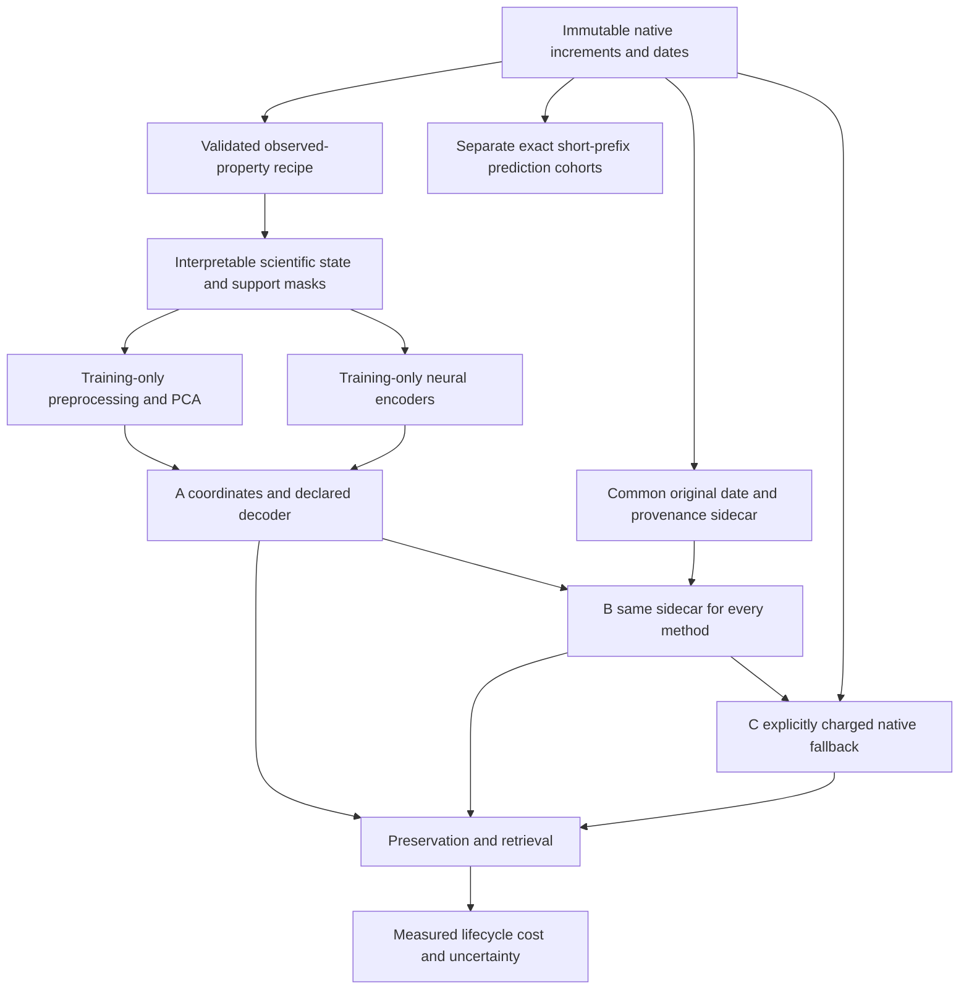
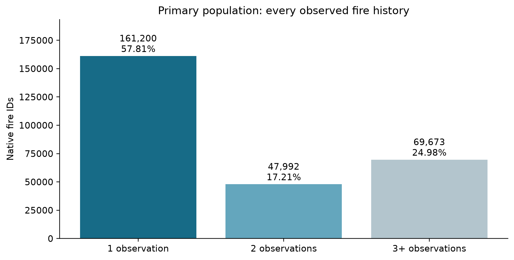
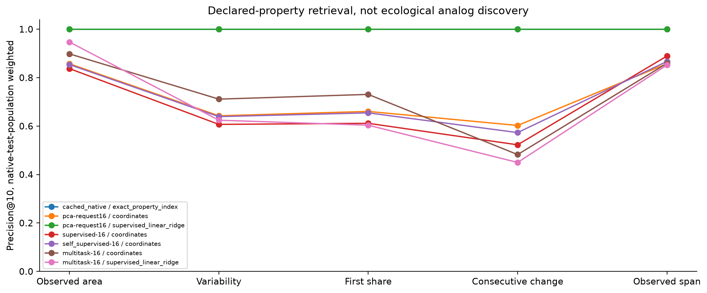
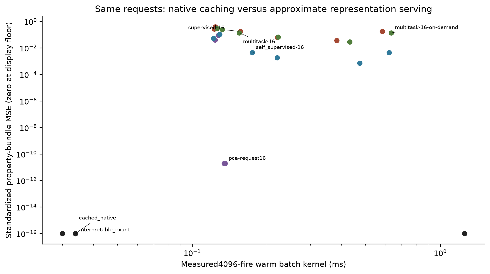

# Fire VASE full-population representation utility

**WORKING — real observed-scientific-state experiment, Milestone8.**

All 278,865 native fires enter supported primary tasks, including the 75.02% with
one or two observations. The experiment trained 75 primary encoders across three
objectives, five dimensions and five training fractions, plus 21 neural
control/update fits. It compares native operations, interpretable state, PCA,
learned coordinates and trained heads. Historical milestones remain preserved.

For these declared scalar queries, exact cached-native operations dominated the
learned methods on measured cost and error. Full-rank PCA retained the numerical
state; its coordinate distance still changed retrieval rankings. Learned states
preserved approximate reusable information, but did not add information to the
source. A secondary next-day prefix task improved error about 1.9% over a linear
raw-state head, with similar performance from a direct neural control. This is
limited retrospective modeling evidence, not operational forecast skill.

The neural input is ten validated observed properties plus support masks. It
includes the scalar targets by design. This is **scientific-state encoding**,
not an end-to-end native sequence, polygon, raster or agent experiment. Native
measurement quality, physical lifetime and future operational availability are
unknown. Mathematical retrieval relevance is not ecological analogy.

Undefined properties stay undefined: no fabricated one-point variability or
missing-day zero growth. One/two-point cumulative sequences are recoverable from
raw short-state values; general longer cumulative paths are not uniquely encoded.
Absolute dates are restored by the common sidecar, and fallback recovery is
credited to native access. These distinctions prevent overstating learned utility.

All comparisons use whole-fire splits, fixed test IDs, training-only transforms
and independent native references. Retrieval uses 4,096 stratified test queries
and full eligible training galleries. All 50 adjusted coarse-region comparison
p-values are1.0; this does not establish equivalence. Timing is warm local batch
execution, with unknown physical disk I/O and true source-update costs.

See the repository experiment folder
`reports/embedding_utility/fire_vase/milestone-8/` for manuscript methods/results,
uncertainty, unsupported claims, tables, thirteen PDF/SVG/PNG figure families,
reproducibility commands and the hash-bound execution manifest. Checkpoints and
lineage remain ignored private local artifacts. Internal investigator execution
authority is recorded separately from third-party publication rights and
scientific approval.

Related: [full-population protocol](fire-vase-full-population.md),
[native census](fire-vase-population.md), [study overview](embedding-utility.md).
