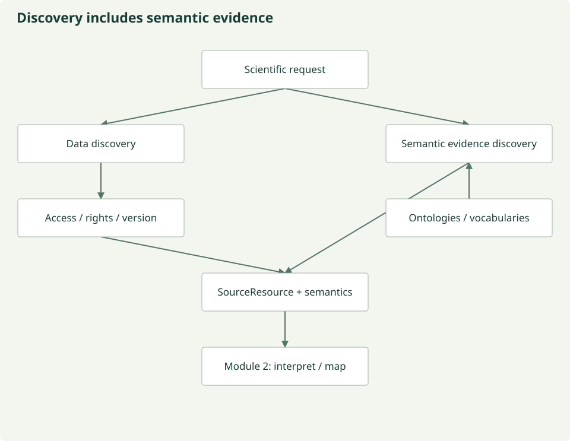
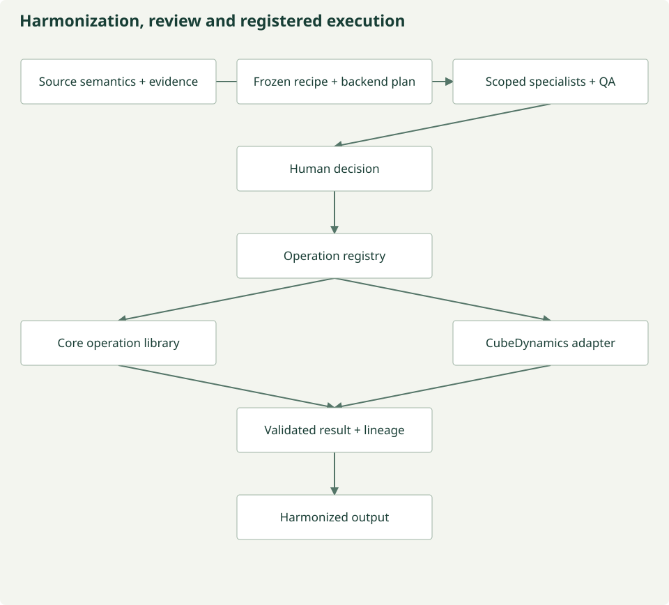
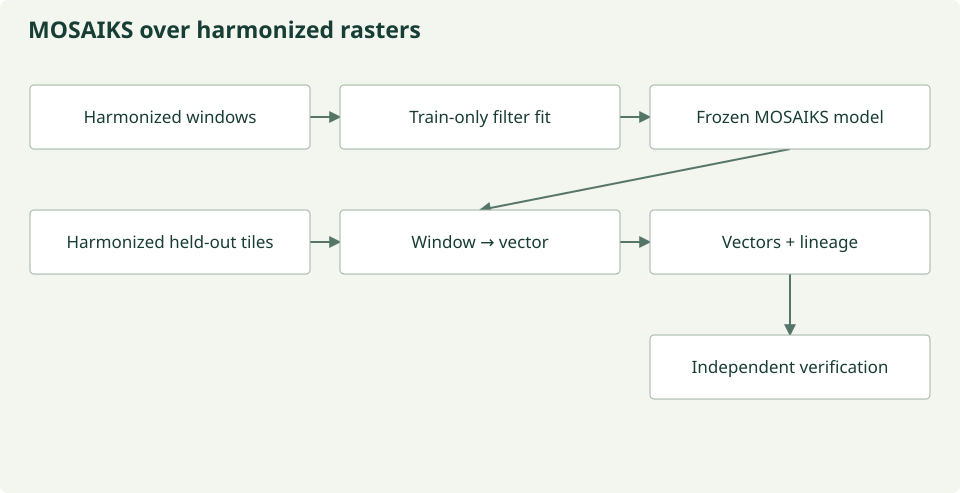

---
hide:
  - navigation
---
# An evidence-led path from question to dataset

A useful dataset begins with a scientific question. We separate finding observations,
deciding what they can mean together, and generating machine features. Each stage
has a typed input and output and can be called independently.

Finding data and discovering their meanings are related but different tasks.
Scientific communities already maintain taxonomies, vocabularies, ontologies and
standards. We preserve that variety before comparing or composing it. Automated
composition remains planned; current semantic evidence and review contracts provide
the boundary for that work.

[Explore community semantics](semantics/index.md) · [Glossary](semantics/glossary.md)

## 1. Discover observations and their conditions of use

A `ScientificRequest` describes the question, variables, bounds and time support.
Discovery returns candidate `SourceResource` records with typed semantic evidence,
not an assertion of equivalence. It preserves source identifiers, definitions and
community semantic systems before Module 2 proposes any mapping.
Native metadata, identifiers, processing versions, calibration and rights accompany
each source. STAC supplies catalog metadata; it is one component of the architecture.

*Discovery is metadata-first. Raster access follows review. [Figure source](https://github.com/CU-ESIIL/AI_ready_datasets/blob/main/scripts/generate_figures.py).*

[Discovery implementation and contracts](discovery.md) · [Semantic resources](semantics/index.md)

## 2. Make scientific transformations explicit

A versioned recipe states the exact allowed operations. Specialists review meaning,
units and calibration, spatial and temporal support, rights, integrity and quality.
Each finding cites evidence in its jurisdiction and binds the same recipe digest.
QA synthesizes existing findings. Missing evidence leads to review; a demonstrated
failure requires revision. Eligibility still requires a separate human decision.

*Agents propose; deterministic code executes allow-listed operations. [Figure source](https://github.com/CU-ESIIL/AI_ready_datasets/blob/main/scripts/generate_figures.py).*

Calibrated reflectance, quality-filtered reflectance and an analysis-ready dataset
are different product claims. Applying a scale and offset does not establish
quality or fitness for a scientific question. Negative calibrated values alone
are not evidence that calibration failed. No implicit clipping is allowed.

[Semantic comparison and recipes](harmonization.md#semantic-alignment-and-composition-capability-boundaries) ·
[Review rules and evidence](review/index.md) · [Harmonization executor](harmonization.md)

## 3. Stream harmonized outputs into representations

An approved source reader yields bounded windows. The deterministic harmonizer
applies the frozen recipe in memory; MOSAIKS consumes those harmonized rasters.
Empirical filters are fit on a bounded training-only reference stream. Validation
and test windows use frozen filters and never supply normalization statistics.

*Source reads and scientific calibration remain upstream of MOSAIKS. [Figure source](https://github.com/CU-ESIIL/AI_ready_datasets/blob/main/scripts/generate_figures.py).*

Numeric shards, labels and compact lineage form a machine-readable output dataset.
Integrity checks, geographic leakage checks, held-out prediction and baselines test
specific properties. Independent scientific validation requires appropriate external
evidence. No universal biological ontology or latent space is claimed.

[Representation implementation](mosaiks-embeddings.md) · [Technical architecture](architecture.md)
