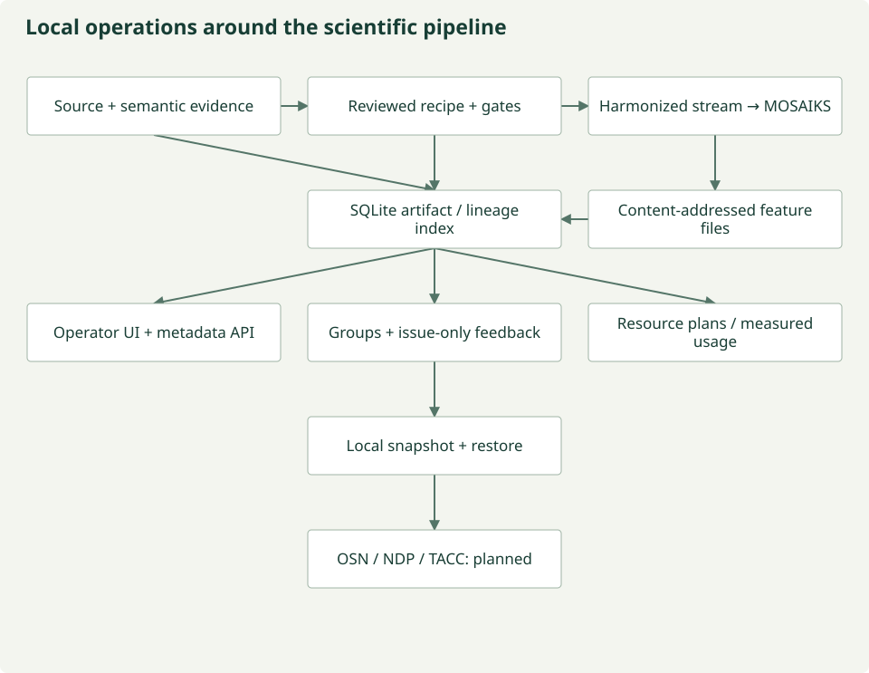

# Architecture

The existing template contained MkDocs Material, static assets, styling, and Pages
workflows. It had no `src/`, `tests/`, or `data/` implementation. The prototype adds
one standard Python package under `src/dataset_prototype/`, without repurposing
website sources as package files.

## Module boundaries

The [local management workbench](management-workbench.md) composes existing
scientific contracts and datasets with operational metadata, without moving the
scientific stages into a registry. `management_contracts.py` defines interfaces;
`asset_registry.py` supplies SQLite/CAS; `management.py` handles bounded imports,
resource plans, exports and recovery; `workbench.py` supplies the local UI/API.
Only version-bound feedback mutates through HTTP. No scientific approval or job
execution endpoint exists; remote partner integrations remain planned.

*Project-authored diagram; [maintained source](https://github.com/CU-ESIIL/AI_ready_datasets/blob/main/scripts/generate_figures.py).*

| Module | Inputs | Outputs | Exclusions |
| --- | --- | --- | --- |
| Discovery and Access | `ScientificRequest`, access client | `DiscoveryResult` with `SourceResource` candidates | No encoders or scientific equivalence decisions |
| Harmonization | Resources, recipe, records, optional review/core parents | Iterator of `HarmonizedObservation` | No MESA dependency or generated-code execution |
| Representation | Validated observation iterator, encoder name | Iterator of `Representation` | No discovery or hidden scientific harmonization |

`contracts.py` defines immutable Pydantic models, rejects extra fields, and exports
JSON Schema. `agents.py` contains deterministic fixture roles; `model_agents.py` supplies four
bounded real inference roles using Ollama without tools or data-write capabilities.
`orchestration.py` composes the stages and writes inspectable JSON artifacts.
`provenance.py` exports PROV-inspired JSON-LD without a graph database.

## Infrastructure boundaries

[MESA](https://idss-mesa.github.io/docs/) is intended to supply distributed data
access, iRODS tools, ontology metadata, and metadata history. It is infrastructure,
not the harmonization recipe or the representation module. See the verified
[integration notes](development/integrations.md).

STAC is a spatiotemporal catalog/metadata standard, one part of discovery. `real_data.py` now
implements bounded live Sentinel STAC search and raster-window access, retains
native Items/collection/license evidence, and supplies verified offline snapshots.
Raw DN, calibration metadata, pixel support and instantaneous time stay explicit.

[OpenClaw container](https://github.com/CU-ESIIL/openclaw_container) supplies the installed
agent runtime. Local role objects exchange structured contracts; later workers
can return the same proposal artifacts. No runtime is copied. The optional OpenClaw/Verde adapter invokes the installed
`llm-task` plugin in an isolated container; fixture and Ollama modes remain independent.

## Storage and streaming

Source descriptions, raw records, and observations are frozen models containing
immutable nested contracts and tuples. Source checksum verification detects fixture
changes. Content-addressed cache entries include source/version/metadata/rights,
raw records, recipes, executor version, and resulting canonical observations.
A source or recipe change produces a different key; obsolete entries are retained,
not served under a new identity. Corrupted existing entries fail validation.

Food and water outputs have separate directories and track-bearing identifiers.
Existing output directories fail rather than overwrite. Source and canonical entries use an integrity-checked read-through cache, so
a second track reuses inputs and core products without fetching or executing again.
Entries are published atomically without overwriting existing keys. Filesystem
permissions are not an access-control or adversarial security boundary in V0.

Representation and batch interfaces consume iterators. Harmonization currently
buffers the small input fixture; joins and daily aggregation need grouped inputs.
General partitioned execution for joins and aggregation remains a gap; the separate
bounded Sentinel path below already streams windows directly into encoders. No Kafka,
graph database, or distributed scheduler is introduced.

## Metadata consensus and direct streaming

The [streaming harmonization module](streaming-harmonization.md) adds metadata-only specialist
dialogue, digest-bound unanimous review, documented Sentinel-2 scale/offset
calibration, and bounded window-to-encoder execution without raw or harmonized
data files. The existing fixture/snapshot commands retain their historical
materialization behavior. Current streamed vectors are reference numeric features;
model consensus still requires an actual human decision before execution.

## MOSAIKS over harmonized outputs

The [MOSAIKS module](mosaiks-embeddings.md) consumes bounded harmonized raster tiles,
freezes train-only empirical convolution filters, writes dense feature datasets
with scientific lineage, and verifies held-out ridge-model consumption against
baselines. It does not encode raw source assets. Generated diagnostics exercise
the complete mechanism; independent scientific validation and real-data review
remain separate requirements.

## Evidence-bound review boundary

The [current-state audit](architecture/current-state.md) records the inspected
implementation and observed role leakage. The additive [scoped review module](review/index.md)
accepts a frozen recipe and curated evidence ledger, then returns a typed report
without source-data access or execution authority. It does not rewrite historical
free-text consensus results. [Generated contracts](reference/contracts.md) and
[module reference](reference/modules.md) describe the current code.

*Current stage boundaries. [Maintained figure source](https://github.com/CU-ESIIL/AI_ready_datasets/blob/main/scripts/generate_figures.py).*

## Data and semantic-evidence discovery

Module 1 now discovers **data + metadata + semantic evidence**. Optional nested
`SourceSemantics` preserves explicit source annotations, definitions, methods and
support with evidence kinds and source bindings. `SemanticResourceRegistry` is a
small semantic-resource lookup boundary, not a name for the whole architecture.
Concept candidates remain candidates. Module 2 owns mappings, reviewed recipes
and scientific interpretation; Module 3 continues to consume harmonized outputs.

*Semantic resources support discovery; they are not source observations or automatic mappings.
[Maintained source](https://github.com/CU-ESIIL/AI_ready_datasets/blob/main/scripts/generate_figures.py).*

[Audit](development/semantic-discovery-audit.md) · [Semantics](semantics/index.md) ·
[Pipeline contracts](semantics/pipeline.md)

## Deterministic backbone and model trust

VERDE interprets, selects, parameterizes, compares and proposes. It does not author
scientific computation. New model plans select closed, source-bound capabilities;
metadata coefficients and mathematical operations are resolved by tested code.
Schema validation, scientific checks, existing vetoes and human decisions remain
separate gates. Approved recipes execute without a model. See
[deterministic execution and model trust](architecture/model-trust.md) for the registry, IR contracts,
examples, provenance and current limits.

## External CubeDynamics execution

The optional [CubeDynamics backend](cubedynamics.md) supplies seven registered,
reference-bound capabilities on trusted xarray/Dask inputs. Models select operations;
tested software performs them after scientific validation and exact-recipe human
review. Source access remains upstream. The direct MOSAIKS bridge preserves the
reviewed raster layout; support-changing aggregation/alignment needs explicit review
and does not automatically establish a new representation layout. Real Sentinel
vetoes and existing streaming gates remain binding.

## Scientific validation update — 22 October 2026

The [new scientific validation findings](validation/index.md) retain real graph
measurements, canonical requirement diagnostics, scoped dataset/pair assessments
and live model results. Earlier unmeasured/planned statements describe the prior
architecture snapshot: depth is now measured for three local graphs, while exact
scientific mappings, independent ecological validity and the weaker-model
hypothesis remain unvalidated. The real Sentinel and NEON–Sentinel cases still
require explicit expert decisions; no scientific execution is approved.
