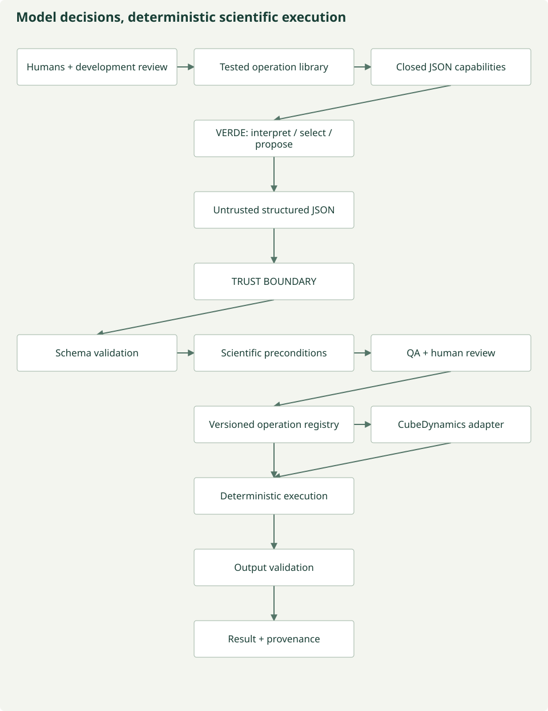

# Deterministic execution and model trust

**AI chooses among tested scientific operations. It does not invent the analysis.**
VERDE models interpret, select, parameterize, compare and propose. They are not trusted
programmers or mathematical engines. Humans and development models can help design
operations, but those implementations must be reviewed, tested and registered before
runtime. A development model is not a substitute for scientific review either.

The intelligence may be probabilistic. The execution must not be.



*Implemented runtime boundaries, not a claim of general scientific validity.
[Maintained figure source](https://github.com/CU-ESIIL/AI_ready_datasets/blob/main/scripts/generate_figures.py).*

## What the model decides, and what software owns

| Responsibility | Authority |
| --- | --- |
| Interpret language, compare supplied definitions, rank candidates, flag uncertainty | Model judgment; not source evidence or approval |
| Select an operation | Offered operation/option IDs only; source and target bindings fixed by caller |
| Parameterize | Schema enums and metadata references; no model-authored coefficients or formulas |
| Propose a semantic interpretation | Evidence-linked proposal; uncertain or consequential meaning requires human review |
| Conversion factors, calibration arithmetic, aggregation and checksums | Pre-written deterministic code and authoritative metadata |
| Validate structure, references, units, rights, support and approvals | Deterministic controller; a valid JSON object is insufficient |
| Approve scientific decisions | Explicit exact-recipe human decision where required; models cannot approve themselves |

No model text is passed to `eval`, `exec`, shell execution, dynamic imports, SQL,
mathematical-expression evaluators or executable templates. Unknown fields and
operations fail closed. Rationale and transcript text remain inert untrusted records;
the boundary does not depend on guessing whether prose resembles code.

## JSON recipes are an intermediate representation

Source data + source semantics + scientific request → model interpretation →
**declarative JSON IR** → structural validation → scientific validation → registered
operations → deterministic execution → harmonized observations.

VERDE helps construct the IR. It is not the compiler backend. The existing
`HarmonizationRecipe` remains the executable scientific plan; new `RecipeDecision`
objects compile deterministically into it. Historical recipes/transcripts retain
their formats. They are not silently reinterpreted as newly reviewed IR.

The new contracts separate:

- `SelectDecision`: `SELECT`, registered operation/version and offered option ID.
- `ParameterizeDecision`: `PARAMETERIZE`, offered option plus constrained target unit
  and/or `source_metadata.calibration_scale` / `source_metadata.calibration_offset` references.
- `SemanticMappingProposal`: `PROPOSE`, supplied evidence/candidate identifiers,
  proposed relationship and confidence, always needing evidence or human review.

Source IDs and numerical coefficients are absent from writable model step fields.
The caller generates `CapabilitySpace` from complete source metadata and fixed mappings.
Option IDs bind a registered implementation, authoritative parameter sources and
resolved operation. Source, mapping, code or registry changes invalidate the capability
identity. The model selects an option; the controller retrieves its stored operation.

The standalone semantic-proposal validator checks supplied evidence/candidate IDs;
it does not approve an ontology mapping. Existing semantic agent comparison remains
bound to the caller's source and target, with novel model judgments requiring review.
General ontology alignment and autonomous ontology-service retrieval remain planned.

## Closed operation library

`operations.REGISTRY` exposes ten pre-existing operations. Runtime input cannot
register, replace, import or synthesize an implementation. Registered definitions
include version, parameter schema, input/output contracts, implementation reference,
assumptions, pre/postconditions, units, support effects, review requirements and tests.
They dispatch to pre-written row operations. Raster execution uses the same registry
validation and conversion constants, with its existing restricted vectorized subset.

| Registered ID | Implemented boundary |
| --- | --- |
| `unit.convert` | degC ↔ K and cm ↔ m; constants in versioned code |
| `calibration.scale_offset` | DN → unit 1 with exact documented source coefficients |
| `semantic.rename` | Reviewed canonical variable binding; no inferred equivalence |
| `quality.filter` | Explicit inclusive bounds, track scope only |
| `quality.missing` | Explicit sentinel → missing; no imputation |
| `temporal.aggregate.daily_mean` | Complete nonoverlapping UTC-aligned daily coverage, duration-weighted mean |
| `spatial.match` | Unique coordinate-tolerance match in WGS84 degrees; no resampling |
| `spatial.validate_wgs84` | Identity validation of already WGS84 coordinates; no reprojection |
| `observation.join_exact` | Unique exact coordinates/interval and equal support, reviewed rights |
| `quality.validate_bounds` | Explicit bounds; no inferred clipping or plausibility rule |

All ten are registered; the automatic capability builder offers only conservative
core validation, rename, supported conversion and documented calibration options.
Track joins, aggregation and filtering still require explicitly authored reviewed
recipes. Reprojection, resampling, median aggregation and spectral correction are
not advertised as implemented operations.

```sh
prototype operation-capabilities --output run/operation-capabilities.json
```

This exports the operation/check manifest. Deployed decision schemas additionally
restrict offered IDs to a concrete source/target capability space. Semantic validation
checks operation/option pairing, metadata identity and parameter applicability.
Operation-specific scientific checks and existing QA, model vetoes and human gates
still run before source access. During execution, coverage, join uniqueness, range,
native support and output contracts are checked where applicable.

## Consensus and QA remain bounded

Legacy four-specialist streaming consensus now requests `DecisionRecipeDraft`, not
free-form operation parameters. Every review binds the compiled frozen recipe.
Unanimity and unresolved concerns are aggregated by deterministic rules. The additive
six-domain evidence review uses deterministic synthesis of PASS, FAIL,
NEEDS_EVIDENCE and NOT_APPLICABLE. Its model QA can veto or request more evidence;
it cannot create consensus, change specialist findings or grant execution permission.

QA may recommend `schema.recipe` and `recipe.scientific_preconditions`. The registered
check library performs those checks; mandatory checks run regardless of a model's
recommendation. A general statistical QA library is not implemented by these two
checks. Model descriptions of ranges or statistics remain MODEL_JUDGMENT unless
independently checked; they do not become numerical inputs.

## Failure and review are first-class outcomes

| Outcome | Controller behavior |
| --- | --- |
| `INVALID_MODEL_OUTPUT` | Malformed JSON, extra fields, invalid schema or failed transport; no repair or fallback |
| `UNSUPPORTED_OPERATION` | Unknown registered ID; no implementation is requested from a model |
| `INVALID_PARAMETERS` | Option mismatch, invalid unit/reference, duplicate or empty operation plan |
| `PRECONDITION_FAILED` | Stale source/registry/review identity or failed authorization |
| `NEEDS_EVIDENCE` | Explicit missing-evidence outcome; no scientific result |
| `NEEDS_HUMAN_REVIEW` | Ambiguity or compiled model proposal; no execution permission |
| `REJECTED` | Deterministic QA rejects a compiled plan |
| `EXECUTED` / `EXECUTION_FAILED` | Authorized fixture execution completed or deterministic data checks failed |

The typed state vocabulary also reserves PROPOSED, VALIDATED, APPROVED and
READY_TO_EXECUTE for explicit workflow reporting. The controller does not claim a
model proposal is executable merely because it parsed.

A semantic ambiguity can be a successful review outcome. No blanket human approval
can override an `unknown` mapping, model veto, prohibited rights or unsupported operation.

## Execute with VERDE off

Approved recipes need no model call. Existing `harmonization.run`, `stream_embed`
and approved raster contexts accept scientific contracts and reviews, not a backend.
Real sources still require the full bounded streaming context, consensus, evidence
review, QA and human decision. Raw and harmonized windows remain in memory upstream
of MOSAIKS; this pass adds no real-data downloads or materialized datasets.

The new `execute_approved` convenience controller is deliberately limited to at most
1,024 generated fixture records, consumed only after authorization. It is not a
replacement for the real-data streaming API. The legacy fixture CLI also remains
available for approved recipes; it explicitly writes small fixture observations.

```sh
# Explicit synthetic model replacement; no VERDE, OpenClaw or source-data access.
prototype operation-demo --output run/operation-trust-example

# Validate a decision against already-available source/mapping metadata, without a model.
prototype ir-validate decision.json sources.json mappings.json --output validation.json

# Existing no-model fixture executor: review binds the exact approved recipe.
prototype harmonize approved-recipe.json fixture-sources.json fixture-records.json \
  --review human-decision.json --output fixture-observations.json
```

The demo generates a 2 m fixture measurement. Its fixture model selects `unit.convert`;
tested code uses the fixed m→cm factor and returns **200 cm**. The recorded human
decision is explicitly synthetic. Artifacts contain source metadata, capabilities,
model selection, proposed/approved fixture recipes, review and result/provenance
hashes. It does not persist raw/harmonized datasets or call a live model.

An invented selection such as `{"operation_id":"spectral.magic_correction"}` with
an otherwise valid decision envelope yields **UNSUPPORTED_OPERATION**. It never
triggers implementation generation. The demo also records two synthetic concept
candidates with relationship `unknown` and **NEEDS_HUMAN_REVIEW**; no ontology
content or equivalence is invented.

## Versioning and provenance

New compiled recipes bind registry/executor/validator/constants identities. Registry
digests include operation definitions and relevant code hashes. New scalar provenance,
stream manifests, raster lineage and cache keys record execution identity. An edited
implementation invalidates a bound recipe, requiring renewed scientific review.
Legacy recipes retain their old serialization when the new optional identity is
absent; historical provenance is not rewritten or claimed to include new checks.

Model traces retain exact prompts, output scope, prompt version, model/provider
identity, timestamps and available usage. The decision controller records model
provenance and input evidence/capability references separately from deterministic
validation and exact-recipe human approval. Unavailable model weight versions are
explicit, not fabricated. SOURCE_DOCUMENTED, OBSERVED_IN_DATA,
DERIVED_DETERMINISTICALLY, MODEL_JUDGMENT, HUMAN_DECISION and MISSING_EVIDENCE remain
distinct. A number stated by a model is not an authoritative scientific constant.

## Current status

| Component | Status |
| --- | --- |
| Closed registry, typed decision IR, schema/scientific checks, deterministic executor | WORKING for listed operations; no general algorithm generator |
| No-model approved execution and deterministic fixture model | WORKING offline; fixture controller is bounded |
| VERDE / OpenClaw JSON-only adapter | PROTOTYPE; installed OpenClaw 2026.5.18 and tool-free route verified; no new live inference in this pass |
| Semantic agents and scoped reviewers | PROTOTYPE; evidence-constrained judgments, not approved scientific truth |
| Human decision binding and lineage | WORKING local audit contracts; authenticated/signed review is PLANNED |
| Demo model and demo human decision | MOCKED; generated and explicitly labeled |
| General ontology composition and generalized support transformations | PLANNED / UNDER ANALYSIS |

Offline tests cover all registered dispatches, invalid inputs, scientific metadata
and lineage, model injections, invented constants/operations, stale identities,
review gates, fixture orchestration and execution with inference unavailable.
[Audit and validation](../development/model-trust-audit.md) ·
[Contracts](../reference/contracts.md) · [Agent role boundaries](../agents.md#runtime-role-authority)

## CubeDynamics is behind the trust boundary

[CubeDynamics](../cubedynamics.md) is an optional external execution backend. Its
seven operations join ten core registry entries. Model selections contain registered
IDs and references; no arbitrary Python or `verbs.apply` callable is exposed.
Scientific review remains in Module 2. Approved backend plans execute with VERDE
off, preserve lazy values where supported and materialize only explicit bounded
results. Resampling, resolution and support remain separate scientific concerns.
