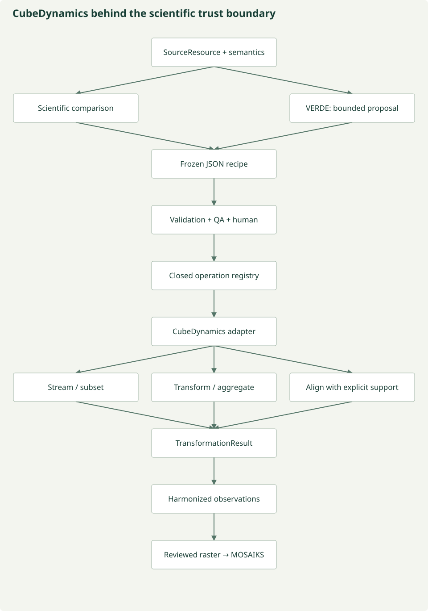

# CubeDynamics execution backend

**Stream first, transform only what is needed.** CubeDynamics gives harmonization
computational capability without giving the language model computational authority.
It is an external [ESIIL software project](https://github.com/CU-ESIIL/cubedynamics),
with its own [documentation](https://cu-esiil.github.io/cubedynamics/), MIT license and
scientific implementation. No CubeDynamics source is copied into this repository.

Module 1 discovers a source and preserves its semantics, rights and access plan.
Module 2 reviews what may change. A registered adapter invokes CubeDynamics on
approved xarray inputs. VERDE selects reference-bound operations; it never writes
CubeDynamics Python. Computational alignment is not scientific equivalence.



*Current bounded adapter; the direct MOSAIKS bridge preserves the reviewed raster
layout. General support-changing representation paths remain future work.
[Figure source](https://github.com/CU-ESIIL/AI_ready_datasets/blob/main/scripts/generate_figures.py).*

## Install the actual external package

```sh
# Use Python 3.12: the pinned CubeDynamics prerelease requires NumPy <2.
python3.12 -m venv .venv-cube
source .venv-cube/bin/activate
python -m pip install -e '.[dev,cubedynamics]'
pytest -q
prototype cubedynamics-demo --output run/cubedynamics-example
```

The optional extra pins **cubedynamics==0.1.0rc3**. Core discovery, semantics, review,
unit checks and existing executors remain usable without that extra. The website's
rc1 installation badge is older than the inspected rc3 package/repository. The
[capability audit](development/cubedynamics-audit.md) records the actual public API
and the difference between repository and wheel dependency declarations. Results
record the installed CubeDynamics and relevant numerical dependency versions.

## What is registered

| Stable operation ID | Actual call | Behavior and limits |
| --- | --- | --- |
| `cubedynamics.select` | `pipe(cube) | verbs.apply(fixed_select)` | Select a documented Dataset variable or band; no model callable |
| `cubedynamics.subset` | `verbs.apply(fixed_subset)` using xarray `isel` | Reviewed half-open time/y/x window; preserves native per-observation support and resolution |
| `cubedynamics.month_filter` | `verbs.month_filter(months)` | Reviewed calendar selection; no invented time interval or aggregation |
| `cubedynamics.quality_mask` | `verbs.apply(fixed_mask)` using xarray `where`/`isin` | Explicit documented categorical predicate on exact coordinates; missing cells remain missing |
| `cubedynamics.temporal_mean` | `verbs.mean(dim='time', keep_dim=False, skipna=False)` | Whole-window unweighted mean of complete equal-duration intervals only; not a daily resampling API |
| `cubedynamics.align_time` | `verbs.align_time(reference, mode='require_exact_support')` | Exact time labels and known identical support; no values, labels or support are changed |
| `cubedynamics.align_nearest` | `verbs.align_cube(like=reference, spatial_method='nearest', temporal_method='nearest', tolerance='0s')` | Same-CRS nearest spatial sampling; exact time labels only; explicit new support and review required |

`select`, positional `subset` and `quality_mask` are fixed **adapter glue through the
real public `verbs.apply` API**, not invented dedicated CubeDynamics functions.
The model cannot supply `func`, code, expressions, import paths or arbitrary keyword
arguments. No generic `cubedynamics.apply` operation is registered.

All seven operations participate in `operations.REGISTRY`, alongside ten existing
core operations. Their definitions include backend/version, parameter schemas,
input/output contracts, implementation reference, effects on values/units/CRS/
resolution/support/extent, lazy behavior, scientific assumptions and tests.

Reprojection, polygon clipping, linear interpolation, temporal reindexing to different
labels, arbitrary resampling and custom/domain/statistical verbs are **not exposed**.
An upstream method existing does not mean it is approved here. Do not call
`align_nearest` reprojection or area averaging.

## Recipe and model decision boundary

`HarmonizationRecipe.backend_operations` contains typed `BackendOperation` steps.
`backend_context_digest` binds the entire reviewed `CubeConfiguration`, complete
source records and operation implementation identity. Optional fields are omitted
when absent, preserving historical recipe serialization.

A step is declarative:

```json
{
  "operation_id": "cubedynamics.subset",
  "operation_version": "1",
  "backend": "cubedynamics",
  "backend_version": "0.1.0rc3",
  "parameters": {"window_ref": "request.window"}
}
```

The actual window is supplied by reviewed configuration, not reconstructed by VERDE.
Other fields similarly reference `request.variable`, `request.months`,
`request.allowed_quality_classes`, `request.target_temporal_support`,
`inputs.quality` or `inputs.reference`. Method/statistic fields are fixed enums.
Unknown fields, statistics, references and functions fail closed.

`cube_ir.capabilities` builds caller-bound options. `ModelHarmonizationAgent.propose_backend`
requests the existing decision IR over a dynamic closed-enum schema; it compiles
selected option IDs into the scientific recipe. Direct JSON recipe authors use the
same step validator and review gates. Every backend plan requires an exact-recipe
human decision. Changed configuration, source version, operation implementation or
materialization intent invalidates the binding. Existing model vetoes are preserved.

The scalar executor refuses recipes with backend operations, preventing an apparent
success that silently skips CubeDynamics. The backend does not execute ontology
reasoning, infer scientific meaning, decide rights or approve mappings.

## Data contracts and independent APIs

The minimal `TransformationBackend` protocol exposes `capabilities`, `validate` and
`execute`. `CubeDynamicsBackend` implements it. The recipe contains operation IDs and
JSON metadata, not CubeDynamics Python types.

Runtime inputs are trusted upstream **xarray DataArray or Dataset** objects with
explicit `time`, `y`, `x` coordinates and an optional `band` dimension. Numerical
values may be Dask-backed. Accepted arrays are numeric/Boolean, not object arrays or
serialized executable graphs. There is no new custom array format or pickled model
payload. `CubeInput` separately records source IDs, variable units, native CRS,
resolution, spatial support, temporal resolution and instantaneous/equal-interval/
unknown support. Equal-interval timestamps explicitly label interval starts in UTC.

```python
from dataset_prototype.cubedynamics_backend import CubeDynamicsBackend

# All arguments are already validated application contracts or trusted xarray inputs.
product = CubeDynamicsBackend().execute(
    approved_recipe, sources, configuration,
    {"primary": lazy_cube}, human_decision,
)
lazy_output = product.value
operation_records = product.transformations
```

The public backend API is independently callable with inference off. For real data,
execution additionally requires the matching existing raster context, four-specialist
consensus, six-domain evidence review, QA and human gates. Fixture flags cannot
establish real integration. The generated demo's model and human review are explicitly
synthetic; the dependency and numerical operations are real.

## Scientific validation precedes computation

The adapter checks exact source/configuration/implementation bindings, rights/QA/
human decisions, supported inputs, units and canonical meanings, dimensions,
monotonic unique coordinates, native CRS, declared resolution, time extent and
spatial source coverage. It rejects unsupported statistics and unknown operations
before transformation.

A mask needs its own documented source/variable and class predicate. It is not
calibration. Alignment needs a reference grid, matching quantities/units, the same
CRS and exact time labels; it does not infer biological comparability. Aggregation
needs explicit interval duration, complete nonoverlapping equal-duration coverage,
target support, evidence and justification. Source/target support and resolution
remain separate. A whole-window mean does not invent a new sampling cadence; target
temporal resolution is unknown unless independently supplied in reviewed configuration.

Ordered-stage preconditions are checked again: a subset cannot silently turn a
complete time series into an invalid aggregation or move an alignment target outside
the current window. Output units/CRS must remain unchanged for these capabilities.

## Lazy plans, bounded batches and materialization

These operations preserve Dask-backed values as **LAZY_PLAN** objects. Coordinate
metadata is inspected eagerly, under axis bounds; data values are not inspected to
construct or validate the plan. A lazy plan is not proof that remote bytes were read.

`CubeConfiguration.materialize=true` explicitly permits computing only the final
bounded result. Source-backed NumPy inputs are already materialized bounded windows;
no new full-source materialization is implied. Results record actual laziness and
materialization status. The adapter never calls file writers or persists arrays.

Default resource guards cap total declared input bytes at 16 MiB, final output at
4 MiB, chunks at 256, graph tasks at 4,096, axes at 512 cells and temporal extent at
366 days. Scientific configuration can tighten them within hard schema maxima.
These are deterministic size/graph estimates, not an operating-system RSS sandbox.
Large sources must enter as bounded window streams; the adapter does not accept an
unbounded global cube and promise a harmless reduction.

A Dask counter test constructs separate delayed source chunks, subsets to one, and
materializes only that selected chunk. Other tests assert zero Dask tasks during
lazy transformations. NaNs from quality masking remain explicit missing values;
MOSAIKS still rejects unsupported missing cells. No hidden clipping or imputation.

## Discovery, source access and MESA

The inspected CubeDynamics Sentinel loader uses Cubo and its own STAC discovery.
This adapter deliberately does not invoke it. Existing Module 1 `SourceResource`
records and native bounded readers remain the authority for asset identity,
calibration evidence, rights and source selection. No second catalog search is
hidden inside harmonization.

Sentinel's existing reader retains native affine transform, CRS, pixel window,
quality evidence and calibration metadata. The reviewed harmonizer applies scale
and offset, then the CubeDynamics bridge performs only approved layout-preserving
selection/subset/calendar stages before MOSAIKS. It cannot change pixel support,
band layout or acquisition without a separately implemented reviewed bridge.
General adapter aggregation/alignment outputs remain inspectable `CubeProduct`
objects; their promotion to new MOSAIKS layouts is not automatically supported.

MESA remains the planned distributed access/registration substrate. CubeDynamics is
scientific manipulation, not a replacement MESA implementation. NEON, Landsat,
ORNL DAAC and other candidates still need their own verified source adapters;
this dependency does not silently integrate them.

## Transformation results and provenance

Each typed `TransformationResult` records operation/version, input resource IDs,
output identity, backend/dependency versions, parameter references and resolved
parameters, input/output metadata, changes, validation and review provenance.
The original source records, meanings and rights remain immutable.

The audit path is SourceResource → semantic evidence/mapping → reviewed recipe →
CubeDynamics operation → TransformationResult → harmonized observations or raster
windows → representation. Ordered upstream pipe-trace names accompany the project's
recipe, human decision and configuration hashes. Metadata changes are measured;
value-change flags describe operation effects, not a claim of pixel differences
measured in an uncomputed graph.

Explicitly computed final windows receive evidence hashes whose scope is the final
window, not the complete remote asset or uncomputed inputs. Raster lineage also
retains existing upstream source-window/quality hashes. No raw or harmonized arrays
are serialized into operation provenance.

## Examples and honest status

`prototype cubedynamics-demo` generates 32 Sentinel-like DN windows, uses explicit
fixture calibration metadata, runs real CubeDynamics operations over the harmonized
outputs, fits MOSAIKS on training-only references and writes vectors/compact lineage
with held-out diagnostic checks. It also writes
`generated-alignment-example.json`: two generated source identities enter as a
DataArray and a Dataset, then same-CRS nearest grid sampling records its support
change. Neither example claims a NEON/Sentinel scientific equivalence.

| Feature | Status |
| --- | --- |
| Pinned external package, registered adapter, typed results, source-bound IR and guards | WORKING in offline generated tests |
| Lazy subsetting, mean, quality predicate and exact/nearest alignment | WORKING within documented preconditions; human review mandatory |
| Sentinel-style bounded window → CubeDynamics → MOSAIKS | PROTOTYPE, verified with generated inputs |
| Fixture model selection and fixture human decisions | MOCKED; never real scientific approval |
| Real source acquisition in this development pass | Not performed; previous blocked Sentinel reviews remain blocked |
| General support-changing MOSAIKS bridges, reprojection, arbitrary functions, MESA registration | PLANNED / not exposed |

[Audit](development/cubedynamics-audit.md) · [Model trust](architecture/model-trust.md) ·
[Harmonization](harmonization.md) · [Streaming](streaming-harmonization.md) ·
[Representation](mosaiks-embeddings.md) · [Contracts](reference/contracts.md)
