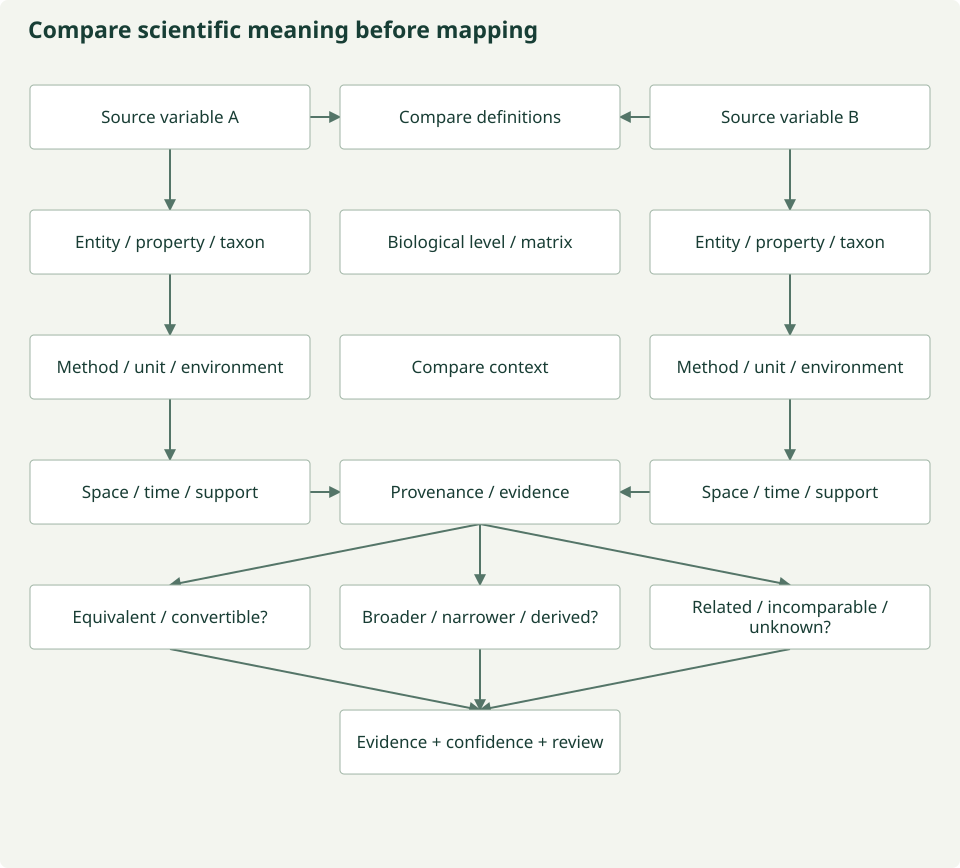

# Harmonization and review

`harmonization.run(resources, recipe, records, human=None, parents=())` consumes
standardized contracts independently of MESA. `SemanticAgent` compares definitions,
methods, entities, ontology identifiers, and units against explicit targets. Exact
curated meaning can produce `equivalent_to` or `convertible_to`; otherwise the agent
abstains with `unknown`. Names alone never justify equivalence.

The relationship vocabulary also represents broader/narrower, derivation,
measurement, association, incompatibility, and human-review needs. Those relations
do not authorize silently treating one scientific quantity as another.

## Recipes and QA

Recipes are JSON-serializable, versioned, attributable scientific artifacts with
formal JSON Schema. Mappings hold scientific interpretation; operations hold
mechanical actions. Every proposal includes rationale, evidence, role, deterministic
agent identity/version, and configuration. States are `proposed`, `needs_review`,
`approved`, and `rejected`.

```bash
prototype schema HarmonizationRecipe --output /tmp/recipe-schema.json
```

QA checks source and variable existence, explicit semantic evidence, target
variable/unit agreement, conversion direction, rights, core/track scope, and
join references. The report binds to the exact recipe digest. Execution recomputes
QA instead of trusting a supplied approval string. QA supports approve/reject/
request-revision/human-review outcomes in its contract; current deterministic checks
emit approve, reject, or human-review.

Human review is required for novel equivalence, confidence below 0.95, disagreement,
ambiguous meaning, spatial or temporal support changes, cross-source joins, and
uncertain rights/restrictions. Known prohibitions block export even with approval.
QA never silently repairs a scientific decision.

## Human workflow

1. Save the standalone candidate recipe JSON and source-resource list.
2. Inspect evidence, operations, and `prototype qa recipe.json sources.json --output qa.json`.
3. Revise the recipe with explicit supported semantics. Set its intended execution
    status to `approved` only after the scientific decision is ready for review.
4. Record the decision against that exact file:

    ```bash
    prototype review recipe.json --reviewer "Expert name" \
      --rationale "Evidence and scientific justification" \
      --decision approved --output review.json
    ```

5. Load `HarmonizationRecipe`, `SourceResource`, `RawObservation`, and `HumanDecision`
    with their Pydantic JSON loaders and call `harmonization.run` with that decision.
    Any subsequent recipe edit changes its digest and requires a new decision.

Individual execution and encoding are also available through the CLI:

```bash
prototype harmonize recipe.json sources.json records.json --review review.json --output observations.json
prototype encode observations.json --encoder scalar --output vectors.json
```

For track recipes, supply `--parents canonical-observations.json`. The default
orchestrator creates only the conservative fixture recipes; reviewed custom
recipes use these independent stage commands/APIs.

This is a local audit mechanism, not authenticated reviewer identity or signatures.
The default fixture needs no human scientific decision because it uses curated
identity mappings and no support changes. Tests use explicitly labeled synthetic
human decisions to exercise gated operations. Unknown semantics must be revised,
not overridden with a blanket approval.

## Allow-listed execution

| Operation | V0 behavior and boundary |
| --- | --- |
| Unit conversion | degC ↔ K and cm ↔ m only; explicit source/target units |
| Variable mapping | Explicit target name with semantic evidence |
| Filtering | Inclusive bounds; track scope only |
| Missing values | Explicit sentinel → null; encoders reject remaining nulls |
| Temporal aggregation | Duration-weighted daily mean; complete nonoverlapping daily coverage required; review and track scope |
| Spatial matching | Unique match within explicit coordinate tolerance in WGS84 degrees and exact time; review and track scope |
| Coordinate normalization | Explicit identity validation of already WGS84 coordinates; other CRS transforms unsupported |
| Join | Unique exact coordinates, interval, and equal support; review and track scope; retains related source/record |
| Validation | Explicit numeric bounds |

Original values remain in provenance. Unit conversions and daily means currently drop numeric
uncertainty rather than pretend it is unchanged; general uncertainty propagation
is not implemented. These narrow operations are not a universal environmental
harmonization system. Daily aggregation uses UTC-aligned intervals in the examples;
local civil days and daylight-saving calendars need further scientific design.

## Semantic alignment and composition: capability boundaries

Module 1 discovers what the source says. Module 2 decides how source concepts
relate, and whether a proposed transformation is scientifically defensible.

| Responsibility | Current implementation and boundary |
| --- | --- |
| Semantic alignment and crosswalks | Typed relationship proposals and curated fixture rules; general ontology alignment/crosswalk generation is PLANNED |
| Ontology comparison, variable decomposition and composition | Human comparison workflow and candidate profile documented; automatic I-ADOPT decomposition/composition is PLANNED |
| Scientific comparability | Explicit entity, method, unit and support checks; no name-based inference or general cross-scale validity engine |
| Units and calibration | Narrow allow-listed conversions and reviewed Sentinel scale/offset; no arbitrary model-generated operations |
| Space, time and cross-scale changes | Narrow reviewed operations above; generalized support transformations remain research work |
| Consensus, QA and human decisions | Deterministic digest/contract checks, legacy four-specialist consensus, additive six-domain reviews and mandatory human review for model proposals |



*Conceptual comparison workflow; automated semantic decomposition is planned.
[Figure source](https://github.com/CU-ESIIL/AI_ready_datasets/blob/main/scripts/generate_figures.py).*

The candidate relationship can be equivalent, convertible, broader, narrower,
derived, related, incomparable or unknown. These conceptual categories do not
replace the [typed mapping vocabulary](reference/contracts.md) or authorize execution.

## The recipe as an inspectable intermediate representation

Heterogeneous observations → semantic interpretation → **recipe** → deterministic
execution → harmonized observations. The compiler analogy helps separate scientific
judgment from execution: the recipe is inspectable, versioned and validated, and the
executor accepts only supported operations.

Current mapping and operation contracts retain source/target meanings, relation,
evidence, confidence, proposals, units and supported transformations; review reports
and human decisions bind them by digest. A complete research review packet should
also describe relevant ontology IDs/versions, entity/property decomposition, spatial
and temporal changes, aggregation, method assumptions and potential loss. Not every
item is a dedicated executable recipe field today. Use the
[non-executable semantic comparison template](semantics/review-template.md) for the
richer scientific record; do not imply its free text is executed.

[Human concept-review workflow](semantics/review-workflow.md) ·
[Cross-support research](semantics/gaps.md) · [Provenance](provenance.md)

!!! note "Same unit does not mean same variable"
    A [trait](semantics/glossary.md#trait), [variable](semantics/glossary.md#variable) and [measurement](semantics/glossary.md#measurement) are distinct. Standardized structure does not establish harmonized scientific meaning.
