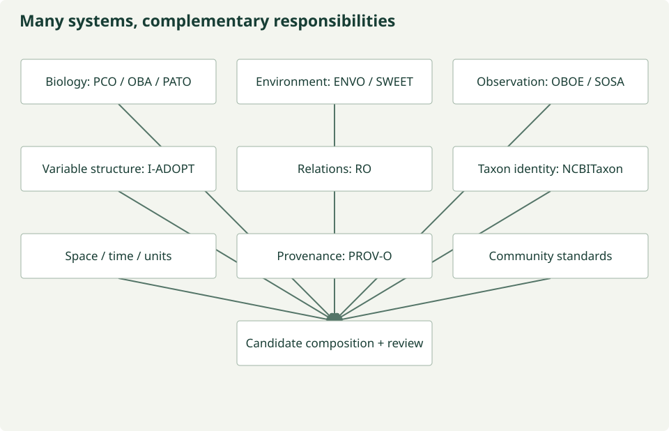

---
hide:
  - navigation
  - toc
---

ESIIL · Research infrastructure prototype

# From environmental observations to AI-ready science

Finding data is only the first discovery problem. The second is discovering
what the data mean. Scientific traditions describe the living world in different
ways. That variety contains information.

We are building a way to discover those meanings, preserve their distinctions,
and make the transformations needed for synthesis explicit and reviewable.
Specialist agents propose; scientists govern; approved observations stream into
machine representations.

[Explore the approach](approach.md){ .md-button .md-button--primary }
[Read the documentation](documentation/index.md){ .text-link }

<figure class="hero-earth">

<figcaption>Blue Marble, 2002 · NASA’s Earth Observatory. <a href="image-credits/">Image source and usage</a></figcaption>
</figure>

The scientific problem

## Data can be accessible and still be difficult to use together

A satellite pixel, a vegetation measurement and a water sample observe different
things at different scales. Similar names do not make them interchangeable.
Combining them requires evidence about units, methods, spatial support, timing
and rights. Those decisions are often hidden in a researcher’s preprocessing code.

Our research question is whether that work can become explicit, repeatable and
reviewable, while retaining the distinctions that make observations scientifically useful.

## Many ways to describe the living world

Organisms, communities, traits, genomes, experiments, monitoring networks and sensors
observe different aspects of reality. A species name, a functional group, a habitat,
a measurement and a pixel belong to intersecting systems of meaning. Units, methods,
space, time and provenance add further dimensions.

There is no single hierarchy of biological data. A taxonomic rank does not tell us
a sampling footprint, and a shared location does not make two observations comparable.
The project preserves community definitions, then asks how their meanings relate.

*Conceptual perspectives, not a universal ladder or automatic transformation rule.
[Figure source](https://github.com/CU-ESIIL/AI_ready_datasets/blob/main/scripts/generate_figures.py).*

[Explore biological organization](semantics/biological-organization.md) ·
[Look up a term](semantics/glossary.md)

## Question → discover → understand → harmonize → represent → synthesize

*Discovery identifies sources; harmonization establishes supported transformations;
representation produces machine features. [Figure source](https://github.com/CU-ESIIL/AI_ready_datasets/blob/main/scripts/generate_figures.py).*

**Discover and understand.** Find candidate observations and preserve their native metadata, source
versions, access constraints and licenses. A catalog match is evidence to inspect.

**Harmonize.** Specialists assess a frozen recipe within defined scientific domains.
Deterministic checks and human review govern what can execute. Uncertainty or
disagreement stops the stream.

**Represent.** Read bounded windows only after approval. Apply the reviewed recipe
in memory, then feed harmonized raster outputs into MOSAIKS. Keep vectors and
compact lineage; avoid saving raw or harmonized raster datasets.

[Follow the full approach →](approach.md)

Different observations, distinct meanings

## Bring data into relation without erasing its context

The architecture accommodates field, sensor and remotely sensed observations.
The current real-data work concentrates on Sentinel-2 metadata and bounded access.
NEON metadata access is implemented; authenticated observation processing remains
unfinished. MESA is an adapter boundary awaiting verified integration.

[Explore data and integration status →](data.md)

## Discover what the source says its data mean

Sources may already reference an ontology, controlled vocabulary, standard name,
protocol, taxon identifier or unit system. The discovery layer preserves that
semantic evidence before harmonization begins. The intended semantic profile composes scientific communities’
existing systems while keeping source identifiers and definitions intact. Automated
ontology composition remains planned; evidence preservation works today.

Module 1 discovers evidence and candidate concepts. Module 2 interprets their
relationships; retrieval is never approval of scientific equivalence.

[Explore the semantic landscape and glossary →](semantics/index.md)

## A landscape of complementary meanings

Biological resources such as [PCO](semantics/landscape.md#pco),
[OBA](semantics/landscape.md#oba), [PATO](semantics/landscape.md#pato) and
[NCBITaxon](semantics/landscape.md#ncbitaxon) address different entities and attributes.
[ENVO](semantics/landscape.md#envo) and SWEET describe environmental context.
OBOE, SOSA and BCO organize observations and sampling. [I-ADOPT](semantics/landscape.md#iadopt)
structures variables; RO supplies relations; GeoSPARQL, OWL-Time and QUDT describe
space, time and units; PROV-O records lineage. These are complementary resources,
each with limits, rather than interchangeable names for one schema.

*Conceptual semantic families; ontologies, vocabularies, standards and classifications
support discovery and harmonization without becoming one universal schema.
[Figure source](https://github.com/CU-ESIIL/AI_ready_datasets/blob/main/scripts/generate_figures.py).*

[Explore and filter the semantic landscape →](semantics/landscape.md)

## Which systems and datasets work well together?

Which resources cover broad parts of biological meaning? Which describe narrow
areas deeply? Which compose well? Which datasets expose enough evidence to use them?
We are developing an evidence-based framework for these questions. The current
benchmark measures local inventory assessments and source documentation; deeper
ontology and scientific-comparability analysis remains open.

[Ontology benchmarking](semantics/ontology-benchmarking.md) ·
[Dataset potential and candidate pairs](semantics/dataset-benchmarking.md)

## Shared infrastructure, independent scientific questions

Food security and water security are configuration namespaces over a shared core.
Their scientific assumptions and products remain separate. A third track stays
undefined until scientists specify its question, evidence and reviewed rules.
These tracks are research scaffolding; we have not validated food or water outcomes.

[See how science tracks work →](science.md)

## A stopped run is a useful result

The Sentinel prototype produced real model-backed proposals and rejected reviews.
Specialists repeated concerns outside their domains, including unsupported claims
about negative reflectance and licensing. No approved real Sentinel MOSAIKS dataset
was produced by those runs.

That evidence motivates scoped reviews, explicit missing-evidence states and a
separate integrity reviewer. Generated MOSAIKS tests demonstrate numeric usability,
with held-out diagnostics and baselines; they do not establish ecological validity
or native language-model understanding.

[Read the Sentinel case study →](development/sentinel-review-refactor.md)

## Toward reusable, inspectable scientific datasets

The intended impact is less repeated data preparation and more visible scientific
judgment. Success means that another researcher can inspect a dataset, understand
its limits, and trace a vector through its harmonized observation, recipe and
review decisions back to the source asset and its rights.

[Research goals and limits](impact.md) · [What works today](PROTOTYPE_STATUS.md) ·
[Build and verify the prototype](documentation/index.md)

## Trust comes from inspectable decisions

Source semantics and evidence stay attached to their identifiers. Model judgment is
labeled; uncertainty and disagreement require review. Deterministic software executes
only approved operations, and provenance connects representations to their sources.
[Inspect the full audit trail](provenance.md).

| Current prototype | Status |
| --- | --- |
| Typed semantic evidence, local inventory, offline diagnostics and tests | WORKING |
| Sentinel metadata/window access, model-backed reviews and MOSAIKS mechanism | PROTOTYPE; no approved real Sentinel MOSAIKS release |
| Fixture source access and deterministic demonstration agents | MOCKED; explicitly synthetic |
| General ontology-service integration and automated semantic composition | PLANNED |
| Ontology depth, dataset potential/diversity and cross-scale justification | UNDER ANALYSIS |
