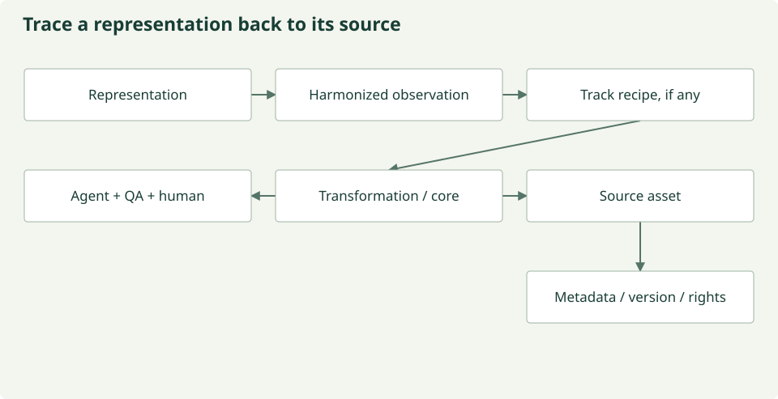

# Representation provenance

Every reusable representation should be traceable to the observations, recipes,
transformations, decisions, and source evidence that justify it. The intended
backward trace is:

```text
representation
      ↓
harmonized observation
      ↓
track-specific recipe if applicable
      ↓
core recipe
      ↓
transformation
      ↓
agent proposal
      ↓
QA decision
      ↓
human decision if applicable
      ↓
source asset
      ↓
source metadata/version/license
```

These arrows express an audit traversal from an output back to its supporting
evidence, rather than execution order. Actual provenance can branch: an
observation may depend on several assets, transformations, proposals, and
decisions. Preserve every contributing link rather than forcing that history
into a single chain.

## Records to preserve

| Record | Required provenance information |
| --- | --- |
| Representation | Identity, version, construction method, and contributing harmonized observation identifiers. |
| Harmonized observation | Scientific quantity, modality, units, measurement method, taxonomic identity where relevant, spatial and temporal support, and recipe references. |
| Track-specific recipe, if applicable | Track identity, version, parameters, and the core recipe it specializes. Keep scientific track assumptions explicit. |
| Core recipe | Shared harmonization rules, version, parameters, and transformation references. |
| Transformation | Operation, implementation version, inputs, outputs, and links to the proposal and decisions governing its use. |
| Agent proposal | Proposed action, rationale, supporting metadata, and agent/model identity and configuration. |
| QA decision | Checks performed, evidence, outcome, and the exact proposal and output versions assessed. |
| Human decision, if applicable | Reviewer, timestamp, outcome, rationale, and the proposal, QA results, or rights question reviewed. |
| Source asset | Original source identifier, access location, retrieved version or checksum where available, and acquisition time. |
| Source metadata/version/license | Product and record metadata, source version, sensor/platform identity, license and attribution requirements, and any unresolved rights restrictions. |

Use stable identifiers and explicit relationships between records. Retain the
metadata and license evidence associated with the asset version used; a link to
mutable current metadata alone is insufficient. When an optional recipe or human
decision is absent, record that it was not applicable and preserve the direct
link to the remaining evidence.

## Scientific and review boundaries

Shared sources may support food-security, water-security, and future tracks.
Source identity stays separate from scientific use: tracks can select different
variables, windows, support, metrics, and representations while retaining the
same original asset references.

Variable names or source names alone do not establish equivalence. Preserve the
evidence supporting whether observations are equivalent, convertible, related
but not equivalent, or not safely harmonizable. Agent proposals require recorded
QA outcomes; human review applies where required, including unresolved reuse or
redistribution rights. Preserve rejected proposals and failed QA outcomes as
history rather than treating them as approved lineage.

## Implementation status

The offline prototype preserves these records in typed immutable contracts and
exports a PROV-inspired JSON-LD graph. Every track observation embeds its core
parent lineage, source records, metadata/rights snapshot, recipe proposals, QA,
and optional human decision. Representations retain observation identifiers and
that lineage. Complete records remain embedded in JSON-LD even where the compact
graph does not expose every relationship as a separate PROV edge.

This is a local audit mechanism, not signed or tamper-resistant governance.
Live Sentinel source retrieval and real local model proposals are now implemented,
with source-native evidence and versioned model transcripts. The optional OpenClaw/Verde route records plugin-validated JSON, runtime/configuration
identity, and explicit unavailable usage/model-digest fields. Live MESA and
authenticated NEON normalization remain pending.
See [prototype status](PROTOTYPE_STATUS.md) and [review workflow](harmonization.md).

## Metadata consensus and direct streaming

The [streaming harmonization module](streaming-harmonization.md) adds metadata-only specialist
dialogue, digest-bound unanimous review, documented Sentinel-2 scale/offset
calibration, and bounded window-to-encoder execution without raw or harmonized
data files. The existing fixture/snapshot commands retain their historical
materialization behavior. Current streamed vectors are reference numeric features;
model consensus still requires an actual human decision before execution.

## Representation-to-source inspection

Inspect lineage in this order: representation → harmonized observation → optional
track recipe → core recipe → transformation → agent proposal → QA decision →
applicable human decision → source asset → source metadata, version and license.
These are related records, not interchangeable identifiers. Streaming products
retain compact observation/window hashes and native support rather than serialized
raw or harmonized observations. Full scientific context and review reports remain
in metadata artifacts beside vectors.



*Inspection path, with review decisions grouped for readability.
[Maintained figure source](https://github.com/CU-ESIIL/AI_ready_datasets/blob/main/scripts/generate_figures.py).*

## Semantic evidence is part of the audit trail

Source asset → native metadata → source semantic evidence → candidate concepts →
proposed mapping → review findings → applicable human decision → versioned recipe →
deterministic transformation → harmonized observation → representation.

This is a conceptual forward audit path; records and dependencies branch. Discovery
preserves `SourceSemantics` within source identity, and provenance embeds the source
contracts. Concept candidates are not accepted mappings. Definitions, source field
locations and evidence kinds must remain inspectable alongside the mapping and
review reports. Compact streaming lineage retains per-window hashes and native
support rather than serializing original pixels. A metadata digest is not a data
checksum, and a window hash does not cover a whole remote raster.

[Semantic contracts](semantics/pipeline.md) · [Mapping workflow](semantics/review-workflow.md)
