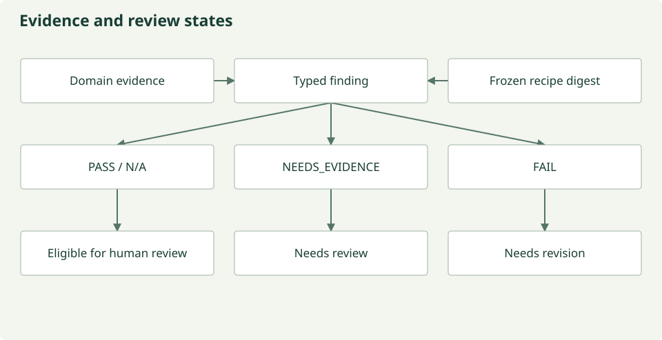

# Evidence-bound scientific review

Review exists to identify what is supported, what is contradicted and what is still
unknown. Its input is a frozen scientific recipe plus a curated evidence ledger.
Its output is a typed report. It never reads scientific raster data or authorizes
execution. Human review and the existing execution gates remain separate.

## Reviewer jurisdictions

| Owner | Permitted scientific scope | Must not infer |
| --- | --- | --- |
| Semantic | Quantity, definition, biological or measurement meaning | Rights or numeric quality from variable names |
| Units/calibration | Units, coefficients, mathematical range | Licensing consequences from negative reflectance |
| Support | CRS, indices, space/time support, support changes | Semantic equivalence from coincident coordinates |
| Rights | Documented permissions, restrictions, attribution for intended operation | A prohibition from an unexplained catalog label |
| Integrity | Source/version, hash scope, recipe binding, provenance | Raster integrity from a metadata checksum |
| Quality | Explicit masks, nodata and fitness evidence | Analysis readiness from calibration alone |
| QA synthesis | References to existing finding IDs and unresolved evidence | New specialist findings or execution permission |



*Statuses describe evidence; workflow and human approval are separate.
[Figure source](https://github.com/CU-ESIIL/AI_ready_datasets/blob/main/scripts/generate_figures.py).*

## Evidence and findings

Evidence is classified as `SOURCE_DOCUMENTED`, `OBSERVED_IN_DATA`,
`DERIVED_DETERMINISTICALLY`, `MODEL_JUDGMENT`, `HUMAN_DECISION` or
`MISSING_EVIDENCE`. A curator supplies domain, source pointer, statement and a
content digest. A digest identifies a statement; it does not verify that the
statement faithfully describes its cited source. Evidence curation is an explicit
scientific responsibility.

A finding has a stable domain-prefixed ID, status, claim, evidence IDs, source,
severity, required action, confidence and references. Explicit `supports` references
produce supporting-reviewer annotations; a citation alone is not endorsement. The validator rejects
cross-domain citations, unknown evidence, duplicate finding IDs, stale recipe
bindings and unknown QA references. Duplicate IDs must be referenced rather than
resubmitted. It does not automatically detect two differently worded claims with
different IDs, or prove natural-language claims scientifically correct.

## Deterministic synthesis

Required `FAIL` yields `needs_revision`. Missing required roles or
`NEEDS_EVIDENCE` yields `needs_review`. All required findings `PASS` or
`NOT_APPLICABLE` yields `eligible_for_approval`. Missing evidence is not a
failure. A failure needs documented, observed or deterministic evidence; model
opinion alone cannot establish either a pass or failure.

QA may veto synthesis with `revise` or `reject`, which forces revision, or request
more evidence; it cannot overturn required specialist findings. Every report has
`execution_authorized: false`. A model proposal still needs an
exact-recipe human decision, deterministic QA and all existing consensus gates.
A new report cannot erase a historical model veto. Real streaming now requires
a source/recipe-matched report from all six domains and accepted QA synthesis;
preflight recomputes its evidence and finding checks before opening a source iterator. Recipe edits invalidate earlier
review bindings. The old `consensus` command remains a legacy dialogue workflow;
its free-text votes have not been silently reinterpreted as scoped findings.

## Run a metadata review

```sh
prototype review-metadata review-bundle.json --runtime run/openclaw --output run/scoped-review
```

The `ReviewBundle` contains a full `HarmonizationRecipe`, complete source resources,
a validated source-set digest, intended
operation, curated evidence and an explicit fixture flag. All six specialists see
the same recipe; each receives only its domain’s evidence. Prior domain findings
are referenced by ID. The QA model receives the resulting report. Accepted role
outputs and exact backend traces are saved even when a later step fails. Invalid
output is rejected without fabricated repair or fallback.

The OpenClaw adapter targets installed version 2026.5.18 with provider-qualified
Verde routing and no model tools, heartbeat or fallback. The isolated runtime adds
integrity and quality roles; working-group roles and Slack remain separate.

## Scientific product levels

1. **Calibrated:** documented scale/offset applied, original quantity and units retained.
2. **Quality-filtered calibrated:** an explicit mask/nodata predicate also applies.
3. **Analysis-ready for a stated use:** independent acceptance evidence establishes suitability.

These are descriptions of evidence, not new interchangeable quantity types. The
current Sentinel reader applies SCL selection separately from calibration. It does
not impose an inferred reflectance range. Unit `1` denotes a dimensionless quantity;
the separate definition identifies bottom-of-atmosphere reflectance.

[Generated contract schemas](../reference/contracts.md) ·
[Sentinel comparison](../development/sentinel-review-refactor.md) ·
[Implementation map](../reference/modules.md)
