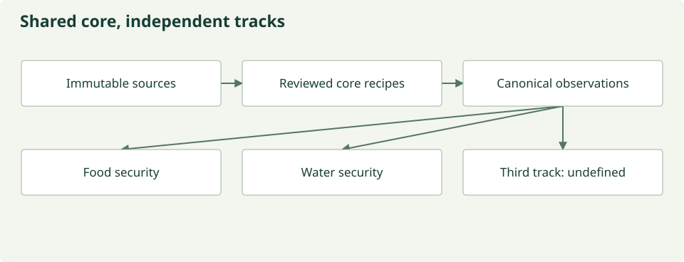

---
hide:
  - navigation
---
# Shared observations, independent science

Food security and water security motivate distinct questions. They can reuse immutable
source observations and reviewed core transformations without sharing every interpretation.
Track-specific rules produce new products carrying track provenance.

*Shared resources do not imply shared scientific assumptions. The third track is disabled.
[Figure source](https://github.com/CU-ESIIL/AI_ready_datasets/blob/main/scripts/generate_figures.py).*

## Food security

The current configuration exercises track isolation over small generated examples.
It is a place to specify reviewed variables, support and assumptions for future food
security research. It does not predict yield, nutrition or food-system resilience.

## Water security

The water configuration uses the same core pipeline and separate product identity.
Future questions need explicit measurements and validation appropriate to water systems.
No validated water-security outcome is supplied by this prototype.

## A deliberately open third track

The third configuration remains disabled. Scientists must define its question and
rules before any domain assumptions enter the system.

## What would count as scientific verification?

A dataset must retain its scientific definitions and units, pass integrity and leakage
checks, and support held-out tasks against meaningful baselines. A texture statistic
derived from an input raster can verify an encoder’s numeric utility; it cannot
independently validate environmental meaning. The next scientific milestone requires
independent reference labels and a scientist-defined evaluation protocol.

[Track configuration and independence tests](tracks.md) · [MOSAIKS verification](mosaiks-embeddings.md)
