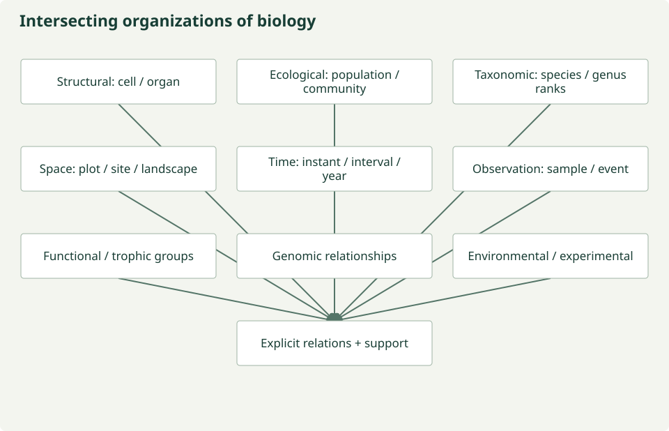

# Biology has intersecting hierarchies

Biology does not supply one universal ladder from molecule to globe. The following
are useful study perspectives. Arrows indicate movement through a perspective,
not one shared `is-a` relation or an automatic transformation rule.

| Structural | Ecological | Taxonomic | Spatial | Temporal | Observational |
| --- | --- | --- | --- | --- | --- |
| molecule | organism | organism identified under a taxon concept | point | instant | sample |
| organelle | population | species rank | plot | observation interval | measurement |
| cell | community | genus rank | site | day | observation |
| tissue | ecosystem | family rank | landscape | season | event |
| organ | biome | order rank and higher ranks | region / continent / globe | year / decade | inventory / dataset |
| organism | — | — | — | — | — |

## The arrows mean different things

Structural organization often involves **part-whole** relationships. Ecological
organization involves memberships, interactions and study-defined systems. Taxonomic
ranks organize taxon concepts; an organism is **not a taxonomic rank**. It is
identified under a taxonomic treatment. Spatial and temporal examples describe
support, resolution or extent only when those roles are specified.

The observational column is an illustrative workflow vocabulary. A sample can
support multiple measurements; an observation/event can group them differently in
[OBOE and SOSA](observation.md). It is not a universal containment or subclass hierarchy.

## Other intersecting organizations

**Trophic:** resource use, feeding relationships and trophic groups can cut across
taxa, life stages and places. A guild is not automatically a taxonomic group.

**Genetic:** sequences, alleles, genes, gene products and genomes have relationships
that do not map one-to-one to anatomical or ecological organization.

**Functional:** organisms can be grouped by traits or selected ecological roles.
The chosen function and grouping rule must be explicit.

**Environmental:** systems, features and materials provide different kinds of
context. A water sample's matrix, a stream feature and a watershed system are related
without being the same entity or scale.

**Experimental:** treatment, replicate, block, experimental unit and observation unit
organize interventions and inference. They need protocol and design evidence.

## What this means for harmonization

Do not infer biological scale from pixel size, taxonomic rank from body size, or
sampling support from an entity label. State the entity, property, organizational
perspective, space/time support and method separately. Moving between perspectives
requires a reviewed scientific relationship or transformation.

[Scale and support](scale-support.md) · [Cross-scale gaps](gaps.md) ·
[Organism/population/community definitions](glossary.md#biological-organization)

*Repository-authored conceptual diagram; [maintained source](https://github.com/CU-ESIIL/AI_ready_datasets/blob/main/scripts/generate_figures.py). Analytical hypotheses are not measured results.*
