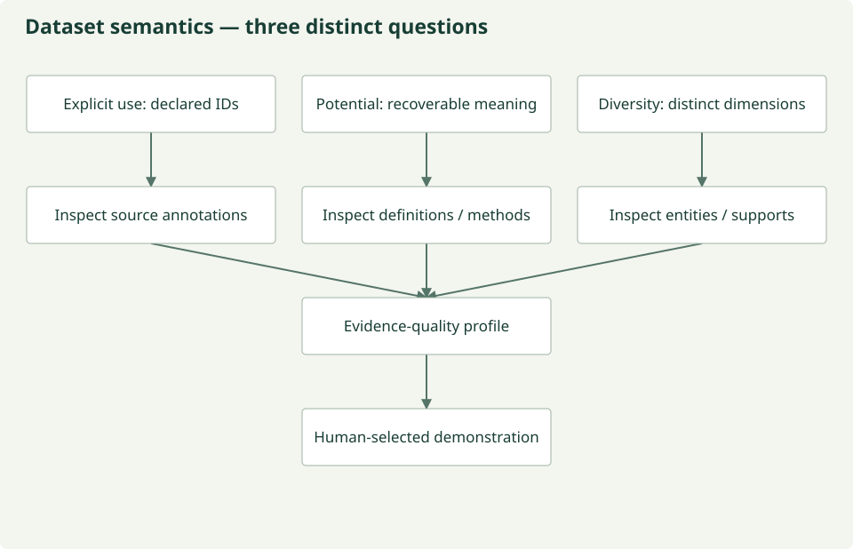
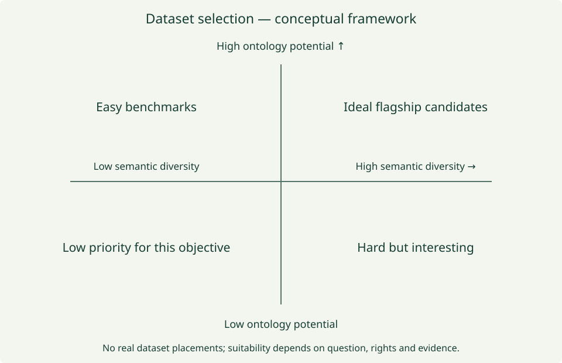

# Dataset benchmarking: evidence for useful synthesis

**WORKING:** source-record metadata diagnostics. **UNDER ANALYSIS:** dataset potential,
semantic diversity, leverage, pair suitability and flagship selection. Current rows
represent versioned source assets; they do not rank entire networks or collections.

## Three questions, three profiles

| Concept | What it asks | Evidence needed |
| --- | --- | --- |
| [Explicit ontology use](glossary.md#explicit-ontology-use) | What semantic infrastructure is already declared? | Concept/taxon IDs, vocabulary annotations, units, standard names and observation standards with source locations |
| [Ontology potential](glossary.md#ontology-potential) | How much meaning could be recovered responsibly? | Definitions, methods, protocols, context, support and rights sufficient for reviewed mappings |
| [Semantic diversity](glossary.md#semantic-diversity) | How many distinct kinds of meaning must interact? | Taxa, traits, populations, communities, interactions, environment, sensors, methods, space/time, units and provenance |

*Repository-authored conceptual diagram; [maintained source](https://github.com/CU-ESIIL/AI_ready_datasets/blob/main/scripts/generate_figures.py). Analytical hypotheses are not measured results.*

A dataset with few ontology IDs can still expose excellent definitions and protocols.
Low explicit use plus high potential may be especially valuable: the system has real
semantic work to do. Conversely, many IDs cannot compensate for unclear support.
Metadata field presence is neither semantic completeness nor scientific validity.

## Ontology leverage is a profile

[Ontology leverage](glossary.md#ontology-leverage) considers **semantic richness ×
recoverable meaning × ontology connectivity × machine accessibility × evidence
quality**. This is a conceptual statement of interacting requirements, not an
implemented product or calibrated scalar score. Report components and uncertainty
separately. An accessible API does not establish rights or correct definitions.

*Repository-authored conceptual diagram; [maintained source](https://github.com/CU-ESIIL/AI_ready_datasets/blob/main/scripts/generate_figures.py). Analytical hypotheses are not measured results.*

No real datasets are positioned in this quadrant. An eventual placement needs a
versioned assessment rubric, source evidence, reviewer and uncertainty. The priority
labels describe this prototype objective, not the dataset's general scientific value.

## Best for which purpose?

Selection can distinguish the best ontology-native, ontology-ready, cross-scale,
multimodal, community/ecosystem or interaction dataset; the strongest semantic stress
test; the best pair; and the best flagship demonstration. These categories may select
different sources. A single documentation leaderboard cannot answer all of them.

## Pairs reveal what individual datasets cannot

| Candidate pair — not selected | Questions to review before use |
| --- | --- |
| NEON + Sentinel-2 | Field quantities versus reflectance; pixel/plot footprint, timing, calibration and quality |
| NEON + TRY | Taxon concepts, individual versus species summaries, trait methods and permissions |
| NEON + AmeriFlux | Measurement definitions, tower footprint, intervals and field sampling |
| NEON + ORNL DAAC | Product-specific quantity, modeled versus observed values, spatial and temporal support |
| Community inventory + trait database | Membership, abundance weights, taxonomic reconciliation and missing traits |
| Biodiversity occurrences + remote sensing | Presence versus abundance, sampling bias, detection and sensor support |
| Flux network + satellite observations | Footprint variability, aggregation, retrieval definitions and uncertainty |

Pairs may expose shared or complementary semantics, ontology conflicts, support
mismatches and opportunities for synthesis. They require explicit scientific
transformations; proximity and common names do not authorize a join. Current
`dataset_pairs.parquet` compares metadata field presence and namespace references
only. **Scientific comparability is not evaluated.**

## Selecting a flagship: proposed decision process

Choose a scientific question; inspect permitted, versioned metadata; assess the three
profiles; review complementary pairs; document unresolved support transformations;
then select a bounded case with an independently testable outcome. Freeze the recipe,
complete specialist/QA and human review, stream approved windows into MOSAIKS, and
verify with held-out data and baselines. Rights or evidence gaps can stop selection.

No flagship has been selected by this benchmark. The existing Sentinel metadata case
is a prototype calibration/review example; blocked reviews did not yield an approved
real MOSAIKS product. [Source status](../data-sources.md) separates implemented access
from candidates. [Actual output contracts and formulas](benchmark.md) explain the
current project diagnostics and their limits.

## Scientific validation update — 22 October 2026

The [new scientific validation findings](../validation/benchmarks.md) retain real graph
measurements, canonical requirement diagnostics, scoped dataset/pair assessments
and live model results. Earlier unmeasured/planned statements describe the prior
architecture snapshot: depth is now measured for three local graphs, while exact
scientific mappings, independent ecological validity and the weaker-model
hypothesis remain unvalidated. The real Sentinel and NEON–Sentinel cases still
require explicit expert decisions; no scientific execution is approved.
