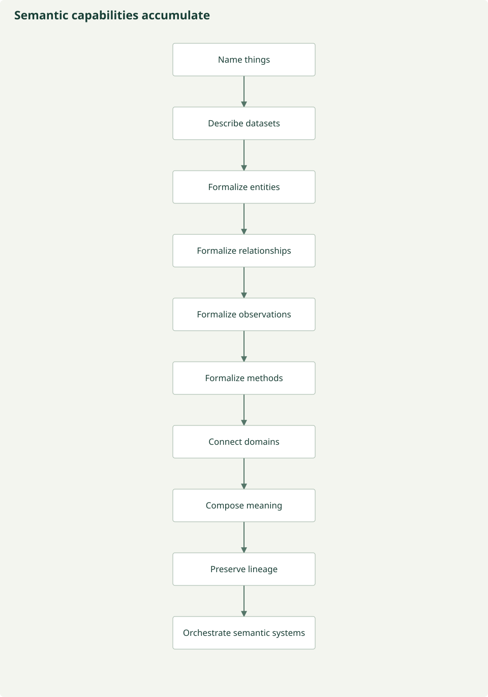

# Overlapping histories of semantic infrastructure

The conceptual progression below is a reading guide, **not a strict chronology**.
Communities revisited these needs in parallel and still do. A modern vocabulary can
address naming while an older project already explored sophisticated mediation.
The [inventory](landscape.md) preserves known milestones, uncertainty and historical leads.

| Capability | Illustrative resources and contribution | What it did not finish |
| --- | --- | --- |
| Name things | Taxonomic names/identifiers and managed vocabularies | Names alone do not identify taxon circumscriptions or measurement meanings |
| Describe datasets | Dublin Core, EML, later DataCite/DCAT/STAC metadata | Description does not establish scientific equivalence |
| Formalize biological entities | Anatomy, cell, molecular, trait and taxonomic ontologies | One domain's entity model is not every domain's |
| Formalize relationships | RO and explicit relation patterns | A relation still needs correct scientific application |
| Formalize observations | OBOE, SSN/SOSA | Shared observation structure does not eliminate method/support differences |
| Formalize methods and sampling | OBI, BCO, MIAPPE/PPEO, Humboldt | Recorded procedures do not prove equivalent procedures |
| Connect domains | ENVO, SWEET, MarineTLO, domain overlays and explicit alignments | Cross-domain links can be contextual or lossy |
| Compose meaning | Entity-quality patterns and I-ADOPT | Composition needs domain concepts and compatible relations |
| Preserve lineage | PROV-O and scientific-workflow extensions such as ProvONE | A derivation can be recorded but scientifically unjustified |
| Orchestrate many systems | Community profiles, registries and governed pipelines | Discovery must remain separate from interpretation and approval |

## Selected documented milestones

Dublin Core's [1995 workshop lineage](https://www.dublincore.org/specifications/dublin-core/dcmi-terms/)
and [EML's ecological metadata precursors](https://github.com/NCEAS/eml) illustrate
resource description needs. [SEEK notes](https://cseweb.ucsd.edu/groups/tatami/seek/)
and [Ecolingua](https://www.scielo.br/j/jbcos/a/xbtCVcgqzPx8bKGb5WBDzNg/?lang=en)
show that ecological semantic mediation predates recent agent systems.

[OBOE's 2007 paper](https://github.com/NCEAS/oboe),
[SKOS's 2009 Recommendation](https://www.w3.org/TR/skos-reference/),
[PROV-O's 2013 Recommendation](https://www.w3.org/TR/prov-o/) and
[SOSA/SSN's 2017 Recommendation](https://www.w3.org/TR/vocab-ssn/) mark different
capabilities, not replacements for every predecessor. The
[Bari Manifesto](https://www.vliz.be/imisdocs/publications/322519.pdf) frames EBV
interoperability as a coordinated scientific-infrastructure problem; a proposed EBV
application ontology is not assumed to be a complete deployed resource.

## What we inherit

Reuse identifiers, definitions, models, relations, methods and provenance rather
than declaring a new universal biological ontology. Some artifacts remain useful
historical precedents even when active maintenance or executable releases have not
been verified. MicrO and CARO are marked inactive **in the inspected OBO registry**;
that is a scoped metadata fact, not a claim that every descendant use has ceased.

A blank origin or crosswalk field means this review has not established it.
Continued literature review and community input are part of the resource's purpose.

*Repository-authored conceptual diagram; [maintained source](https://github.com/CU-ESIIL/AI_ready_datasets/blob/main/scripts/generate_figures.py). Analytical hypotheses are not measured results.*

Biology has many semantic resources. The current challenge is finding, understanding,
selecting and connecting them while preserving distinctions, identifying genuine gaps
and determining whether a mapping is scientifically justified.
