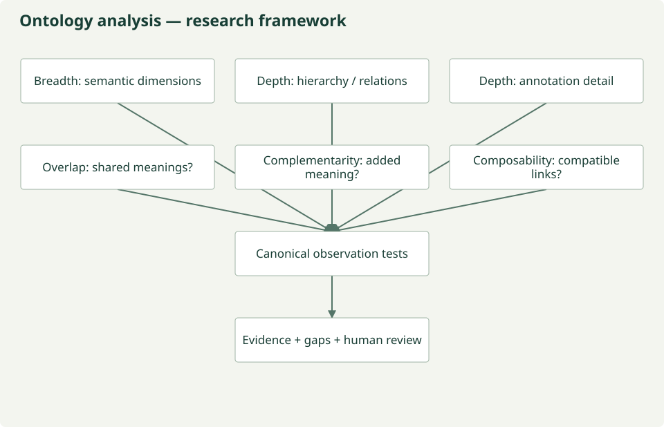
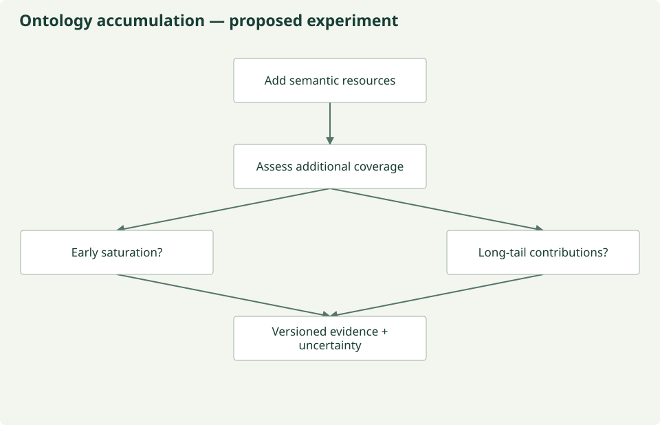

# Ontology benchmarking: what meaning can we describe?

**WORKING:** bounded local inventory diagnostics. **UNDER ANALYSIS:** a richer
scientific comparison of semantic systems. This page defines that research design;
it does not report ontology graph analysis that has not been run.

The [86-resource inventory](landscape.md) includes ontologies, vocabularies, standards
and classifications. Their different responsibilities make one universal ranking
misleading. Start with the scientific observation and ask which resources describe
its meaning, which work together, and which assumptions still require a recipe.

## Breadth, depth and composition

| Dimension | Research question | What is measured today? |
| --- | --- | --- |
| Breadth | Which biological and contextual dimensions can a resource describe? | Provisional ratings across 21 inventory dimensions |
| Hierarchical depth | How specific are its subclass structures within a selected branch? | Not computed; branch/version and modeling style matter |
| Relational depth | Which meaningful relationships connect entities and processes? | Not computed; relation counts alone would be inadequate |
| Annotation depth | How precisely do definitions, methods and contextual annotations describe observations? | Not computed at term/observation level |
| Composability | Can selected concepts and relation constraints express one complete observation consistently? | Proposed human-reviewed tests; no automatic composition engine |
| Overlap | Where do resources describe shared meanings? | Assessed-scope weighted overlap only; no term alignment |
| Complementarity | What additional meaning does another resource supply? | Greedy gains in assessed scope only |
| Gaps | What meaning or justification remains unsupported? | Inventory coverage counts and an unmeasured cross-support hypothesis |

*Repository-authored conceptual diagram; [maintained source](https://github.com/CU-ESIIL/AI_ready_datasets/blob/main/scripts/generate_figures.py). Analytical hypotheses are not measured results.*

An ontology may be narrow and deep, broad and shallow, or useful mainly for relations.
A small specialized resource can contribute indispensable meaning. No score here
measures logical correctness, scientific completeness or suitability for every task.

## Does coverage saturate?

Add resources and assess the additional meaning represented. Does a small general
portfolio cover the question, or do disciplinary resources continue to contribute?
Both are hypotheses. The long tail could motivate composition, but evidence must
precede that conclusion.

*Repository-authored conceptual diagram; [maintained source](https://github.com/CU-ESIIL/AI_ready_datasets/blob/main/scripts/generate_figures.py). Analytical hypotheses are not measured results.*

No empirical accumulation curve has been computed. `recommended_portfolio.json`
contains marginal gains from local assessment ratings, not a graph-derived coverage
experiment. Selection order, observation mix, resource versions, unresolved meaning
and reviewer disagreement must be recorded in any future experiment.

## Canonical observations: proposed tests

| Increasing complexity | Meaning that must survive |
| --- | --- |
| Air temperature at a site | Air as object/matrix, temperature, unit, method, location, time and support |
| Leaf area of an individual tree | Leaf and organism identity, area definition, sampling and measurement method |
| Mean specific leaf area of a species in a plot | Trait definition, taxon concept, sampled individuals, plot membership and estimator |
| Community-weighted mean specific leaf area | Community boundary, abundance weights, species values, missingness and uncertainty |
| Community functional composition and Sentinel-2 reflectance | Distinct observed quantities, sensor calibration, acquisition and field support; an association is not equivalence |
| Annual vegetation change with community, climate and disturbance | Baseline, temporal aggregation, change definition, causal limits and multiple source lineages |

These are proposed review cases, not encoded scientific truths or completed benchmark
results. The question is which combination can express the **complete scientific
meaning** and justify any transformation. A missing local annotation is not proof
that an external ontology lacks the concept.

[Actual algorithms and output contracts](benchmark.md) · [Dataset benchmarking](dataset-benchmarking.md) ·
[Cross-scale research gap](gaps.md) · [Candidate semantic profile](profile.md)
