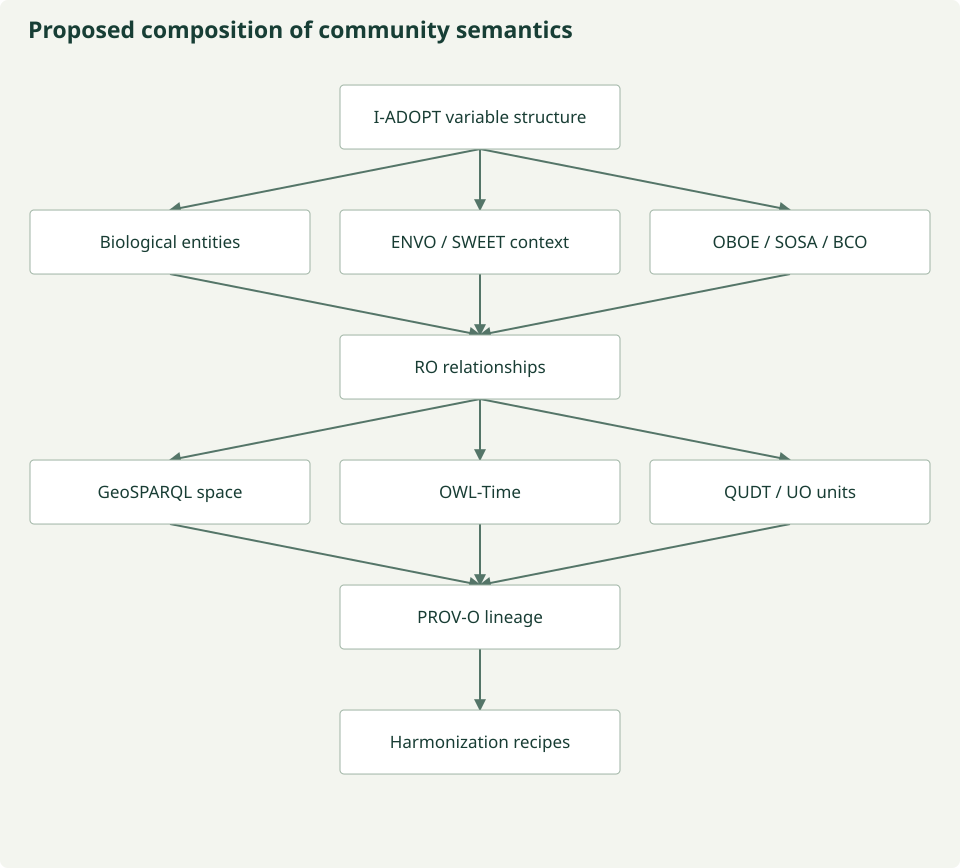

# An evolving semantic profile

This is a proposed composition architecture, **not a final project ontology or an
approved set of mappings**. Individual resource versions, scientific definitions,
rights and compatibility still need review. The project should compose established
community semantics rather than replace them.

*Provisional semantic composition, not an implemented universal ontology.
[Figure source](https://github.com/CU-ESIIL/AI_ready_datasets/blob/main/scripts/generate_figures.py).*

## Complementary responsibilities

**Variable structure:** I-ADOPT describes property, object of interest, optional
matrix/context and constraints. It does not supply every component concept or all
units, methods and observation metadata.

**Biological entities and attributes:** NCBITaxon, PCO, OBA/PATO, PO and UBERON provide
different taxonomic, group, attribute and anatomical resources. Preserve their
identifiers and definitions; no blanket equivalence between their classes is proposed.

**Environmental context:** ENVO and SWEET address overlapping but distinct environmental
needs. Their assessed coverage does not imply automatic alignments.

**Observation model:** OBOE, SOSA/SSN and BCO offer different observation/sampling structures.
They should be compared against actual source records and intended uses.

**Relationships and quantitative context:** RO can supply specifically defined
relations; GeoSPARQL, OWL-Time and QUDT/UO contribute space, time and units. Relations,
classes and quantity kinds must not be silently interchanged.

**Provenance and execution:** PROV-O can record derivation. Versioned recipes must
separately state and justify scientific operations with QA and applicable human review.

## Domain overlays

| Overlay | Candidate resources | Boundary |
| --- | --- | --- |
| Biodiversity | Darwin Core, Humboldt, TCS | Exchange, inventories and taxonomic concepts remain distinct |
| Food/agriculture | AgrO, Crop Ontology, MIAPPE/PPEO, FoodOn | No validated food-security outcome implied |
| Genomics | MIxS, GO, SO, ChEBI | Sequence/sample context is not ecological abundance |
| Traits | OBA, PATO, TO, VT, ETS | Trait, variable and measurement remain distinct |
| Interactions | RO, GloBI, SFWO | Asserted interactions retain participants, context and source evidence |

Food and water tracks continue to use shared immutable resources and independent
reviewed assumptions. This profile does not enable the undefined third track or
promote a domain rule into the shared core.

The diagnostic `recommended_portfolio.json` is a coverage heuristic for human
inspection. It does not implement this architecture, approve a mapping or select
one semantic system to replace the others.

[Inventory and limits](landscape.md) · [Review process](review-workflow.md) · [Pipeline integration](pipeline.md)
