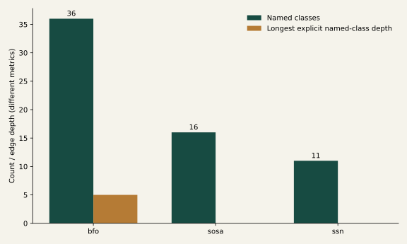

# Measured semantic-resource and dataset experiments

{ .validation-figure }

## Resource scope and canonical observations

The new analysis retains 2,408 evidence-linked assertions for 86 resources across
28 requested dimensions. Known legacy scope judgments map to an ordinal rubric;
new unsupported dimensions remain null. Zero means not-targeted in the assessed
scope, not proven absence of a concept. All scope scores remain PROJECT ASSESSMENT,
with provisional confidence and no fabricated expert review.

Twenty-five observations have explicit requirement IDs. Exact best-set enumeration
through size three yields size 1: 37.2% (eml); size 2: 52.7% (ebv, eml); size 3: 62.2% (ebv, eml, foodon). The objective counts repeated dimension
requirements with at least meaningful assessed scope. It does **not** measure
exact term expressibility, equivalence or ontology quality. Longer accumulation
curves are greedy witnesses; they do not prove minimal sets beyond size three.

Exact SOSA term presence is measured separately in `canonical_term_witnesses.json`.
Presence is a building-block witness, not an approved scientific mapping.
Subdomain accumulation, marginal gain, resource-pair overlap, unknown dimensions,
threshold failures and complete-case exploratory PCA are retained independently.
No missing values are imputed as zeros.

## Real graph structure

| Local snapshot | Named classes | Longest named-class depth | Median shortest root depth | Restrictions |
| --- | --- | --- | --- | --- |
| bfo | 36 | 5 | 4.0 | 31 |
| sosa | 16 | 0 | 0.0 | 0 |
| ssn | 11 | 0 | 0 | 73 |

These are explicit local triples, not imported or inferred closures. SOSA/SSN
modeling patterns and external superclass references are not summarized by local
named-class depth. SSN's explicit SOSA import is verified; other inventory
relationships retain their weaker declaration provenance. Identifier resolvability,
I-ADOPT compatibility and semantic crosswalk correctness remain unmeasured.

## Candidate dataset diagnostics

The 18 records include product/network descriptions, a standard comparator and an
unselected climate counterpart. They are not 18 integrated datasets. Each source statement has primary evidence and scope; dimension and field-presence
coding are separately labeled PROJECT ASSESSMENT. Undocumented fields remain unknown.

Semantic diversity is a documented dimension lower bound, not variable count.
The ontology-potential diagnostic counts proposed resource relationships and is a
PROJECT ASSESSMENT. Formal ontology references are distinguished from standard use.
Eight separate review-prioritization rubrics and all 153 pair diagnostics are
available. Ties have no scientific standing; mixed documentation scope confounds
ranking. Pairwise added dimensions do not grant scientific compatibility.

[Evidence inventory](https://github.com/CU-ESIIL/AI_ready_datasets/blob/main/data/semantics/validation/dataset_inventory.json) ·
[Canonical results](https://github.com/CU-ESIIL/AI_ready_datasets/blob/main/outputs/scientific_validation/canonical_benchmark.json) ·
[Graph measurements](https://github.com/CU-ESIIL/AI_ready_datasets/blob/main/outputs/scientific_validation/resource_depth.json) ·
[Dataset and pair diagnostics](https://github.com/CU-ESIIL/AI_ready_datasets/blob/main/outputs/scientific_validation/dataset_benchmark.json).
