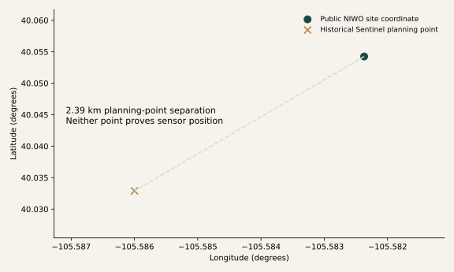

# NEON + Sentinel: retain the differences

{ .validation-figure }

The proposed bounded case uses NIWO air temperature (DP1.00002.001) in July 2023 as
environmental context for instantaneous Sentinel B08 NIR reflectance. Air temperature
is not reflectance, and tower support is not pixel support.

## Evidence supporting candidate selection

Public NEON product metadata confirms NIWO availability for July 2023; the retained
Sentinel scene footprint contains the public site coordinate. This is one eligible
metadata-backed candidate, not an optimized site ranking. Exact release/file
membership remains to be verified.

The historical Sentinel planning point is approximately
2.39 km
from the published NEON site coordinate. Neither is a selected sensor coordinate.
A site centroid cannot establish tower height, air-sensor position, footprint or
spatial colocation. No NEON observation files were acquired; the process token is
absent and the legacy download method is not used by this streaming case.

## The proposed scientific relationship

NEON documents one-/thirty-minute averages of aspirated air-temperature observations
at multiple heights. Sentinel supplies instantaneous 10 m optical pixels. The review
must specify sensor, height, source units, interval convention, quality/uncertainty,
spatial relationship and intended ecological interpretation without equating them.

The registered Sentinel calibration/rename recipe fragment is preserved. The NEON
branch is unbound because source observations and sensor-aware normalization are
missing. A reviewed interval-to-instant contextual association is not registered;
`observation.join_exact` requires equal supports and is inappropriate here.
No model is asked to invent an operation, equation or matching rule.

**Stop at the data, method and expert gates.** The
[complete proposed review package](https://github.com/CU-ESIIL/AI_ready_datasets/blob/main/outputs/scientific_validation/neon_sentinel_case.json)
records what/where/when/how, available operations, meaning lost if forced equal,
missing capabilities and decisions needed before implementation or execution.
