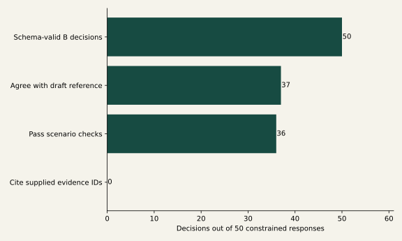

# Live Verde constraint experiment

{ .validation-figure }

The pilot completed 100 calls over 25 tasks and two repeats
using the configured Verde `js2/gpt-oss-120b` model through isolated OpenClaw
2026.5.18. 98 responses returned; two failures remain
retained and were not repaired or replaced.

## Arms and interpretation

- A captures free natural-language content inside the JSON text envelope required
  by the installed plugin; it is not a fully unconstrained provider baseline.
- B requests the closed decision schema over offered operations/concept IDs.
- C deterministically validates the same B outputs using scenario preconditions
  and authoritative-parameter references; it is not an extra model sample.
- D adds a pending human gate; it cannot execute without actual approval.

All 50 B outputs passed their schema. Fourteen failed deterministic scenario checks,
and none of the 50 supplied an evidence-ID citation. Thirty-six passed scenario
checks, including abstention/review dispositions; this does not mean 36 validated
scientific transformations. The citation metric tests reference presence/membership,
not natural-language truth. Six of six operation-target examples selected the
expected operation, but this did not satisfy evidence requirements.

Strict agreement with the assistant-drafted reference was 37/50. **This is not
human-gold scientific accuracy.** A separate
[blank expert gold form](https://github.com/CU-ESIIL/AI_ready_datasets/blob/main/data/semantics/validation/expert_gold_template.json)
is required. Prose correctness and unsafe-proposal rates need blinded human coding.
Zero scientific executions in every arm is an enforced design property, not evidence
of model competence. The weaker-model hypothesis and inter-model disagreement
remain untested by this single configured model.

Exact prompts, schemas, normalized outputs, failures, task IDs, repeat IDs, elapsed
latency and provider/model are retained. Token cost and weight digests are not
exposed by this plugin and remain unknown. Original `started_at` fields were recorded
after receipt in this runner version; elapsed durations are retained correctly.

[Measured summary](https://github.com/CU-ESIIL/AI_ready_datasets/blob/main/reports/scientific_validation/data/model_experiment/summary.json) ·
[Exact inert call records](https://github.com/CU-ESIIL/AI_ready_datasets/blob/main/reports/scientific_validation/data/model_experiment/calls.jsonl).
No output is passed to eval, exec, shell, SQL, dynamic imports or scientific execution.
