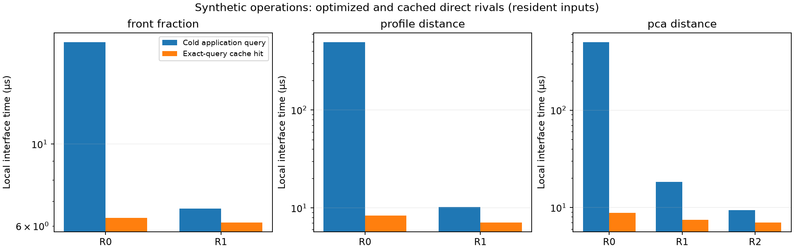
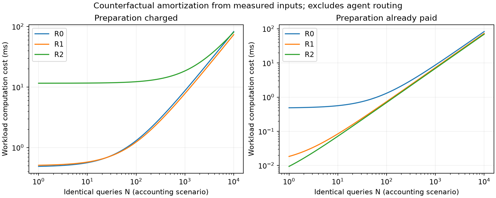

# Fire VASE representation utility — Milestone 3

21 November 2026. **WORKING** expanded synthetic benchmark; **MOCKED** agent evidence;
**PLANNED** real-model evidence and expert adjudication of scientific claim rubrics.

The experiment now separates representation sufficiency, operation/view selection,
correctness and cost against optimized/cached raw-data rivals. It can expose losses
and overhead as well as useful compression. It does not establish whether real
agents benefit from embeddings: authorized inference remains unavailable.

## Scientific discrimination and new questions

The [diagnostic matrix](scientific-discrimination-m3.md) audits all six requested
contrasts against M1/M2. Fixed R0 and adaptive R0-first previously matched because
of both mock policy and the deterministic representation hierarchy: R0 can derive
R1/R2. Adaptive access adds no information over R0. Efficiency is a separate question;
no adaptive advantage is manufactured.

The frozen fixture contains 32 training, eight development and 20 evaluation
histories, with 30 development and **120 evaluation questions across 24 templates**.
Evaluation categories: 20 observation, 25 morphology, 20 compression, 15
cross-representation, 20 validity and 20 efficiency cases. This is coverage, not a
power calculation; repeated questions/calls are not independent fires.

Histories, dates and template IDs are separated; evaluation adds longer histories
and explicit missing/omitted observations, unknown baseline, observed zeros,
zero-total normalization, plateaus, recurrent pulses, equal-size/reversed-order and
equal-shape/different-scale controls. Seeds and source/checksum/license evidence are
recorded. Original M1/M2 fixtures and result snapshots remain unchanged.

Numerical references independently use Fraction cumulative differences, rational
allocation integration, training-only SVD and exhaustive prominence evaluation.
Every answerable operation/view is cross-checked before agents run. Draft scientific
evidence-claim rubrics are assistant-authored: **not expert gold**. Claim-assessment
operations implement general evidence-scope rules; correctly invoking them is not
proof that a model independently understands the science.

These are frozen **model-unseen** evaluation cases, visible to implementers and the
hand-authored rule baseline. They are not an externally blinded holdout. No real
model performance has been observed or used to edit the cases. The older pending
held-out configuration remains historical and inert.

## Execution and correctness

The [retained manifest](results/milestone-3-v1/manifest.json) records:

- 1,440 cells × two repetitions = **2,880 mock episodes**.
- **360** separate adaptive rule-router episodes.
- **2,520** cold/warm direct measurement pairs (seven repetitions per task/view),
  plus separate development-only calibration.
- **Zero real-model invocations** and no external model charges.

| Interface/policy | Correct answers / 120 | Appropriate abstentions / 120 | Errors |
| --- | ---: | ---: | ---: |
| Fixed optimized R0 mock | 103 | 17 | 0 |
| Fixed R1 mock | 87 | 33 | 0 |
| Fixed R2 mock | 51 | 69 | 0 |
| Adaptive first-R0 mock | 103 | 17 | 0 |
| Adaptive contract-cost router | 103 | 17 | 0 |

Counts collapse metadata and repetitions. Abstentions reflect the assigned interface;
more correct abstentions are not greater information coverage. The 17 R0/adaptive
abstentions are unsupported numerical/support requests, separate from returned
negative evidence-claim assessments. Full reference tables, result receipts,
source lineage, malformed/recovery protocol and private grading traces are retained.

All task-level paired M1−M0/M2−M0 scientific-outcome contrasts are zero after averaging
repeats. This is expected: both mock policies ignore metadata. It verifies isolation,
**not metadata efficacy**. The negative-control and hypothesized-sensitive strata
remain ready for a real model; no population significance is claimed.

The rule router selected R0/R1/R2 on **56/43/21** questions (M0, one trial). Its
phrase/contract policy is explicit and tailored; construction/maintenance labor is
unmeasured. Selection variety is not evidence that an LLM can discover these choices.

## Strong direct rivals and measured costs

Native lookup is indexed; one-day growth independently verifies support. Targeted
first-half and last-quarter integrals match upstream CDF interpolation without
computing all traits. Positive and invalid cases, rational references and upstream
trait agreement are tested. Profiles and prominence continue to use the unchanged
pinned external worker; no upstream algorithms are vendored.

Representative local median resident-interface costs, across answerable cases:

| Operation | R0 cold / cached (µs) | R1 cold / cached (µs) | R2 cold / cached (µs) |
| --- | ---: | ---: | ---: |
| First-half allocation | 18.85 / 6.31 | 6.69 / 6.13 | Unavailable |
| Full-profile distance | 496.06 / 8.31 | 10.21 / 7.06 | Unavailable |
| Declared standardized PC distance | 501.50 / 8.81 | 18.40 / 7.46 | 9.38 / 6.98 |
| Declared backprojected-profile distance | 512.98 / 8.29 | 25.06 / 7.35 | 16.50 / 7.10 |

These are local interface costs, including Python validation/cache keys and worker
IPC where used, not pure algorithm times, raster throughput or general speed ratios.
OS/storage caches are not reset. Direct cold full-profile operations still invoke
the worker; cached direct results are strong rivals. Cross-query intermediate-profile
memoization and heterogeneous workloads are not benchmarked here.

Feature preparation per history, training-only fit and coordinate construction are
recorded separately. Worker startup is separately measured. The frontier assumes
resident views; native index/view-wrapper construction, prompt rendering before the
controller, metadata authoring, refresh/storage and physical I/O are not fully
attributed. Consequently total accounting is explicitly scoped, not a complete
production lifecycle cost. The direct-cost frontier assumes the correct registered
operation is supplied; it is not a free natural-language interpreter.

Each episode retains the task-specific valid-cost minimum at its declared accuracy
requirement, all view costs, selected view, scientific dispatch, routing/controller
overhead and cost regret. Public hints use development measurements only; evaluation
costs and sufficiency are private. Preparation-paid/unpaid and repeated identical
query counts are declared before selection. Amortization is a counterfactual formula
using measured inputs, not an executed 10,000-query workload.

Rule-router/controller overhead was about **2.91 ms** median, greater than these
scalar computations and even many on-demand worker operations. This is mock CPU
cost, not real-model latency. It demonstrates why faster representations alone do
not establish lower total system cost. Tokens/provider cost remain **null**, never
invented zero; real inference and operational costs are unknown.

## Compression findings and theory

Four neighbor-stability cases are answerable from R0/R1: **three change their top-one
neighbor after projection**, one stays stable. A fifth lacks valid profile support
and abstains. These are mathematical geometry diagnostics, not ecological relevance.

Three retained PCs leave at least 16 local degrees of freedom on the 19-dimensional
20-bin probability simplex. An arbitrary exact profile cannot be recovered. The
triangle inequality bounds distance distortion by the sum of both reconstruction
residual norms, but coordinates alone do not retain those residuals. Therefore R2
can answer explicitly declared PC/projected-geometry questions, while exact-profile
or discarded-error audits require fuller evidence. The [theory and equations](../../../docs/analysis/fire-vase-pilot.md#what-theory-permits)
make this distinction explicit.

## Figures

The amortization example is a declared PC-geometry workload. Curves include the
stated preparation charge and matched query caching; no universal break-even point
or adaptive superiority is inferred. Routing is accounted separately in episode rows.

## Real access and next evidence

The [new read-only access check](model-access-check-m3-v1.json) verifies saved isolated
OpenClaw 2026.5.18 policy. Gateway connection from this session raises PermissionError;
credential presence checks are false and access/cost authorization is unverified.
This does not prove the service is absent elsewhere. No credentials, services,
Docker state, Slack configuration or external infrastructure were changed.

The existing frozen two-task/six-call smoke configuration is preserved. The
[disabled V3 pilot configuration](config/agent-live-pilot-m3-v1.json) binds frozen input
hashes and a call ceiling. The optional live runner requires verified no-charge
access and a checked smoke record (identity, parsing, usage availability, governance,
external cost), rejects changed inputs/substituted models and never falls back to
mocks. Positive paid budgets are unsupported with the installed transport's absent
usage/cost measurement. No live invocation was attempted.

Independent expert adjudication of draft scientific rubrics and authorized real
inference remain necessary before claiming scientific understanding or metadata
benefit. Neural training, real fire acquisition, forecasts and ecological analog
labels remain outside this milestone.

## Verification and provenance

**311 passed, two skipped** in the full offline suite, including **21 M3 tests**.
Tests cover independent numerical/support references, every operation/view,
train-only fitting, separation/frozen generation, metadata/gold isolation, malformed
recovery, closed arguments, source authorization, no-charge guards, cached/routing
cost accounting, dual matrix replay, report regeneration and projection-error bounds.
Strict MkDocs build and generated schemas/architecture accompany delivery.

The [development ledger](agent-development-log-m3-v1.json) preserves failed integration,
draft fixtures and the first successful matrix. That matrix overlapped test activity
and is excluded from retained timing interpretation. The retained run executed after
tests completed. No historical M1/M2 outputs or upstream checkout were changed.

See the [generated run report](results/milestone-3-v1/report.md),
[structured summary](results/milestone-3-v1/summary.json),
[frozen protocol](agent-protocol-m3-v1.md) and
[reproduction guide](../../../docs/analysis/fire-vase-pilot.md).
