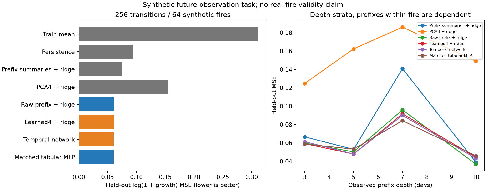
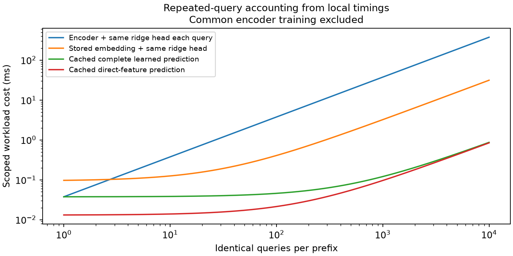

# Fire VASE representation utility — Milestone 4

21 November 2026. **WORKING offline learned-representation experiment; real-agent and
real-fire evidence PENDING.** Upstream and frozen Milestones 1–3 are unchanged.

## Findings

The learned four-dimensional representation predicts held-out synthetic subsequent
growth better than the tested PCA and interpretable-summary baselines, but **does
not improve on raw-prefix ridge** with the same linear probe objective. End-to-end
TCN and similarly sized tabular MLP errors are very close. This run therefore does
not establish distinctive scientific value from learned temporal embeddings beyond
strong raw-data alternatives. Differences are descriptive, not population significance.

Materialization improves repeated access to the **same trained encoder/head**,
but caching complete predictions is a stronger rival for identical fixed-head
queries. Learning, compression, materialization and agent choice are separate mechanisms.
No real scientific or real-agent result is manufactured from these controls.

## Track A — unchanged frozen real-agent experiment

[Access/execution report](track-a-m4.md) and
[adapter preflight](adapter-preflight-m4-v1.json) document review of the M2/M3
protocols, renderer, provider, dispatcher, independent evaluator and diagnostics.
All 6,480 recorded M3 transport payloads fit the installed 48,000-byte request limit
(maximum 37,810), without adapter modification. This verifies serialization of
recorded requests, not live model identity or every possible recovery history.

The [new access check](model-access-check-m4-v1.json) still finds saved isolated
OpenClaw 2026.5.18 policy valid, but gateway connection raises PermissionError from
this session. Access/no-charge authorization is unverified; approved environment
credential presence checks are false. **Zero real inference calls and no external
model charges.** No infrastructure, credential, Docker, Slack or network-policy
changes. Frozen smoke/pilot configs are unmodified. Plugin token/provider-cost
usage remains unavailable, not zero. Track A smoke and paired pilot remain pending.

## Track B — data audit and objective

The [data-access audit](track-b-data-m4.md) and
[inspection evidence](data-access-audit-m4-v1.json) distinguish physical availability
from approved scientific access. Real event/daily GeoPackages and lakehouse Parquet
exist at the documented legacy CubeDynamics roots. Fire VASE's current expected
local roots are absent. Only Parquet footer and GeoPackage schema/catalog metadata
were inspected; **no real observation rows were read** and no large archive copied.

Source code licensing does not establish FIRED/gridMET reuse terms. Native
ring/cumulative/daily support mapping, experiment-specific rights/attribution,
source/checksum verification and operational availability remain unresolved.
The repository [governance](../../../AGENTS.md) requires: “Human review is required
for consequential/uncertain decisions” and “Every scientific transformation belongs
in a validated, versioned recipe.” The new prefix recipe is synthetic-only and
cannot silently approve those real-source mappings. `RealPrefixApproval` records
required evidence; it neither approves itself nor implements a real source adapter.

Choose **next-calendar-day growth prediction from observed prefixes**. Analog
retrieval lacks independent relevance labels; spatial development needs approved
geometry/support. Prefix prediction needs the least new infrastructure and has an
independently recorded subsequent observation as its target. Real-source prospective
availability is unresolved, so the executed objective is explicitly a synthetic
prospective-style control, not an operational wildfire forecast.

## Cohort, methods and independent evaluation

The [frozen protocol](learned-protocol-m4-v1.md) and
[configuration](config/learned-synthetic-m4-v1.json) precede the retained run.
Generator seed 20261121 supplies 128 training, 48 validation and 64 test synthetic
fires. Four prefixes per fire (3,5,7,10 observed days): 512/192/256 transitions.
All prefixes stay with their fire. Validation is split by fire into 24 seed-selection
and 24 interval-calibration fires. Test values never fit preprocessing, PCA, encoder,
prediction heads or seed selection. No hyperparameter edits after retained test results.

Dates, units, source IDs and synthetic availability are explicit. Each target is
cross-checked against the next canonical synthetic daily observation, not a generated
class label. Prefix-only features preserve absolute scale; no final duration/area,
completed-history normalization, future weather/geometry or IDs enter the predictor.
The declared generator is a statistical control, not a wildfire mechanism. Synthetic
years/region labels are separate strata under the same generator, not real transfer.

TCN: causal kernel3 Conv1D 4→8 channels, masked mean/final-state pooling, tanh embedding4,
linear head; **177 parameters**. Conventional tabular MLP: 48→3→4→1,
**168 parameters**. Both use training-only future-growth supervision. NumPy gradients
are independently finite-difference checked; no neural framework or foundation model.
Three fixed seeds per architecture, fixed Adam/L2/epochs, validation-only selection.
All checkpoints, CPU/wall times, loss curves, parameter counts and seed metrics survive.

Full raw-prefix ridge, nine explicit prefix-summary ridge, train-only PCA4 ridge and
learned4 ridge share the same past information and subsequent outcomes. Persistence
and training-mean are additional controls. PCA is unsupervised; the encoder uses
training targets. End-to-end TCN versus frozen-embedding probe and the matched MLP
help separate representation, nonlinear fitting and capacity; they do not identify
a unique causal mechanism.

| Method | Held-out log-growth MSE ↓ | MAE (km²/day) ↓ |
| --- | ---: | ---: |
| Training mean | 0.311009 | 2.8280 |
| Persistence | 0.093738 | 1.6025 |
| Interpretable prefix summaries + ridge | 0.074885 | 1.4574 |
| PCA4 + ridge | 0.155574 | 2.1594 |
| Raw prefix + ridge | 0.060737 | 1.2901 |
| Learned4 + ridge | 0.060796 | 1.3241 |
| End-to-end TCN | 0.060604 | 1.3178 |
| Similar-size tabular MLP | 0.060521 | 1.3305 |

The primary objective is log-growth MSE, not an after-the-fact chosen metric.
Raw ridge has the lowest original-unit MAE here; MLP has the lowest displayed MSE.
No general winner or statistically meaningful difference is established. The
[manuscript-style evidence table](evidence-table-m4.md) adds empirical interval
coverage/width and costs. Calibration is descriptive; dependent prefixes and the
synthetic cohort do not warrant universal coverage or ecological uncertainty claims.

## Scientific fidelity and perturbations

Predeclared mathematical controls use static operations: permutation, scale change,
equal-total reversal, observation removal, temporal-resolution change and nominal-ID
renaming. Spatial geometry is unavailable in the approved synthetic cohort. Original
single-prefix diagnostics are retained; the
[all-prefix extension](representation-controls-m4-v1.json.gz) applies the same frozen
weights/operators to all 256 held-out prefixes without refitting or outcome changes.
This extension is descriptive, not new predictive evidence.

Median embedding L2 changes: permutation 0.362, fourfold scale 1.608, equal-total
reversal 0.522. Nominal-ID renaming changes no embedding exactly. Scale/order changes
are meaningful to absolute next-day growth and are not forced invariances. Removing
an observation or changing daily resolution is rejected; **this is support-aware
abstention, not demonstrated predictive robustness to missing observations**.

Raw versus embedding top-five neighborhood overlap is 0.4625 on the recorded subset;
it includes possible same-fire prefixes and is a geometry diagnostic only. No
retrieval relevance labels or ecological mechanism is inferred. Reconstruction error
is not applicable to the predictive objective and was not fabricated.

## Computation, materialization and lifecycle

Measured all-seed TCN training: about 0.988 seconds wall; tabular MLP 0.212 seconds.
Raw ridge fit about 0.236 milliseconds; PCA preparation 1.594 milliseconds. Per-seed
CPU/wall records and checkpoint/source/preprocessing identities are in the manifest.
Retained training used single-thread BLAS/OMP/MKL environment settings and ran after
tests completed, with no deliberately concurrent test workload.

Local scalar warm median costs on validated immutable prefixes:

| Path | µs/query |
| --- | ---: |
| On-demand encoder + frozen ridge | 37.500 |
| Stored learned vector + same ridge | 3.125 |
| Raw prefix + ridge | 10.458 |
| Direct interpretable summaries + ridge | 13.125 |
| Cached complete learned prediction | 0.083 |
| Cached direct-feature prediction | 0.083 |

Stored/on-demand predictions agree. Construction for 256 prefixes costs 18.410 ms;
JSON write/read 2.586/2.980 ms. Complete stored embeddings/provenance use 155,425 bytes;
coordinates alone use 8,192 bytes. Numeric dimension reduction does not establish
complete-interface storage savings. Query identity construction (21.750 µs) is
separate; cache keys are precomputed consistently for immutable queries.

The scoped formula crosses repeated encoding at about **three identical queries per
prefix** after allocating construction/write/read. It cancels common encoder training;
it is not a crossover against raw-model lifecycle cost. Cached full predictions beat
both learned modes for repeated identical fixed-head requests. Refresh changes source,
recipe, preprocessing, checkpoint or head identities and invalidates relevant caches.
Training is measured; real refresh frequency, durable storage pricing, review labor,
monitoring and maintenance remain unmeasured. No universal boundary is asserted.

## Integration, reproducibility and remaining claims

The [utility framework](representation-utility-m4.md) separates information availability,
statistical learning, computational reuse and agent selection. All predictions request
the same subsequent day and are approximate; none establishes an exact stochastic
future. No ex ante real-fire accuracy tolerance was supplied, so error/cost vectors
are reported without invented scientific acceptance thresholds. Materialization
preserves a model's prediction; it does not improve predictive information.

The [explicit unsupported-claims list](unsupported-claims-m4.md) includes real metadata
benefit, adaptive-agent superiority, real predictive validity, operational availability,
ecological analogs, missingness accuracy and complete lifecycle advantage.

**326 tests passed, two skipped**, including 15 new learning tests. Full suite checks
independent gradients, deterministic replay, future leakage, source support, split
independence, configuration bounds, checkpoint integrity and cache refresh. Strict
MkDocs build, generated schemas/reference/architecture and visually inspected static
figures accompany delivery. No upstream file or historical frozen output was modified.

Reproduction and module overview: [learning guide](../../../docs/analysis/fire-vase-learning.md).
Artifacts: [manifest](results/milestone-4-learning-v1/manifest.json),
[evaluation](results/milestone-4-learning-v1/evaluation.json),
[training records](results/milestone-4-learning-v1/training_records.json),
[held-out predictions](results/milestone-4-learning-v1/held_out_predictions.json),
[materialization](results/milestone-4-learning-v1/materialization.json).
