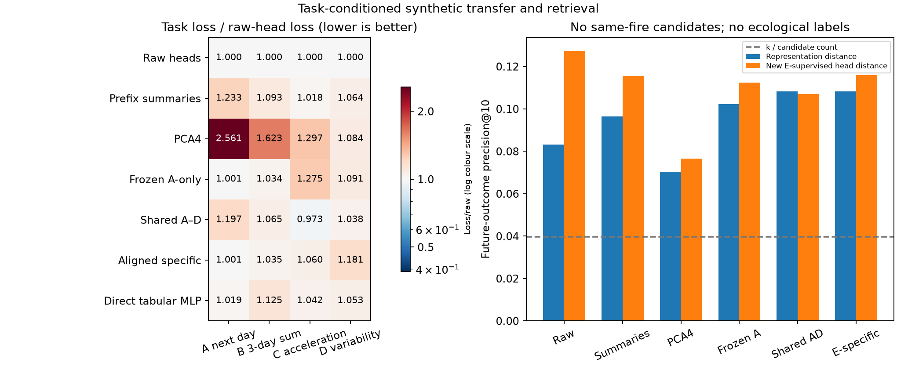
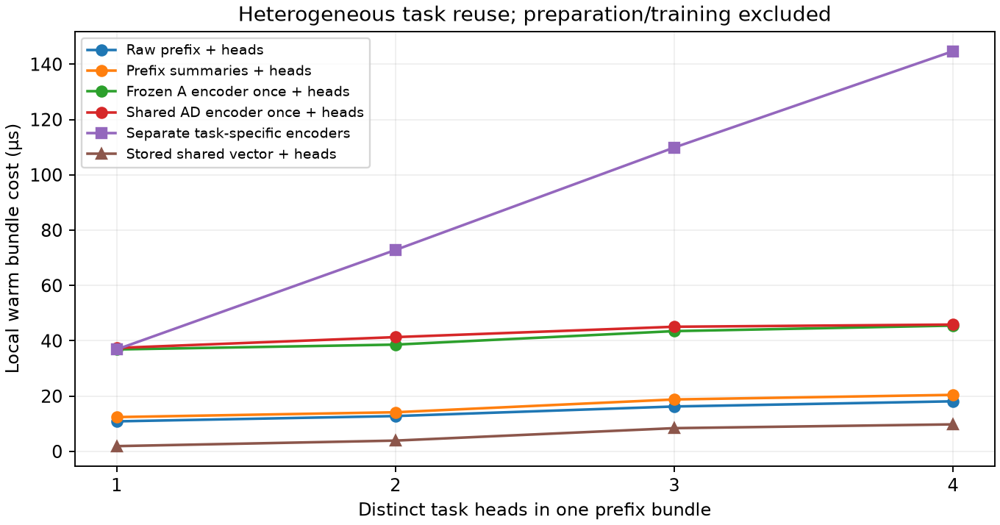

# Fire VASE representation utility — Milestone 5

21 November 2026. **WORKING synthetic cross-task investigation. No real-fire or
real-agent evidence.** All frozen M1–4 artifacts and upstream remain unchanged.

## Main result

The original next-day-trained embedding is not a generally adequate substitute for
strong raw-prefix models. Frozen A-only features underperform raw heads on the
three new predictive tasks. Joint training improves the acceleration comparison
but worsens next-day prediction. Separate task-specific training does not consistently
help. Learned distances align better with future-pattern relevance than raw distances,
but supervised raw-data retrieval heads reverse that ordering.

A shared encoder saves computation relative to four separate neural encoders;
direct raw-data heads are cheaper in this measured bundle. These findings distinguish
restricted transfer, extra supervision, metric learning and reuse without presuming
that shared or task-specific embeddings win.

## Protocol, audit and independent outcomes

The [audit](transfer-audit-m5.md) separates raw input information, learned A-only
supervision, downstream-head recovery and unknown general utility. The
[frozen protocol](transfer-protocol-m5-v1.md) and
[configuration](config/transfer-m5-v1.json) precede retained B–E evaluation. Reuse the
exact M4 cohort, train-only preprocessing/PCA and selected A encoder; verify all
snapshot hashes and exact prefix support/availability identities. Original weights
are unchanged before and after the run.

The cohort has 128 training / 48 validation / 64 test fires, four prefixes each
(3/5/7/10 observations), giving 512/192/256 cases. All prefixes stay with their fire.
Validation-selection and calibration use distinct sets of 24 fires. A performance
was already observed in M4: this is **new task evaluation on an existing cohort**,
not a new independently hidden dataset.

| Task | Target from canonical observations | Primary loss / ranking |
| --- | --- | --- |
| A | Next daily increment | log-growth MSE |
| B | Sum of next three daily increments | log-total MSE |
| C | Mean next-three growth strictly exceeds mean last-three observed growth | Brier; fixed zero relative-change threshold, equality false |
| D | Population SD of next-three growth, ddof=0 | log-variability MSE |
| E | Top-ten neighbors in next-three log-increment outcome geometry | precision/recall@10, rank Spearman |

B–D are independently checked using Fraction/pairwise identities; missing future
support fails closed. E references are held-out future observations, never embedding
coordinates or ecological labels. Tasks share future observations and are statistically
dependent. No completed-fire normalization or future input enters a predictor.

## Representation strategies and predictive results

Compare raw ridge/logistic, interpretable summaries, PCA4, frozen A-only4, shared AD4,
aligned task-specific4 and direct tabular MLP. Shared/end-to-end neural controls and
all cross-specific head results are retained, not selected after seeing winners.
B–E frozen-transfer heads use training labels; this is not zero-shot prediction.
Joint/specific encoders receive extra supervision, which is explicitly not A-only
transfer. All representations use identical source information and query targets.

Three fixed initialization seeds per newly trained group, 120 fixed epochs and
validation-only selection. TCN trunk 172 parameters; scalar-head 177, four-head 192,
future-vector 187. Tabular MLP equivalents 168/183/178. Downstream heads/probes add
parameters and training, so exact capacity equality is not claimed. All 33 new
checkpoints, training curves/costs and selected seeds are retained.

| Strategy | A MSE ↓ | B MSE ↓ | C Brier ↓ | D MSE ↓ |
| --- | ---: | ---: | ---: | ---: |
| Raw heads | 0.060737 | 0.114779 | 0.160051 | 0.124811 |
| Interpretable summaries | 0.074885 | 0.125463 | 0.162906 | 0.132788 |
| PCA4 | 0.155574 | 0.186318 | 0.207585 | 0.135305 |
| Frozen A-only | 0.060796 | 0.118626 | 0.204011 | 0.136228 |
| Shared AD | 0.072711 | 0.122286 | 0.155780 | 0.129519 |
| Aligned task-specific | 0.060796 | 0.118836 | 0.169666 | 0.147380 |
| Direct tabular MLP | 0.061918 | 0.129121 | 0.166828 | 0.131453 |

These are descriptive losses on the same test cases. A-only transfer does not beat
raw on B/C/D. Shared AD yields the lowest displayed C loss but its paired advantage
against raw is 0.004271, with descriptive 95% fire-resampling interval
[-0.014352, 0.023531]. Frozen A's C deficit is -0.043960
[-0.064448, -0.023051] in raw-minus-method units. Do not call this wildfire population
significance. Average paired prefix losses within each fire before 1,000 empirical
fire resamples, conditional on fitted models; no refit or multiple-testing guarantee.

The [full tables](results-tables-m5.md) and
[evaluation](results/milestone-5-transfer-v1/evaluation.json) include original-unit
MAE, regression interval coverage/width, classification reliability/log loss/ECE,
prefix-depth and synthetic generator strata. No task or metric was removed because
it disfavored embeddings. No independent scientific accuracy threshold is invented.

## Retrieval and information preservation

Direct representation-distance P@10: raw 0.0832, summaries 0.0965, PCA 0.0703,
frozen A 0.1023, shared AD 0.1082, E-specific 0.1082. Corresponding explicitly
E-supervised head distances: raw 0.1273, frozen A 0.1125, shared AD 0.1070;
direct E MLP 0.1336. A learned metric improves on a generic raw metric, but strong
outcome-trained raw/capacity controls remain better here.

Same-fire prefixes are always excluded. Query/gallery vectors and scaling never fit
on test outcomes; relevance is grader-only. Top-ten chosen/relevant sets mean recall
and precision coincide. Chance k/gallery is 0.0397. Spearman averages tied ranks;
paired retrieval intervals also aggregate by fire. Relevance is mathematical future-
outcome similarity, **not ecological analog discovery**.

Independent observed-property probes test total scale, temporal mass centroid,
recent growth, recent acceleration, strict interior-local-maxima count and observed
variability. This local-maxima definition is distinct from upstream prominence pulses.
Linear and higher-capacity RBF probes are fit on training data only. The
[complete CSV](information-probes-m5.csv) and
[diagnostics](results/milestone-5-transfer-v1/information_probes.json) retain all views.

For example, frozen A ordering-centroid descriptive R² rises from 0.331 with a linear
probe to 0.508 with the nonlinear probe; PCA rises from 0.153 to 0.740. Failed linear
recovery is therefore not evidence of absence. Raw numeric inputs are invertible for
supplied observations within floating precision, but successful learned probes do
not establish exactness or causal understanding. Accepted source completeness is
constant true; invalid schedules fail contracts rather than receiving a fabricated
learned completeness score. Retained source lineage still identifies observations.

## Perturbations and reuse

Permutation, fourfold scaling, equal-total reversal and nominal-ID renaming are
applied to all held-out representation/task heads. Query-only E perturbations hold
the gallery and future relevance fixed and record ranking/precision changes. These
are sensitivity diagnostics, not observed ecological counterfactuals. Scale changes
matter for absolute A/B/D; C's relative criterion is invariant only when observed
and future increments are jointly scaled. No universal order/scale invariance.
Nominal IDs change no numeric representation. Observation removal/changed resolution
are rejected; this is support-aware abstention, not measured missingness accuracy.

Four distinct task heads per prefix cost about 45.9 µs with shared AD on demand,
versus 144.7 µs for aligned separate encoders. Raw heads cost 18.1 µs, summary heads
20.5 µs, stored shared-vector heads 9.8 µs, cached complete bundle 0.17 µs.
These are local warm CPU/interface measurements at each model's observed accuracy,
not complete lifecycle or matched-scientific-acceptance winners.

Current training across all new strategies costs 6.159 seconds wall. Historical A
acquisition (~0.988 seconds) is separate, not a new sample or a free shared resource.
[Reuse economics](results/milestone-5-transfer-v1/reuse_economics.json) records each
K=1/2/3/4 task bundle, head fits, encoder training, materialization construction,
file read/write, coordinates/file bytes and identity. Retrieval serving-distance timing is in the retrieval artifact.
Materialized and on-demand outputs agree using the same heads/weights. File byte
counts exclude common lineage/checkpoints and cannot establish whole-interface savings.

Identical complete-bundle caching is different from heterogeneous/new-head reuse.
The [utility map](utility-map-m5.md) derives conditional break-even formulas including
training/preparation. Source/recipe/preprocessing/model changes invalidate affected
vectors/predictions; head changes invalidate predictions. Real refresh frequency,
storage-service pricing and human maintenance/review labor remain unknown.

## Reproducibility and boundaries

The first complete matrix is preserved under ignored run history. A metadata-only
hardening added explicit prefix-availability fingerprint verification and compact
row-level lineage; the release replay has **the identical evaluation digest**.
No task, target, hyperparameter, checkpoint selection or predictive outcome changed.
The [development ledger](development-ledger-m5-v1.json) distinguishes these executions
from independent samples. The final snapshot is
[manifest](results/milestone-5-transfer-v1/manifest.json), with frozen source/model
identities, all checkpoints, targets, predictions, probes, controls and costs.

Complete offline suite: **339 passed, two skipped**, including 13 new transfer tests.
Checks cover independent targets, mixed-objective finite-difference gradients,
classification/regression heads, frozen A equality with M4, retrieval exclusions,
paired fire aggregation, checkpoint roundtrip and a complete tiny transfer run.
Strict documentation build and generated schema/reference/architecture accompany
the static figures and manuscript tables. No historical output or upstream file changed.

[Unsupported claims](unsupported-claims-m5.md) remain explicit: no ecological
interpretation, real-agent result, zero-shot transfer, exact general scientific
preservation, necessary architecture, population inference or universal cost boundary.
Reproduction: [website guide](../../../docs/analysis/fire-vase-transfer.md).
