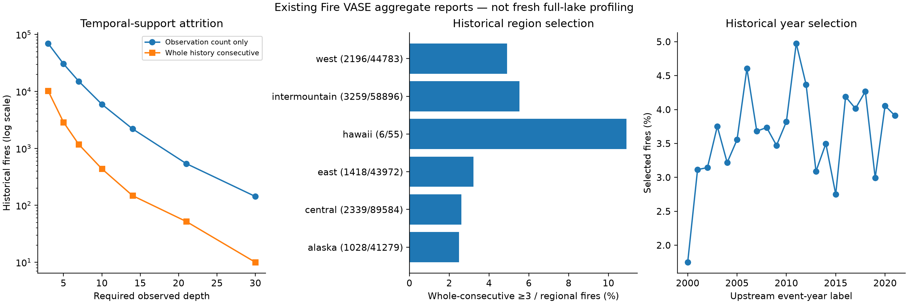

# Milestone 7.2 — partial empirical assessment from historical aggregate evidence

**Status: historical aggregate reanalysis completed; fresh real-row profiling BLOCKED.**
No observation records or array values were read. No models were trained. This is not the requested fresh full-lake population census. Internal outputs have no publication/redistribution clearance.

## What was actually executed

- Re-statted the complete canonical lake: 646 files, 40,318,194,810 bytes, unchanged from M7.
- Rechecked four sidecars: two 32,768-byte SHM files and two zero-byte WAL files. Stat evidence does not establish authorship, contents or checkpoint consistency. No sidecar was removed or source modified.
- Six size discrepancies concern documentation/configuration/schema files. No inference about observation changes or current hashes follows.
- Recomputed historical cohort arithmetic directly from existing upstream aggregate CSV/JSON reports. Input hashes and reproducible script are retained; no individual-fire table, raster or geometry was opened.
- Invoked the existing real-profile preflight. It rejected the unapproved review before opening a binding or creating an output directory. See `profile-preflight.txt`.
- Recorded the reported “yes this is fine” statement as investigator intent, with attachment provenance; preserved the later direct request to use the whole lake. Neither is labeled an authenticated review receipt.

## Historical population and observation support

Existing upstream reports describe **278,569 fires**, **627,033 native daily rows**, and **626,102 cached daily rows**. The historical cache audit reports 931 native rows absent from the cache. Those sources must be reconciled before claiming all-lake completeness. Duplicate/missing dates and observed zero increments were reported as zero in that historical audit; these have not been independently verified against current bytes.

One-observation fires account for 57.82% of the historical catalog; two-observation fires account for 17.21%. Of 347,533 within-fire adjacent row pairs, 196,611 (56.57%) have exact one-day separation; 150,922 have longer gaps. The number of unobserved calendar days is not supplied by that pair count. Missing dates, gaps and observed zero increments are different quantities.

## Correcting the 3.68% interpretation

Upstream `scripts/fire_vase_v2.py` requires **every date in the retained fire history to be consecutive**, no duplicates, valid growth, and at least three observations for the primary morphology cohort. Therefore 10,246 / 278,569 = **3.6781%** reproduces the historical primary fraction, not the fraction containing any local three-day run. Gappy histories may still contain supported local prediction windows. The broader local-run population is currently unknown.

| Required depth | At least this many observations, regardless of gaps | Whole-history consecutive fires | Consecutive windows within that historical subset |
| --- | --- | --- | --- |
| 3 | 69,546 | 10,246 | 24,855 |
| 5 | 30,538 | 2,887 | 9,486 |
| 7 | 15,036 | 1,171 | 4,796 |
| 10 | 5,956 | 438 | 2,205 |
| 14 | 2,201 | 148 | 1,015 |
| 21 | 540 | 52 | 342 |
| 30 | 143 | 10 | 110 |

Counts at different thresholds overlap. “Whole history” means the retained observed history; it does not prove complete ignition-to-extinction coverage. The observation-count column is not a consecutive-support estimate.

## Historical subset prediction opportunities

For a whole-consecutive history of length L, depth d and horizon h contribute max(0, L-d-h+1) dependent windows. This calculation was independently checked by summing length-tail counts. It excludes local runs inside gappy histories and assumes only the documented historical cohort, not freshly verified current source values. Acceleration and variability require h≥3 under the existing proposed protocol; their scientific acceptance has not been granted.

| Input depth | Future horizon | Fires in historical subset | Dependent windows |
| --- | --- | --- | --- |
| 3 | 1 | 5,123 | 14,609 |
| 3 | 3 | 1,803 | 6,599 |
| 3 | 7 | 438 | 2,205 |
| 7 | 1 | 830 | 3,625 |
| 7 | 3 | 438 | 2,205 |
| 7 | 7 | 148 | 1,015 |
| 14 | 1 | 121 | 867 |
| 14 | 3 | 93 | 646 |
| 14 | 7 | 52 | 342 |
| 30 | 1 | 9 | 100 |
| 30 | 3 | 8 | 83 |
| 30 | 7 | 6 | 56 |

The ≥3 morphology sample is not the available next-day training sample: a depth-3/next-day task needs four consecutive observations. In this documented subset that leaves 5,123 fires, not 10,246. A depth-30/next-seven-day task leaves only six fires and 56 overlapping windows. Multiple windows do not restore independent-fire replication.

## Selection bias that can already be demonstrated

Whole-consecutive ≥3 selection is 2.49% in Alaska, 2.61% central, 3.22% east, 5.53% intermountain and 4.90% west. Hawaii is 6/55 (10.91%); that small denominator precludes a broad regional conclusion. Intermountain fires increase from 21.14% of the full catalog to 31.81% of the historical primary cohort; Alaska decreases from 14.82% to 10.03%. These are descriptive upstream region labels, not newly validated geospatial associations.

Year-specific selection also varies. Historical weather-complete counts are 237,235, with all 41,279 Alaska and 55 Hawaii events excluded. Within the primary morphology subset, 9,212 are weather-complete. Historical weather-complete and incomplete populations differ in mean duration (3.34 vs 2.35 days) and mean observation count (2.32 vs 1.82). These compare weather selection, not a direct long-history size-bias estimate. Native quality, size-stratified long-history selection and environmental support need fresh reviewed profiling.

Figure: analysis of existing aggregate reports, not current source observations. Region denominators are displayed; year labels come from upstream event metadata. PDF/SVG versions are retained for internal review, without publication clearance.

## Consequences for the representation experiment

1. Separate all-fire descriptive, local-run prediction and whole-history morphology cohorts. A single global sample size would hide the strongest selection effect.
2. Prioritize local-run profiling before deciding long-depth tasks are infeasible. It can legitimately retain windows from otherwise gappy fires without imputing missing dates.
3. Keep raw/summary/PCA/neural comparisons on identical task-specific examples. Do not assign greater apparent neural sample size by counting correlated windows as fires.
4. Treat deep-window tasks as feasibility questions. The historical strict subset is too small for sweeping depth-30 model claims, even though the archive contains 40 GB.
5. Freeze task cutoffs and scientifically meaningful differences before test inspection. Do not choose a favorable region/year using these observed selection patterns.
6. Propose temporal and geographic whole-fire holdouts only after current identities and task eligibility are known. No actual fire-ID split has been generated from aggregate tables. Nested training fractions remain 1%, 3%, 10%, 30%, 100%; exact training counts are unknown until splits and overlap are reviewed.

## Statistical power and resource limits

Actual power is **not estimable from these aggregates alone**: it needs task-specific held-out fire counts, paired loss variance, year/region dependence, a reviewed minimum meaningful effect and model-training variability. Under an explicitly hypothetical independent-fire model with comparable variance, standard error scales as 1/sqrt(n). Moving from 10,246 to 1,171 fires inflates it by 2.96×; this is a planning ratio, not measured predictive uncertainty or a power estimate. No current-source prediction outcomes were inspected.

No full-lake throughput, decoder memory, training time or encoder cost was measured. The implemented reader uses bounded projected batches, but physical Parquet pages may exceed logical batch size. Current full hashes have not been computed; no formerly verified current identity was found to reuse. Rehash only relevant approved source containers, not every figure and document. Historical source hashes do not establish current identity.

## Specific unresolved execution requirements

The investigator request establishes intent for internal scientific analysis. The milestone brief explicitly says **“Do not fabricate an externally verified human-review receipt or treat this statement as resolving all existing authorization gates.”** The existing amendment requires an externally verified attributed review. Only a typed receipt contract was found, not an authenticated identity service or an actual externally verified receipt. No assistant-generated PASS record has been created.

To execute the existing real reader, the applicable review must establish: (a) an attributable verified approval for profiling and its required native-binding/harmonization scope; (b) FIRED internal-use rights/attribution evidence; (c) exact approved native identity/date/area/support/quality policy and source binding digest; (d) approved byte verification followed by current matching source hashes. Source daily area can remain a native value during inspection; physical growth-rate equivalence need not be invented. The source date is not operational availability.

Publication may be NOT_APPLICABLE for internal profiling, availability may be NOT_APPLICABLE for retrospective reconstruction, and training effect sizes are not required for profiling. They are not the actual blocking requirements. No publication or training approval is requested for this work. The current draft reports those jurisdictions NEEDS_EVIDENCE; a real reviewer must explicitly establish applicability rather than an assistant silently converting findings.

## Source binding evidence and exact decisions

| Binding | Available evidence | Remaining decision |
| --- | --- | --- |
| Event ID | Native `id`; builder maps to `fire_id` | Approve exact release/key policy and source/cache reconciliation |
| Date | Native date field; exact-calendar checks in corrected code | Approve date-bin interpretation without invented availability |
| Daily increment | Builder copies `dy_ar_km2` into `ring_area_km2` | Review native meaning/units; do not generalize across products |
| Cumulative area | Builder cumsums retained observed increments | Approve explicitly derived observed-prefix sum; catalog `tot_ar_km2` remains distinct |
| Missing/zero | Existing validators distinguish null, absent dates and observed zero | Approve exclusion/reporting policy; never impute absent days |
| Quality/uncertainty | Original measurement QA survival unresolved | Preserve unknown; approve which findings affect task eligibility |
| Geometry/environment | Schemas/caches exist | No support association or spatial/environment approval established |

## Deliverable status

Historical population arithmetic, depth/window tables, year/region selection, figures, source/report provenance and investigator intent: **completed**. Fresh unique-fire census, native/cache reconciliation, local-run eligibility, duplicate/ambiguity distributions, current geographic/size/quality strata, actual fire splits, source-specific power and full-lake resource measurements: **blocked / unmeasured**. This does not satisfy the full empirical profiling objective yet.

## Unsupported claims

No current population verification, authenticated receipt, source rights clearance, scientifically reviewed equivalence, approved harmonization, fresh local-run counts, ecological analog validity, operational forecasting, new embedding benefit, model training, public output permission or all-lake completeness is claimed. Historical aggregates are not relabeled as current source measurements.

## Validation and preservation

Full relevant suite: **377 passed, 2 skipped**; strict MkDocs build: **passed**.
Historical aggregate calculations passed reconciliation and independent-window-formula
assertions. Frozen M1–7 recorded artifact hashes all match (`frozen-integrity.json`);
upstream Git status is clean. Figures were visually checked. No claim of a successful
real-row profiling run follows from these validations.
