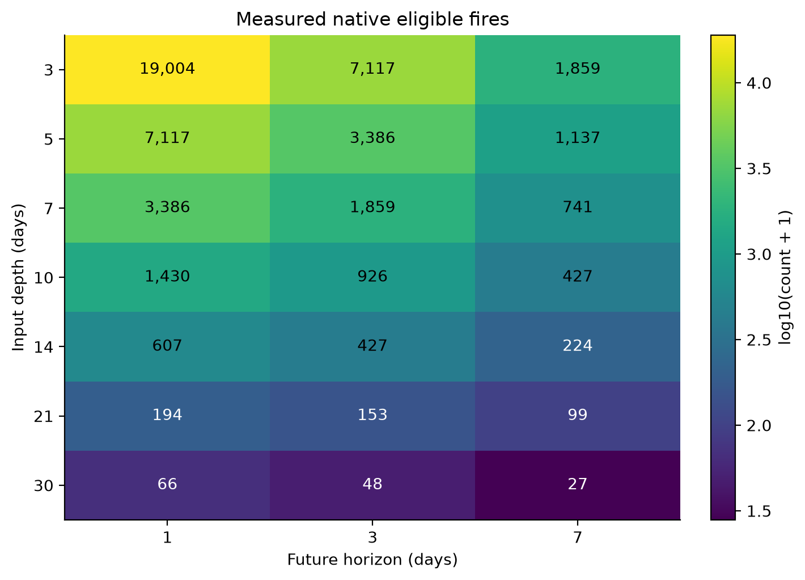

# Real Fire VASE population census

**CURRENT REAL OBSERVATIONS — internal-use outputs; no model training or publication performed.**

The complete relevant native daily/event GeoPackages and cached daily/trait Parquet
containers were freshly hash-verified and decoded without a pilot row cap. All four
full-container hashes match their historical identities. Climate raster arrays and
unrelated figures were not read: they are not needed to count the fire population.
No source file was modified. The investigator’s direct instruction superseded the
separate-receipt requirement for read-only internal profiling; no fictional receipt,
reviewer identity or domain PASS finding was created.

## Complete native/cache accounting

| Quantity | Native daily | Cached daily |
| --- | ---: | ---: |
| Distinct fire IDs | 278,865 | 278,569 |
| Daily records | 627,033 | 626,102 |
| Supported valid date/area records | 627,033 | 626,102 |
| Observed zero increments | 0 | 0 |
| Missing daily values | 0 | 0 |
| Invalid/nonfinite/negative daily values | 0 | 0 |
| Missing/unsupported dates | 0 | 0 |
| Duplicate event-date rows | 0 | 0 |
| Exact one-day intervals | 196,982 | 196,611 |
| Longer inter-record gaps | 151,186 | 150,922 |
| Unobserved calendar days inside gaps | 263,312 | 262,683 |

The event catalog contains **278,569 unique IDs**, with no missing or duplicate IDs.
Native daily observations contain **278,865 IDs**. The difference is 296 unmatched
native IDs, not a normalization collision or newly approved event merge. They remain
separate and retain unknown catalog year/region/size. Cached cumulative values are
finite/nonnegative in all 626,102 cached rows; this is a value check, not independent
validation of their scientific interpretation. Native `tot_ar_km2` is not differenced
or substituted as a daily increment.

## Local runs unlock substantially more usable histories

A supported run contains consecutive original calendar-day bins with valid
nonnegative native values and unique dates. Duplicate dates, missing/invalid values
and gaps break support. No gap filling, interpolation or cross-fire combination occurs.
“Strict history” describes the retained record, not full ignition-to-extinction coverage.

| Minimum run depth | Fires with a local run | Maximal qualifying runs | Within-run windows | Entire-history-consecutive fires |
| --- | ---: | ---: | ---: | ---: |
| 3 | 34,911 | 39,693 | 101,035 | 10,260 |
| 5 | 11,195 | 11,828 | 40,724 | 2,891 |
| 7 | 4,777 | 4,932 | 21,479 | 1,172 |
| 10 | 1,859 | 1,896 | 10,570 | 438 |
| 14 | 741 | 749 | 5,131 | 148 |
| 21 | 224 | 225 | 1,883 | 52 |
| 30 | 73 | 73 | 593 | 10 |

Native ≥3 local-run coverage is **34,911/278,865 = 12.52%**, compared with **10,260**
strict whole-consecutive ≥3 histories, a **3.40×** increase in fires. On the exact
historical cache population, the fresh result is **34,852 local-run fires** versus
**10,246 strict fires**, retaining the historical strict count while broadening
local-run coverage. The older 3.68% headline described strict histories, not local runs.

## Complete depth × horizon matrix

Cells below are eligible independent fire counts; dependent window/run counts,
median/max windows per eligible fire, cache comparisons and strata are in
`depth-horizon-eligibility.csv` and `eligibility-strata.csv`.

| Input days | Future 1 day | Future 3 days | Future 7 days |
| --- | ---: | ---: | ---: |
| 3 | 19,004 | 7,117 | 1,859 |
| 5 | 7,117 | 3,386 | 1,137 |
| 7 | 3,386 | 1,859 | 741 |
| 10 | 1,430 | 926 | 427 |
| 14 | 607 | 427 | 224 |
| 21 | 194 | 153 | 99 |
| 30 | 66 | 48 | 27 |

For depth3/horizon1, **19,004 fires**, **20,618 runs** and **61,342 overlapping
windows** are distinct sample sizes. For depth7/horizon3, the corresponding counts
are **1,859 / 1,896 / 10,570**. These same-support counts establish candidate task
feasibility, not predictive or ecological validity. All target days are supported;
original measurement QA, uncertainty and operational availability remain unknown.

## Reproducibility and resource evidence

The full successful replay decoded 1,253,135 daily records (native plus cache), took
73.55 seconds and used 313,917,440 bytes peak process memory. Exact source/cache
records are reconciled through compact key/value hashes and row references; no raw
or harmonized daily measurement dataset or prediction tensors were persisted.
Metadata products are approximately 0.7 GB, mostly the reconciliation key index.
Full-container verification covered 893,563,713 bytes; filesystem physical I/O bytes
are unmeasured and are not substituted with that logical total.

Independent replay gave identical census JSON, byte-identical run/profile Parquet
files and identical fire/run/window/gap metadata rows. The initial Arrow writer
failed when a later batch had all-null quality columns; the failure and partial
file were retained, the schema handling was corrected, and stage restart reused
completed source streams. A dedicated test now covers that batch-boundary defect.

See `replay-validation.json`, `profiling-resource-report.json`, source hashes and
validation logs. All nine requested figure families are generated in PDF/SVG/PNG.
They are internal scientific artifacts, not published or independently reviewed
scientific conclusions. Earlier M1–7 frozen evidence remains separate.

## What this means for the embedding experiment

We have enough supported short-depth fires for a substantial raw/features/PCA/neural
comparison. The critical scientific test is now representation utility under
whole-fire and geographic/temporal separation, rather than whether any sequences
exist. Longer-depth comparisons remain sharply constrained: depth30/horizon7 has
only **27 fires**, so 246 windows must not be presented as 246 independent trials.
Quality/uncertainty, support, source coverage and long-history selection must accompany
any later skill claim. No model has yet been trained on these real cohorts.

Companion reports: [reconciliation](native-cache-reconciliation.md),
[selection bias](selection-bias-report.md), [feasibility](scientific-feasibility.md),
[unsupported claims](unsupported-claims.md).

## Final validation

**389 passed, 2 skipped** in the full repository suite; **12 profiler tests passed**;
strict MkDocs build passed. All nine figure families were visually checked. Frozen
M1–7 report-output hashes still match, and upstream Git status is clean. The complete
replay checks 557,434 fire summaries, 859,542 run summaries, 100,354 nonempty per-fire
depth/horizon records and 17 gap-distribution entries for equality. Native/cache
source containers still match verified sizes/mtimes after execution.

The full profiler replay snapshot is retained as `executed-replay-source.py`. The
current source adds an explicit final source-stat guard; equivalent postflight
source-stat validation was also executed and recorded for this measured run.
