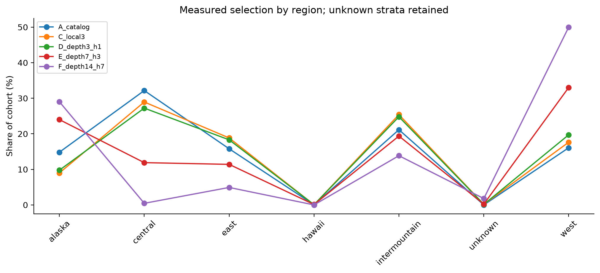
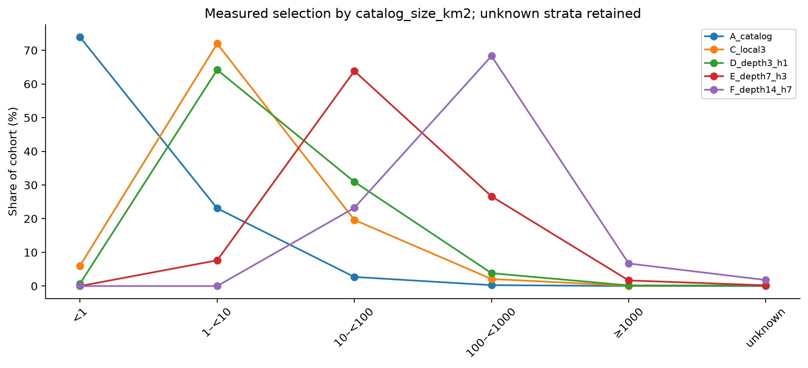

# Scientific selection bias

**CURRENT REAL OBSERVATIONS — internal-use outputs; no model training or publication performed.**

The requested populations are measured in `population-summary.json` and their full
year/region/size/count/span/gap distributions in `selection-distributions.csv`:

| Population | Fires |
| --- | ---: |
| A_catalog | 278,569 |
| B_valid_native | 278,865 |
| C_local3 | 34,911 |
| D_depth3_h1 | 19,004 |
| E_depth7_h3 | 1,859 |
| F_depth14_h7 | 224 |
| G_strict | 188,723 |

A is the event catalog; B contains valid native daily IDs and therefore includes
296 additional unmatched IDs. These populations are not a sequential nested funnel.
G includes one-observation histories that are vacuously consecutive; morphology
comparisons must additionally require ≥3 observations. The strict ≥3 counts are
reported separately. Unknown attributes are retained rather than assigned to zero.

## Geography and temporal depth change the population

At local depth≥3, catalog-linked eligibility is Alaska 3,137/41,279 (7.60%), central
10,105/89,584 (11.28%), east 6,575/43,972 (14.95%), intermountain 8,866/58,896
(15.05%) and west 6,154/44,783 (13.74%). Hawaii is 15/55, a small denominator.
Another 59 local-run fires lack a catalog region. These are source-provided
`fire_traits.region` labels, not a newly calculated scientific spatial association.

For depth14/horizon7 the population contains 224 fires: its regional composition
is heavily shifted toward west/Alaska, unlike the catalog. Such contrasts concern
source support/observation selection; they do not establish ecological causes.
Year distributions use catalog ignition-year metadata; unmatched IDs retain unknown
event year even though their observation dates are preserved. Partial edge years
and source coverage must remain distinct from fire behavior.

## Fire size, gaps and environmental metadata

Measured source-catalog size selection is substantial: 205,970/278,569 catalog fires
(73.94%) are below1 km²; 25,128/34,911 local≥3 fires (71.98%) fall in1–<10 km²;
153/224 depth14/horizon7 fires (68.30%) fall in100–<1000 km². These compare cohort
composition using source-reported area classes, not causal ecological mechanisms.
A model comparison confined to these temporal cohorts cannot automatically generalize
to all catalog fires.

Figures compare source catalog-total size classes; CSVs additionally report classes
of summed retained native increments. The latter is a deterministic observed-area
summary, not a complete life-cycle reconstruction across gaps. Size bins are
<1, 1–<10, 10–<100, 100–<1000 and ≥1000 source-reported km², used as descriptive
strata rather than ecological equivalence or supervised labels. Observation count,
calendar span and gap distributions are retained for each selected cohort.

The cache flags 550,961/626,102 rows as `climate_available`, and 237,235 fires have
that flag for every cached row. This is source metadata, not verified environmental
alignment, native burn-area QA, physical uncertainty or operational availability.
Native sensor QA and measurement uncertainty are unknown for all counted support
windows. Missing QA is not evidence of high quality. Geometry was not decoded or
validated for scientific use; spatial/environment tasks remain independently scoped.

All charts use actual current cohort metadata. Fractions show composition within a
cohort; they are not the probability of selection from the catalog. Unknown strata
and cohort denominators are retained in CSVs. No ecological-causal interpretation
or representative wildfire-population claim follows from observed-support coverage.
