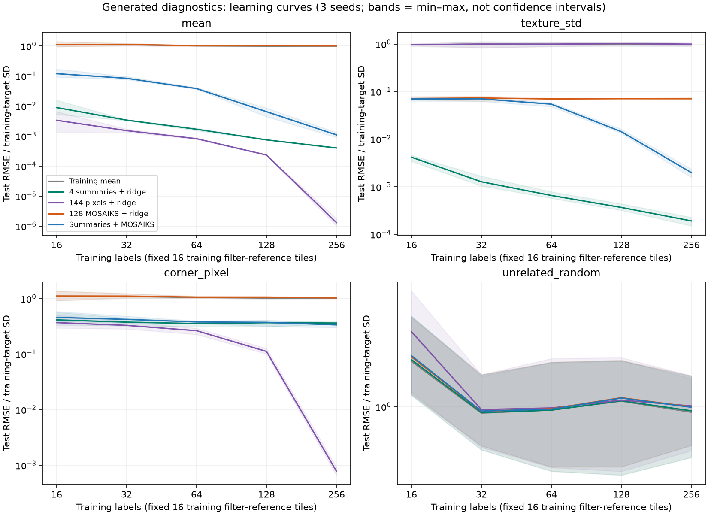
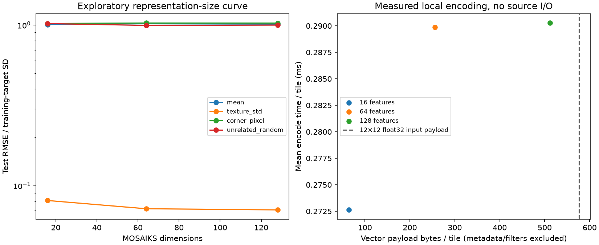
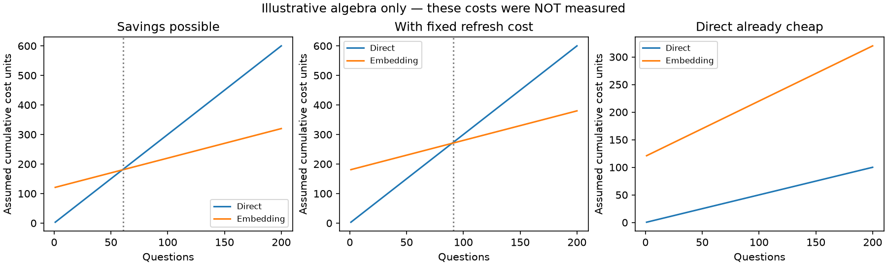

# First generated benchmarks — 20 November 2026

Status: **WORKING** offline diagnostic; broader utility question **UNDER ANALYSIS**.
No agents, source downloads or independent scientific labels were used.

## Design

Three paired generator/encoder seeds; 448 independent generated 12×12 tiles per
seed; 256/64/128 train/validation/test. Nested labeled subsets of 16–256; filters
always see the first 16 training tiles only. MOSAIKS uses 16/64/128 features,
3×3 kernels and explicit input scale 32. Train-only normalization, validation-only
selection among ridge alpha .01/1/100. No test-based setting selection.
All curves are exploratory, not a preregistered confirmatory test.

Targets: input mean, input standard deviation, top-left pixel and unrelated seeded
noise. Four summary features are mean/std/min/max; the pixel head receives all
144 values. Hybrid concatenates summaries and MOSAIKS. The mean/std summary arms
include their target deliberately: exact queries should be compared to simple
source operations. These are mechanics and information-loss tests, not independent
prediction labels. Synthetic reference matrices remain bounded in memory; no raw
or harmonized raster files are written. No pipeline gate is bypassed for real data.

## Observed endpoint

Mean across three seeds, 256 labels, 128 MOSAIKS features. Values are test RMSE
divided by training-target standard deviation; lower is better. A training-mean
baseline is around 1. Each target has its own scale. No significance claim.

| Target | Training mean | Four summaries + ridge | Pixels + ridge | MOSAIKS + ridge | Hybrid + ridge |
| --- | --- | --- | --- | --- | --- |
| mean | 0.999 | 0.000402 | 1.31e-06 | 1.01 | 0.00109 |
| texture_std | 0.967 | 0.000192 | 0.992 | 0.0707 | 0.00198 |
| corner_pixel | 1.01 | 0.362 | 0.000777 | 1.03 | 0.336 |
| unrelated_random | 0.986 | 0.989 | 1 | 0.999 | 0.999 |

MOSAIKS exposes texture to a linear head far better than pixels + linear ridge,
but the direct standard-deviation summary performs better still. Brightness and
exact-pixel queries favor direct inputs. Combining summaries with vectors restores
much brightness information but is not automatically better than summaries alone.
The unrelated-noise case stays near its mean baseline. This supports evaluating
information requirements and strong tools, not declaring one representation best.



Bands are min–max across three seeds, not confidence intervals or real geographic
replication. Compare within each panel; log axes amplify small differences.



Local encoding measurements include encoder validation but exclude patch generation,
source I/O, agent inference, head fitting and setup. One small run per setting does
not establish throughput or a cost frontier. Feature bytes exclude filters/metadata.



Cost curves use assumed abstract units, not measured agent prices or time.

## Reproduce and audit

Install repository `dev,embeddings,validation` extras in Python >=3.11. From root:

```sh
MPLCONFIGDIR=/tmp/embedding-study-mpl PYTHONPATH=src python reports/embedding_utility/run_first_benchmarks.py run/embedding_utility/new-run
python -m pytest tests/test_embedding_utility.py tests/test_mosaiks.py -q
```

The runner refuses an existing output directory. Rebuilding does not overwrite
this curated snapshot. Numerical results should reproduce within numeric tolerance;
timings and timestamps vary. No external services or model calls are made.

[Scores](first-benchmarks-v1/scores.csv) · [Timings](first-benchmarks-v1/timings.csv) ·
[Run manifest](first-benchmarks-v1/manifest.json) · [Assumed costs](first-benchmarks-v1/cost_scenarios.json).
The manifest hashes original run outputs and package sources. Figure basenames in
that manifest map to `../../figures/` in this curated snapshot; CSV/JSON files are
stored beside the manifest. All figures are project-authored generated diagnostics
or explicitly assumed algebra, with no third-party imagery.

Next: implement paired agent direct/embedding/hybrid tasks and measure correctness
versus full cost. No conclusion about actual agent performance follows from this run.

## Verification in this checkout

Full offline suite: 240 passed, 2 skipped. Focused analysis/MOSAIKS suite: 19 passed.
Strict MkDocs build passed; generated reference and architecture figures refreshed.
Curated output hashes, local analysis Markdown links and diff whitespace checked.
