# From Scientific Question to Harmonized Data

Report version 1.0. Narrative source also stored as report.json.

## 2. Finding files is only the beginning

Environmental observations were made by different communities, for different purposes. A shared label does not make two measurements comparable.

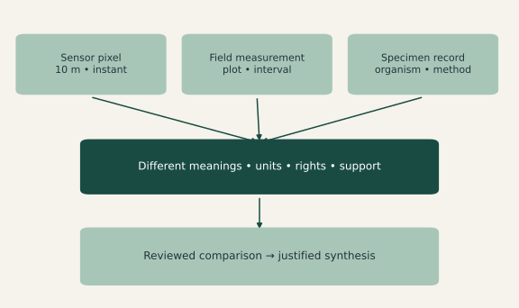

**Meaning must survive the journey.** Pixels, plots and specimens describe different things. The pipeline keeps their definitions, methods and spatial and temporal support visible before any scientific combination.

We built independently callable discovery, harmonization and representation modules. Models help propose interpretations; deterministic code checks and computes. Human review remains part of the scientific method at uncertain or consequential boundaries.

Evidence: AGENTS.md; src/dataset_prototype/contracts.py; docs/science.md. Claim class: PROJECT INTERPRETATION.

## 3. A scientific question becomes a reviewed computation

Discover sources. Understand their meaning. Harmonize only with evidence. Stream approved transformations. Represent the result for a defined analysis.

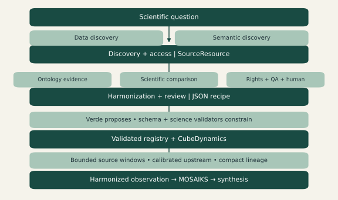

**AI proposes. Tested software computes.** The central recipe records scientific intent as typed JSON. CubeDynamics executes a bounded subset of reviewed transformations; MOSAIKS accepts the harmonized raster output.

Today this architecture is demonstrable offline, including the real external CubeDynamics package. Historical Sentinel retrieval and live Verde judgments exist, but the real Sentinel embedding path remains blocked by review. Synthesis science is the intended destination, not a validated result of this prototype.

Evidence: docs/architecture.md; docs/cubedynamics.md; run/cubedynamics-verified/manifest.json. Claim class: PROJECT RESULT.

## 4. A working prototype, with scientific gates still closed

The audited code exposes 17 registered operations, including 7 CubeDynamics operations. All 203 local tests pass in the integration environment.

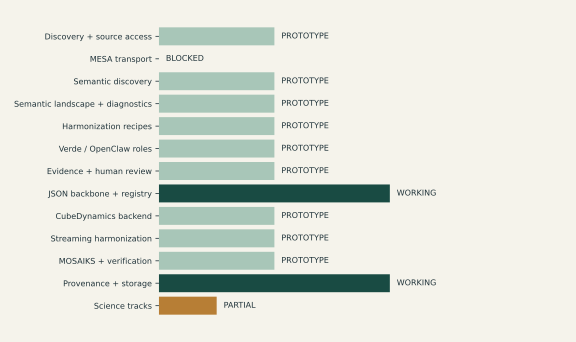

**Demonstrable does not mean production ready.** These statuses describe bounded repository capabilities. WORKING refers to a demonstrated local contract; PROTOTYPE indicates implemented but restricted behavior. MESA transport is blocked on a verified deployed interface.

What is missing: an expert-reviewed real-data release, independent downstream labels, broader support-changing representations and scale measurements. The immediate milestone is one approved bounded Sentinel demonstration with complete source, review and representation lineage.

Evidence: data/component_inventory.json; data/test_results.json; docs/PROTOTYPE_STATUS.md. Claim class: PROJECT RESULT.

## 5. A real pixel anchors the story

The retained source evidence is a Sentinel-2A near-infrared pixel acquired on 30 July 2023. The report reuses that historical evidence without another remote read.

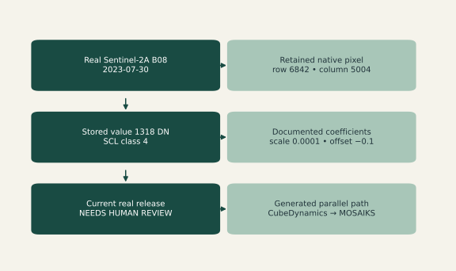

**The real observation and the generated demonstration are separate.** The historical pixel has native EPSG:32613 coordinates, a 10 m footprint and instantaneous support. Its extracted-window checksum covers the retained evidence, not the entire remote raster.

A separate historical review concerns a 15 July Sentinel scene and remains rejected/revision-needed. It is evidence about the review mechanism, not approval of this 30 July pixel. The successful CubeDynamics/MOSAIKS example uses explicitly generated data and fixture approval.

Evidence: run/real-sentinel/window-0.json; snapshot.json; run/scoped-sentinel-review-v4/report.json. Claim class: PROJECT RESULT.

## 6. A catalog describes an asset; an adapter preserves its meaning

Discovery records what exists and how it can be accessed. It must also retain sensor, version, license and native scientific metadata.

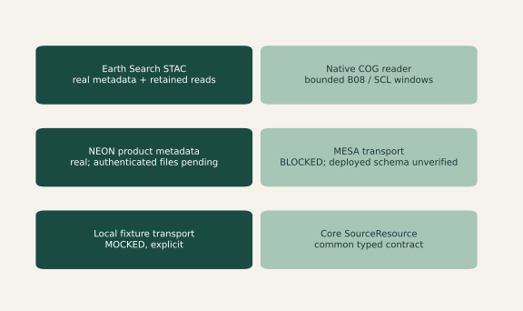

**A fixture is not an integrated data source.** Sentinel has actual historical retrieval evidence. NEON metadata access was demonstrated; authenticated observation retrieval and sensor-aware normalization are incomplete. Local fixtures exercise contracts without pretending to be live sources.

STAC is a catalog standard, not the whole architecture [2]. MESA is an external access/metadata boundary; its production integration is not implemented here [4]. This report does not count conceptual adapters as real source integrations.

Evidence: adapters.py; real_data.py; neon.py; stream_rasters.py; docs/development/integrations.md. Claim class: PROJECT RESULT.

## 7. Access, scientific decisions and computation have different jobs

The prototype keeps these responsibilities separate so that one system cannot silently substitute for another.

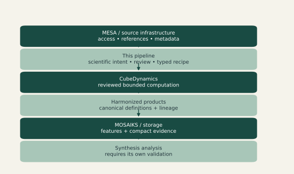

**CubeDynamics is an execution dependency, not a discovery replacement.** This is a responsibility diagram. The external MESA arrows are planned boundaries. Current native source readers remain upstream of CubeDynamics; no new CubeDynamics loader is called to duplicate discovery.

CubeDynamics contributes public pipe and verb operations backed by xarray/Dask [1]. This pipeline supplies source identity, reviewed meanings, resource limits and approval gates. A future MESA registration path must be built against verified deployed schemas, not guessed endpoints.

Evidence: docs/cubedynamics.md; docs/development/integrations.md; adapters.MESAClient. Claim class: PROJECT INTERPRETATION.

## 8. Evidence and judgment are different objects

A source statement, a calculated fact and a model opinion carry different scientific weight. The contracts retain those distinctions.

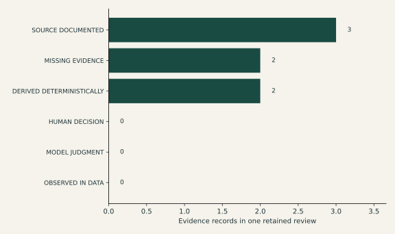

**Missing evidence remains visible.** Counts use only the seven evidence records in the retained scoped Sentinel review. Zero model-judgment and human-decision bars do not mean the project lacks those artifacts: reviews and decisions are separate objects, outside this array.

SOURCE_DOCUMENTED points to source assertions; DERIVED_DETERMINISTICALLY records reproducible calculations; MISSING_EVIDENCE records unresolved requirements. The source label is not a guarantee of truth: reviewers must check what the underlying document actually supports.

Evidence: run/scoped-sentinel-review-v4/report.json.evidence; review_contracts.py. Claim class: PROJECT RESULT.

## 9. Many communities describe different pieces of an observation

The local inventory contains 86 semantic resources, including ontologies, vocabularies, exchange standards and conceptual frameworks.

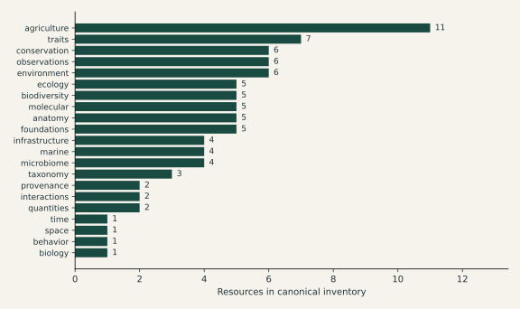

**Semantic diversity is useful context, not scientific equivalence.** Each resource has one inventory domain label; these counts are not global field sizes. Scope and coverage judgments are provisional project assessments, not authoritative ontology properties.

The inventory helps discover candidates for biological entities, traits, environments, observations, space, time, units and provenance. A candidate still needs exact-term and version checks before it can support a mapping. No universal ontology or universal latent space is claimed.

Evidence: data/semantics/semantic_resources.csv; assessments.jsonl; docs/semantics/index.md. Claim class: PROJECT RESULT.

## 10. An ontology and a catalog standard solve different problems

The resource inventory deliberately includes more than formal ontologies. Their types explain how each might contribute.

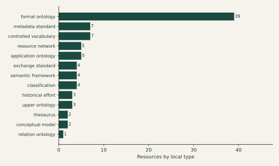

**A standard can organize metadata without establishing biological meaning.** Type counts are derived directly from the canonical CSV. Standards, vocabularies, frameworks and historical efforts remain distinguishable rather than being relabeled as ontologies.

For example, STAC can retain a sensor band description; it does not prove that satellite reflectance and a field trait measure the same quantity. Likewise, a taxonomy identifier helps preserve identity but does not justify aggregation from organisms to communities.

Evidence: semantic_resources.csv.resource_type; docs/semantics/distinctions.md. Claim class: PROJECT INTERPRETATION.

## 11. Meaning has accumulated through different kinds of infrastructure

This conceptual progression explains why several semantic systems may be needed for one scientific question.

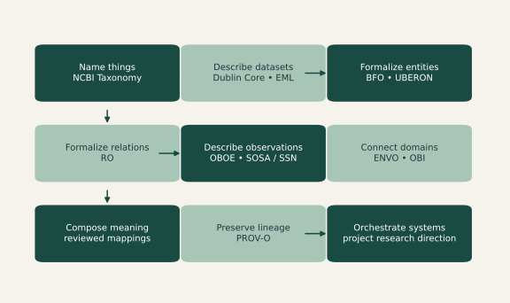

**This is not a strict chronology.** Stages overlap and earlier approaches remain useful. Named examples are inventoried resources; their placement is explanatory rather than a measured historical ranking. The inventory also records origin eras, including unknown dates.

The research direction is to orchestrate existing systems while preserving source meaning. It is not to replace them with a universal biological ontology. Expert review is needed to turn provisional resource assessments into justified scientific mappings.

Evidence: semantic_resources.csv historical_role, era, canonical_uri; docs/semantics/history.md. Claim class: PROJECT INTERPRETATION.

## 12. Scale is not one dimension

A 10 m pixel is a spatial support. An instantaneous acquisition is a temporal support. Neither identifies a biological organizational level.

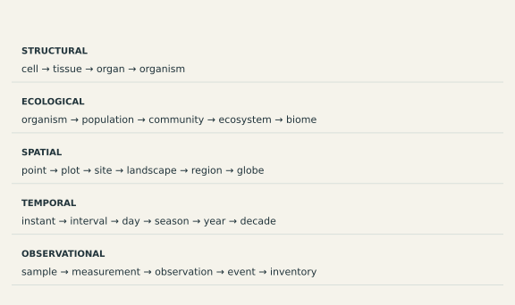

**Computational alignment is not scientific equivalence.** These parallel conceptual sequences are not interchangeable ladders. A coordinate match can make observations colocated while leaving their methods, quantities and supports scientifically different.

Resolution describes spacing or detail; support describes the region or interval represented by a measurement. The CubeDynamics adapter checks these separately. Its nearest sampling changes spatial support and needs review; it does not infer a field-to-satellite relationship.

Evidence: contracts.Support; cube_contracts.CubeInput; cubedynamics_backend.py; docs/semantics/scale.md. Claim class: PROJECT INTERPRETATION.

## 13. AI proposes. Tested software computes.

Models return scientific judgments and bounded plans. The executor chooses only implementations already present in the reviewed operation registry.

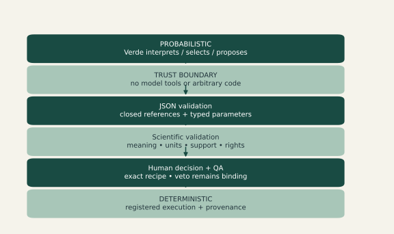

**Valid JSON is necessary, but not enough.** Schema checks reject malformed output and unknown choices. Scientific validators check compatibility and evidence. Model proposals require human review; changing scientific content invalidates prior approval.

OpenClaw is an isolated adapter/runtime boundary pinned to 2026.5.18. The Verde route and returned provider/model must match. Historical live inference exists, while the fresh report demonstration uses a fixture decision model and makes no live inference claim.

Evidence: decision_ir.py; cube_ir.py; model_agents.py; openclaw_backend.py; AGENTS.md. Claim class: PROJECT RESULT.

## 14. A blocked run can be a successful safety test

The retained real Sentinel review asked for revision. No approval, source access or embedding release was fabricated to make the demonstration appear complete.

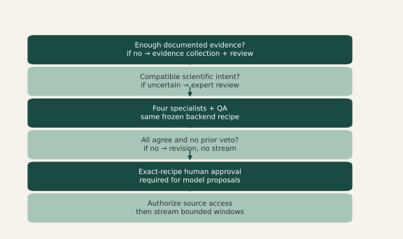

**Disagreement is preserved for scientific analysis.** The six-domain evidence review covers semantics, units, support, rights, integrity and quality. A separate frozen backend consensus involves four specialists and QA. Both are distinct from the human decision.

The historical model identified a native-CRS mismatch, missing rights evidence and unvalidated downstream quality. Its demand for a whole-raster hash may itself need expert correction: per-window evidence has a narrower valid scope. Later pointer validation rejects unsupported source references, so historical findings are not reusable executable approval.

Evidence: scoped_review.py; consensus.py; run/scoped-sentinel-review-v4/report.json; docs/development/sentinel-review-refactor.md. Claim class: PROJECT RESULT.

## 15. The recipe is an auditable scientific plan

The example is taken from the fresh generated run. Its metadata and code identities bind the reviewed intent to the exact execution context.

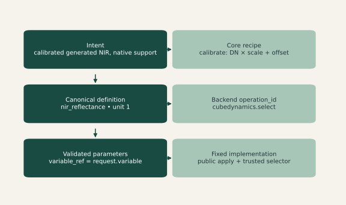

**The model selects an offered operation; it does not write the function.** The real recipe also selects a bounded full-window subset and July acquisitions. Backend parameters are closed references to reviewed configuration, not Python expressions. The full JSON is preserved with the editable report data.

A recipe digest binds mappings, operations and review. Source checksums, executor identity, backend version, encoder configuration and preprocessing identity prevent reuse under stale assumptions. Typed JSON is the interface; deterministic validators and scientific review enforce the meaning.

Evidence: run/cubedynamics-verified/harmonization_context.json; data/annotated_recipe.json; cube_ir.py. Claim class: PROJECT RESULT.

## 16. Seventeen operations, each with an explicit boundary

Ten core operations and seven CubeDynamics operations are exposed. Access and MOSAIKS are separate modules, not invented entries in this transformation registry.

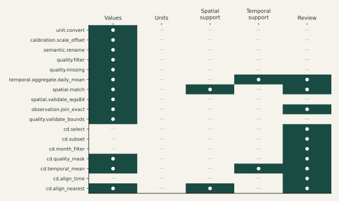

**Flags describe declared operation effects, not data-derived changes.** The matrix is generated from OperationDefinition metadata. Some core flags are broad defaults, not a complete scientific effect analysis; for example unit conversion and calibration must still validate units at execution. All model proposals require human review even when an operation-level flag is false.

Core categories include units, calibration, semantic rename, quality, temporal, spatial and exact observation join. No operation changes biological level. Registry metadata and exact implementations are provided in the appendix and machine-readable inventory.

Evidence: operations.REGISTRY version 2; cube_specs.py; data/operations.json. Claim class: PROJECT RESULT.

## 17. Stream the data instead of moving the world

The integration uses the actual external CubeDynamics 0.1.0rc3 package. Lazy plans defer values until an explicitly approved bounded compute boundary.

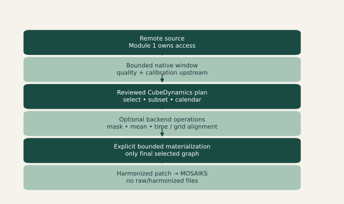

**Laziness is a capability, not proof of remote I/O savings.** Seven exposed operations use public pipe/verb APIs. Select, subset and quality masking use fixed adapter functions through public apply; they are not invented upstream verbs. Public unrestricted apply is never a model permission.

The alternative architecture—download, store and load an entire dataset—is conceptually different. This project has no measured network-throughput or speedup result. The real Sentinel representation bridge currently allows only one-band, layout-preserving operations after calibration.

Evidence: cubedynamics_backend.py; cube_specs.py; docs/development/cubedynamics-audit.md; CubeDynamics [1]. Claim class: PROJECT RESULT.

## 18. A selected lazy chunk stays selected at execution

An offline delayed-source test records which chunks execute. The bounded subset computes the selected chunk without evaluating the others.

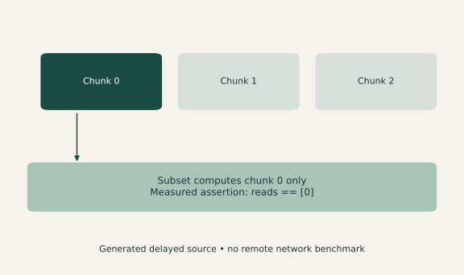

**This is an execution check, not a performance benchmark.** The figure reads the passing test assertion from source. The three boxes explain the tested delayed graph; they are not a measurement of remote file requests. Guard checks additionally bound bytes, dimensions, chunks and task counts before compute.

Every eager output receives an evidence hash; lazy plans are labeled plans rather than completed reads. Metadata checksums and per-window value hashes retain different scopes. No claim is made about complete remote raster immutability.

Evidence: tests/test_cubedynamics.py selected delayed-chunk test; data/tests.xml; cubedynamics_backend.py. Claim class: PROJECT RESULT.

## 19. A stored digital number is not reflectance

The retained Sentinel source metadata supplies the scale and offset. Applying them changes encoded DN into a dimensionless reflectance value.

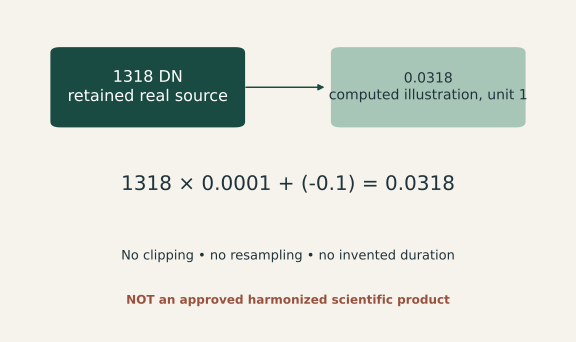

**An exact calculation can still require scientific review.** The displayed arithmetic uses a real retained pixel and its documented asset coefficients. It is a report illustration of calibration, not a newly authorized pipeline product. Source data and coefficients remain unchanged.

Quality class 4 is retained as evidence, not proof of ecological validity. A native 10 m footprint and instantaneous acquisition remain distinct from a geographic bounding box. The next approved real run must preserve these facts through recipe, backend and representation lineage.

Evidence: data/sentinel_example.json; historical run/real-sentinel/window-0.json; calibration.scale_offset. Claim class: PROJECT RESULT.

## 20. MOSAIKS receives the harmonized output

The fresh generated demonstration calibrates windows, applies real CubeDynamics selection and emits numeric MOSAIKS features with lineage.

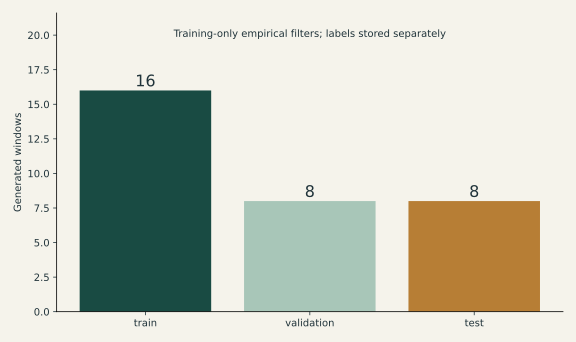

**Training information must stay inside the training split.** The run produced 32 vectors with 32 dimensions. Empirical filters use a bounded eight-window training reference. Spatial groups are disjoint and buffered in the generated layout.

MOSAIKS uses empirical random convolutional features followed by task-specific numerical models [3]. This implementation is a bounded prototype of that approach, not a generic replacement encoder or precomputed satellite feature substitution. Features are not intrinsically interpretable to an LLM.

Evidence: run/cubedynamics-verified/manifest.json; verification.json; cube_demo.py; mosaiks.py; [3]. Claim class: PROJECT RESULT.

## 21. The features carry usable numerical information

Held-out ridge regression predicts the standard deviation of the first harmonized channel. Mean and shuffled-label baselines make the diagnostic comparison explicit.

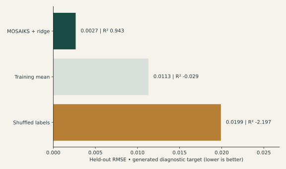

**A derived target verifies the pipeline, not independent ecology.** The target is calculated from generated harmonized data and stored separately from vectors. The test set is held out from filter fitting and ridge selection. These are actual fresh-run metrics, not a claim about real landscapes.

Integrity checks include shard/lineage hashes, dimensions, finite values, duplicate vectors and split geography. Independent ecological labels, spatial and temporal transfer, uncertainty and task-specific acceptance remain unmeasured. Numeric model consumption is demonstrated; native LLM understanding is not.

Evidence: run/cubedynamics-verified/verification.json; embedding_dataset.py; mosaiks_pipeline.py. Claim class: PROJECT RESULT.

## 22. Every vector should lead back to its scientific decisions

Read the lineage backwards from a representation to the source. The path must explain both the calculation and the decisions that made it legitimate.

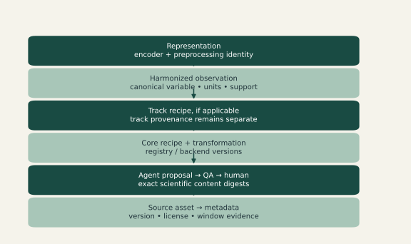

**A compact hash identifies evidence; it does not explain its scope.** Source, recipe, executor, backend, review and encoder identities contribute to lineage. Track-specific products add their own recipe without changing shared immutable sources. Metadata and extracted-window hashes are explicitly different.

The generated release stores vectors, labels and compact lineage, not raw or harmonized raster datasets. Historical snapshot workflows remain labeled legacy examples. External provenance registration remains planned rather than silently attributed to MESA.

Evidence: provenance.py; storage.py; harmonized_rasters.py; run/cubedynamics-verified/records.jsonl. Claim class: PROJECT RESULT.

## 23. Breadth describes assessed scope, not ontology quality

The benchmark contains 1806 resource-by-dimension rows across 21 dimensions. The figure shows a named illustrative subset; all 86 resources remain in the source tables.

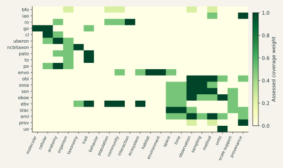

**The colors are provisional project judgments.** Strong = 1; partial = 0.5; indirect = 0.25; not-target = 0; unknown is unscored. Equal dimension weights are diagnostic choices, not a scientific measurement scale.

Coverage does not establish exact concepts, term alignment, scientific compatibility or adoption. Hierarchical, relational and annotation depth have not been computed and are NOT YET MEASURED. A broad resource may still lack the exact distinction a question needs.

Evidence: outputs/semantic_benchmark/benchmark_coverage.parquet; data/semantics/assessments.jsonl. Claim class: PROJECT RESULT.

## 24. Declared links show where semantic systems already connect

The inventory records imports or dependencies when present in inspected metadata. This graph draws only links whose targets are also in the local inventory.

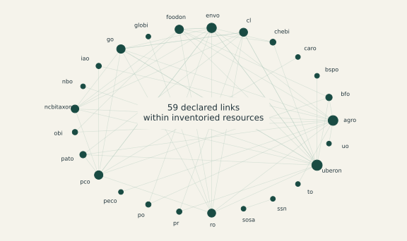

**A declared dependency is not a validated scientific mapping.** The graph is not a parsed OWL import closure, term-level reuse analysis or bridge-centrality benchmark. External target strings are retained in the CSV but excluded from this within-inventory drawing.

Different systems may supply different parts of an observation: an entity, environment, observation method, relation or unit. That is a compositional hypothesis to investigate. This graph alone does not prove interoperability or identify the best ontology portfolio.

Evidence: semantic_resources.csv.imports_or_dependencies; data/inventory_relationships.json. Claim class: PROJECT RESULT.

## 25. Different scope may be valuable—but is not enough

The local pair table evaluates 3655 pairs for assessed coverage overlap. A selected matrix makes that limited result visible.

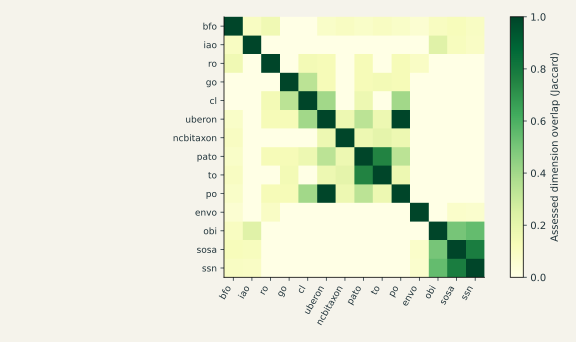

**Low overlap is not measured scientific complementarity.** Jaccard compares sets of positively assessed dimensions. It does not evaluate conflicting axioms, redundant concepts, scientific mapping difficulty or useful combined inference. The diagonal is identity for display.

Redundant, overlapping, complementary, different-domain, potential-conflict and unknown are useful future review distinctions. Only assessed scope overlap is computed here. A term-level, task-specific benchmark is needed before labeling promising scientific combinations.

Evidence: outputs/semantic_benchmark/ontology_pairs.parquet; semantic_benchmark.py. Claim class: PROJECT RESULT.

## 26. An assessed portfolio adds scope; scientific gain is still a question

The existing greedy diagnostic chooses up to eight resources to cover local assessed dimensions. Its recorded marginal gains can be accumulated without inventing new scores.

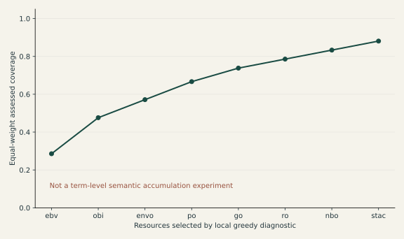

**This curve measures the rubric, not all scientific meaning.** The curve sums recorded marginal gains and divides by 21 equally weighted dimensions. Unknown values add no assessed gain. Selection is a recommendation for human review, not scientific adoption.

The larger research question—whether specialized resources keep adding task-relevant semantic meaning—remains UNDER ANALYSIS. It requires canonical observations, exact term evidence, expert judgments and held-out questions. Ontology saturation has not been demonstrated.

Evidence: outputs/semantic_benchmark/recommended_portfolio.json; method and not_established fields. Claim class: PROJECT RESULT.

## 27. A sparse assessment is a place to investigate

The gap table counts strong and unknown resource assessments. It does not prove that an external concept is absent.

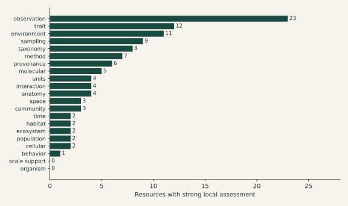

**A missing concept and a missing scientific rule are different problems.** Counts show the current inventory rubric only. They do not classify whether a gap needs a crosswalk, composition, extension, project concept or scientific transformation rule. The table contains an additional review-oriented gap record beyond the dimension rows.

Support, aggregation, representativeness, uncertainty propagation and cross-scale justification need careful review. An expert should first ask whether the concept already exists, then whether a mapping or scientific rule is needed. Unknown remains an acceptable result.

Evidence: outputs/semantic_benchmark/semantic_gaps.parquet; docs/semantics/ontology-benchmarking.md. Claim class: PROJECT RESULT.

## 28. Three source records reveal metadata differences

The benchmark uses two synthetic fixture records and one retained real Sentinel metadata record. These are asset/version records, not three provider-wide assessments.

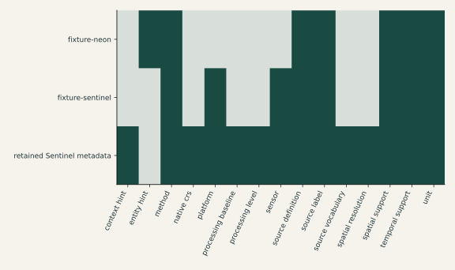

**A present field is not necessarily complete or scientifically adequate.** Green indicates a field extracted by the metadata parser; gray indicates absence. The plotted columns are the union of observed fields, not a claim that all possible semantic dimensions were tested.

Documentation rankings are project diagnostics. They do not rank scientific data quality or dataset suitability. The current sample is too small and mixed in evidence type to support broad conclusions about NEON, Sentinel or other providers.

Evidence: outputs/semantic_benchmark/dataset_metrics.parquet; dataset_rankings.parquet. Claim class: PROJECT RESULT.

## 29. The useful next question has not been scored yet

Two proposed analyses compare ontology potential against explicit ontology use, and against semantic diversity. Neither currently has validated dataset metrics.

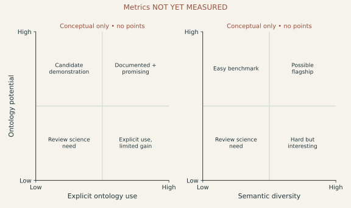

**No real datasets are placed in these quadrants.** The two panels explain separate planned comparisons. Explicit use and diversity have different x-axes and must be measured separately; they are not interchangeable numerical values.

Potential means a reviewed opportunity to make currently implicit meaning computable. A rubric would need evidence of entities, methods, supports, identifiers and scientific use cases. The report preserves the idea without fabricating flagship candidates or coordinates.

Evidence: docs/semantics/dataset-benchmarking.md; docs/development/documentation-sync-audit.md. Claim class: PLANNED WORK.

## 30. A namespace reference is useful but limited evidence

The dataset-edge table contains one extracted STAC namespace association. It does not contain a resolved ontology concept mapping.

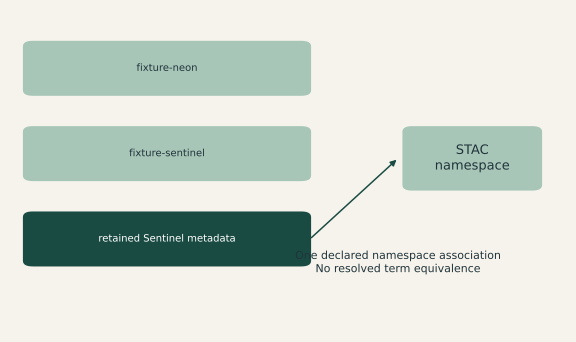

**No inferred dataset–ontology edges are drawn.** The parser recognizes an explicit metadata namespace; term existence, exact concept identity and scientific equivalence are not evaluated. The fixture records have no such extracted edges in this table.

A richer graph should distinguish explicitly uses, implements standard, provides identifiers, reviewed mapping and potential mapping. Those relations need different evidence. Adding arrows merely because a dataset and ontology concern the environment would hide the scientific work.

Evidence: outputs/semantic_benchmark/dataset_ontology_edges.parquet; semantic_discovery.py. Claim class: PROJECT RESULT.

## 31. Shared metadata structure is not shared scientific meaning

The three pair records compare field presence. This is the available pair result; ecological complementarity, science value and cross-scale opportunity are not scored.

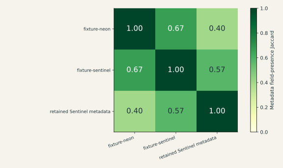

**These pairs do not rank real provider combinations.** The matrix uses the same three source metadata records as the profile. Values compare sets of extracted field names, not measurements, taxa, units or support compatibility. Identity diagonals are supplied for display.

NEON–Sentinel, trait–community and other combinations may be useful future questions, but the present benchmark does not establish them. A valid ranking needs independently reviewed variables, supports, licenses, scientific objectives and transformation rules.

Evidence: outputs/semantic_benchmark/dataset_pairs.parquet; scientific_comparability = not_evaluated. Claim class: PROJECT RESULT.

## 32. The suite tests guardrails as well as successful calculations

203 passed; 0 failed; 0 skipped. The integration environment includes actual CubeDynamics; tests use offline data.

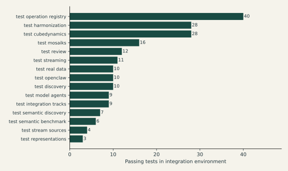

**Passing software tests do not validate ecological conclusions.** The suite exercises malformed model output, stale decisions, unknown operations, support/rights checks, lazy bounded computation, track independence, provenance and held-out numerical diagnostics.

This is test count by module, not line coverage or a percentage of all scientific behavior. Code coverage is NOT YET MEASURED. Independent scientific labels, expert semantic adjudication, remote throughput and production reliability need separate evaluation.

Evidence: data/tests.xml; data/test_results.json; tests/; docs/testing.md. Claim class: PROJECT RESULT.

## 33. There is a broad local demonstration, not a production service

The matrix assesses bounded prototype behavior from source, tests, documentation and retained examples. It does not claim that each row is scientifically complete.

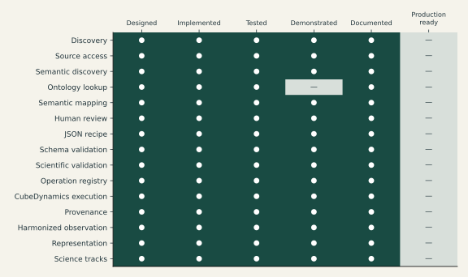

**No component is labeled production ready.** Ontology lookup is limited to local candidates and namespace evidence; no live term-level service is demonstrated. Source access has real historical Sentinel evidence, while MESA transport and NEON observation normalization remain incomplete.

Scientific validation here means deterministic preconditions and review gates. It does not mean independent ecological validation. Science tracks demonstrate configuration separation and shared-source immutability, not validated food or water security outcomes.

Evidence: tables/maturity.json; data/component_inventory.json; docs/architecture/current-state.md. Claim class: PROJECT INTERPRETATION.

## 34. The hardest gaps are scientific, not just computational

The current system can stop an unsupported analysis. It cannot yet resolve every ambiguity or prove that a derived representation is useful for a real ecological question.

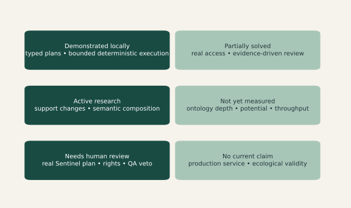

**The limitations define the next experiment.** MESA transport is blocked, general reprojection/resampling is unexposed, and the MOSAIKS bridge preserves a single native band/grid. Model review can contain mistaken claims or unsupported evidence pointers and needs expert revision.

Ontology scores remain provisional metadata diagnostics. Depth, validated composition, dataset potential/diversity and term-level accumulation are unmeasured. Geographic/temporal transfer and independent outcome validation remain open. No unmeasured speedup or universal representation is claimed.

Evidence: docs/PROTOTYPE_STATUS.md; docs/development/cubedynamics-audit.md; semantic benchmark methods. Claim class: PROJECT RESULT.

## 35. One approved real demonstration is the next meaningful milestone

The roadmap follows observed gaps rather than arbitrary calendar dates. Each stage needs evidence that the previous assumptions remain valid.

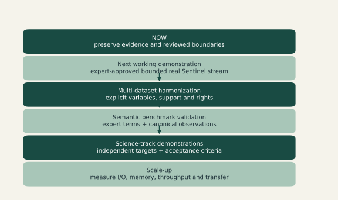

**Make one scientific claim reviewable before making many.** First resolve the real Sentinel recipe, rights evidence, native-CRS wording, quality criteria and historical veto with experts. Re-run fresh frozen consensus and human review before source access. Then stream a small bounded area directly into MOSAIKS and verify lineage and held-out independent targets.

Lessons: finding data is easier than justifying comparisons; alignment does not prove equivalence; constrained JSON makes model decisions inspectable; human review belongs at consequential boundaries. The research opportunity is a human-governed scientific compiler. Novelty remains a hypothesis alongside STAC, observation ontologies, PROV, MOSAIKS and existing workflow systems—not an established priority claim.

Evidence: docs/development/decisions.md; AGENTS.md; [1–7]. Claim class: PLANNED WORK.
