# Scientific validation: evidence, limits and next experiments

## 1. Can the comparison be justified?

Scientific validation begins by asking what the source measured, what a proposed transformation changes and what evidence would make a comparison defensible.

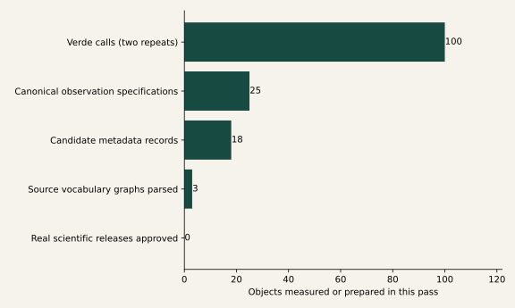

**We measured the boundaries; we did not approve a real-data release.** This pass adds real graph measurements and live model experiments, while preserving a blocked Sentinel review and a proposed NEON–Sentinel case. Candidate counts include heterogeneous product, network, standard and unresolved-product scopes.

The strongest conclusion is about method: structural model validity and successful software execution cannot replace scientific evidence. The following pages separate source facts, measured project results, project assessments, model judgments and proposed experiments.

Evidence: data/run_manifest.json; data/model_experiment/summary.json; AGENTS.md

Claim class: MEASURED PROJECT RESULT

## 2. A veto is evidence to investigate, not an obstacle to erase

The Sentinel package retains 10 issue records, including historical PASS findings and three additional workflow issues. The historical QA decision remains revise.

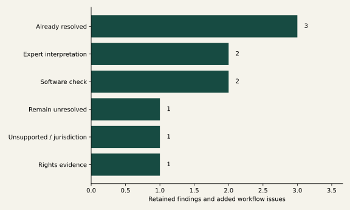

**Software can clarify a finding without lifting the veto.** Native raster EPSG:32613 and footprint EPSG:4326 are different roles. Official Sentinel terms now provide source evidence on lawful distribution/modification and attribution, but intended use still needs review.

The whole-raster-hash demand is not supported by the existing bounded-stream contract; per-window hashes have a valid narrower scope. Residual source-mutation risk remains for expert adjudication. Independent suitability, quality criteria, exact sensor support and fresh recipe/layout review remain unresolved.

Evidence: sentinel_review_gap_analysis.json; expert_decision_template.json; historical scoped review; Sentinel legal notice pp.1–2

Claim class: PROJECT ASSESSMENT

## 3. Breadth is an evidence-linked assessment, not an ontology fact

2408 assertions extend 86 inventory resources across 28 requested dimensions. Every known score retains evidence, source URLs, confidence and a project-assessment label.

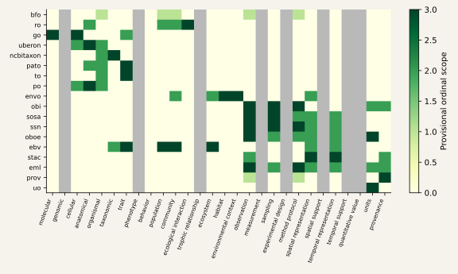

**Unknown stays gray; it does not become zero.** The original strong/partial/indirect/not-target coding maps to 3/2/1/0 for scoped comparison. Zero means not targeted in the assessed scope, not verified absence from an ontology. New dimensions without specific evidence remain unknown.

Scores are inherited provisional judgments, not newly expert-validated results. The report does not infer genomic, phenotype, trophic or support coverage merely from broader labels. Exact concept expressibility is assessed separately and remains mostly unresolved.

Evidence: resource_breadth.json; data/semantics/semantic_resources.csv; assessments.jsonl

Claim class: PROJECT ASSESSMENT

## 4. Three real vocabulary graphs can now be inspected quantitatively

The analysis parses bounded, attributed BFO, SOSA and SSN Turtle snapshots. It counts explicit classes, subclass structure, relations, restrictions, definitions, synonyms, cross-references and imports.

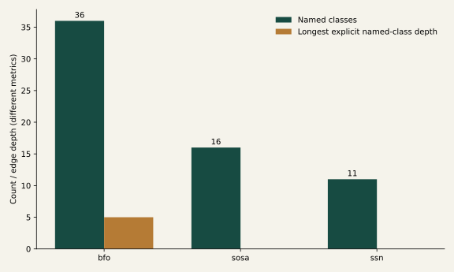

**A shallow explicit hierarchy does not mean poor scientific coverage.** Graph imports are not followed, blank-node restrictions are counted separately and no OWL inference runs. Depth uses named-class subclass edges within the local snapshot; cycles produce unknown depth rather than a fabricated answer.

SOSA and SSN use modeling patterns that this local named-class hierarchy does not summarize. SSN explicitly imports SOSA, so its local depth is not the depth of the combined model. HTTP-shaped identifiers are counted, but resolvability is not tested. Class counts are not quality scores.

Evidence: resource_depth.json; data/graphs/manifest.json; W3C license notice; BFO dc:license

Claim class: MEASURED PROJECT RESULT

## 5. Composability needs typed, evidence-bearing relationships

The relationship output distinguishes inventory declarations, explicit owl:imports triples and URI references. It does not invent overlaps, complements or conflicts from names.

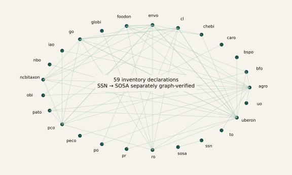

**One graph-verifiable import is stronger evidence than a scope resemblance.** SSN imports the SOSA namespace in the retrieved graph. The wider network shows inventory-level dependency declarations; it is not an inferred import closure or a scientific compatibility graph.

Use of RO/BFO can be investigated through declared references and parsed identifier occurrences. Entity–quality composition, I-ADOPT compatibility, crosswalk correctness and shared-model equivalence are not established by these counts and remain explicit review tasks.

Evidence: resource_relationships.json; resource_depth.json; original CSV relationship fields

Claim class: MEASURED PROJECT RESULT

## 6. Twenty-five observations turn the scientific question into requirements

The suite spans traits, populations, communities, interactions, fluxes, soils, samples, genomics, agriculture, satellite reflectance and cross-source context.

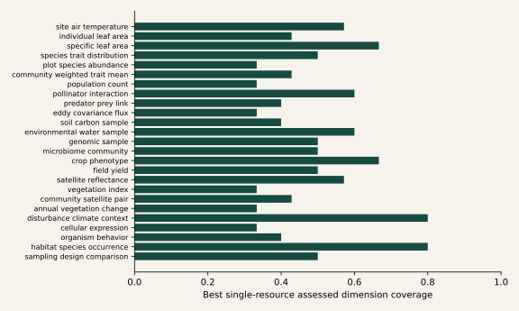

**Requirement coverage is not yet proof that an ontology can express the observation.** Each observation has explicit requirement IDs and dimensions rather than prose alone. The chart computes best-single-resource coverage using meaningful-or-major provisional scope scores; it does not resolve exact scientific variables.

A separate term-witness ledger checks real SOSA observation, sampling, procedure and result terms in the retrieved graph. Candidate alignment to a requirement is still a project assessment. Exact quantity, taxonomic and support semantics need term-level expert review; no canonical human gold set is claimed.

Evidence: data/semantics/validation/canonical_observations.json; canonical_benchmark.json; canonical_term_witnesses.json

Claim class: MEASURED PROJECT RESULT

## 7. Composition adds assessed coverage—but leaves unmeasured meaning

Exact size-1, size-2 and size-3 searches reach 37.2%, 52.7% and 62.2% of requirement instances under the provisional rubric.

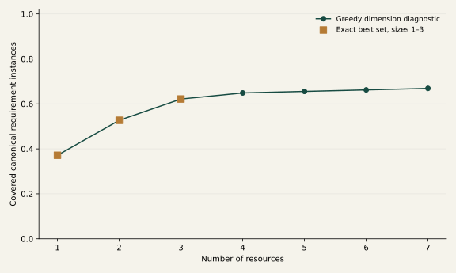

**This is now a computed observation-requirement diagnostic, not a term-level accumulation result.** Coverage counts repeated dimension requirements across the 25 observations. Exact enumeration covers all resource combinations through size three; the longer curve is greedy. A greedy witness does not prove minimum set size beyond the exact search.

The result supports investigating composition, not adopting a universal winning ontology. Missing dimensions cap coverage, and ordinal rubric choices affect the curve. Subdomain curves, pair overlap, marginal gains and unattained thresholds are retained independently in the output.

Evidence: canonical_benchmark.json exact_best, thresholds, resource_pairs and subdomains

Claim class: MEASURED PROJECT RESULT

## 8. Exploratory similarity describes the rubric’s structure

PCA uses 84 complete-case resources and 20 assessed dimensions. Entirely unmeasured dimensions and incomplete resource rows are excluded, never filled with zero.

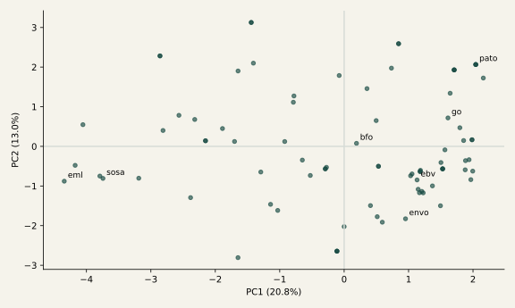

**Nearby points have similar assessed scope, not equivalent concepts.** The centered ordinal vectors are decomposed by singular-value decomposition without imputation. This is a transparent exploratory analysis; it is not an inferential test or an ontology quality ranking.

The shape is conditional on the inventory, the ordinal interpretation and the retained dimensions. Class counts, graph depth and dataset potential are not mixed into this space. Excluded resources and dimensions are listed so the missingness decision remains inspectable.

Evidence: resource_pca.json; scientific_validation.py analysis methods

Claim class: MEASURED PROJECT RESULT

## 9. Dataset semantics are documented at different levels of detail

The inventory investigates the eight central sources plus biodiversity, interaction, genomic and phenotyping examples. Each record states whether it describes a product, network, standard or unresolved counterpart.

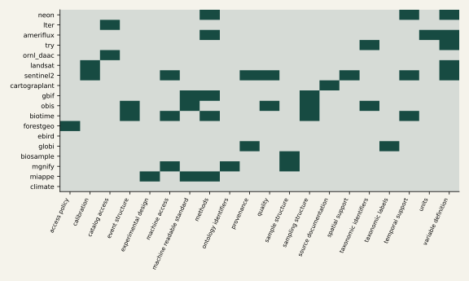

**Gray means unassessed—not absent.** Green marks project-coded documented field presence in the selected evidence. Product-level Sentinel metadata can support more detailed assertions than a network landing page; these unequal scopes must not be interpreted as provider-wide quality differences.

eBird’s documentation was blocked by an access challenge; the climate counterpart is unselected; MIAPPE is explicitly a standard comparator, not a dataset. Neither scores nor inventory membership grant access, integration status, scientific compatibility or execution permission.

Evidence: dataset_benchmark.json; data/semantics/validation/dataset_inventory.json

Claim class: MEASURED PROJECT RESULT

## 10. Potential is a hypothesis attached to evidence, not a source fact

The diagnostic contrasts documented semantic diversity with the number of curator-proposed semantic-resource relationships. It does not count variables or claim semantic gain.

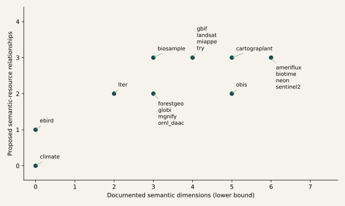

**These are assessed opportunities for expert investigation.** The x-axis is a project-coded lower bound from documented distinct dimensions; missing evidence can lower that bound. The y-axis is a transparent count of proposed relationships, not a validated ontology-potential scale. Datasets at the same coordinates share a label block; ties carry no ranking significance.

Formal ontology references are distinguished from metadata or exchange standards in the ontology-native ranking. Eight separate prioritization rubrics are retained rather than one overall dataset-quality score. Flagship prioritization remains provisional and needs a concrete site, product and scientific question.

Evidence: dataset_benchmark.json records, edges and rankings

Claim class: PROJECT ASSESSMENT

## 11. Explicit references and potential mappings are different edges

The bipartite graph preserves source-documented standard or identifier references separately from proposed resource connections.

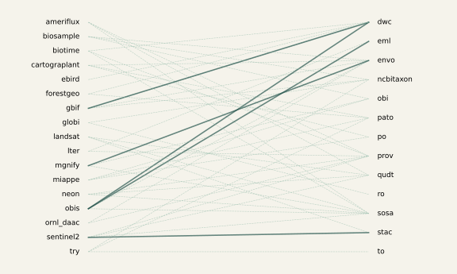

**Dashed edges are project hypotheses, not scientific mappings.** Solid links describe scoped documentation: Sentinel/STAC, OBIS/Darwin Core and EML, GBIF guidance/Darwin Core and a MGnify sample/ENVO. These do not automatically validate individual terms or all records in a provider.

Candidate edges retain their source evidence and pending expert review. The graph does not silently promote namespace recognition into variable equivalence. A larger graph needs versioned concept-level witnesses, reviewed relation types and independent assessment of meaning preserved or lost.

Evidence: dataset_benchmark.json.edges; source assertions and scope fields

Claim class: MEASURED PROJECT RESULT

## 12. Pairs can add documented dimensions without becoming compatible

Nine requested scientific pair questions are evaluated against the inventory, including NEON–Sentinel, NEON–TRY, trait–community and flux–satellite combinations.

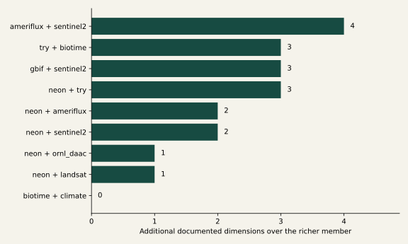

**The pair score does not measure science value or matching feasibility.** The bar counts dimensions documented for only one member beyond the richer member’s set. It is sensitive to incomplete documentation and mixed inventory scopes. All pair records retain scientific_compatibility = unknown and unverified site/time overlap.

BioTIME + climate remains blocked on choosing an actual climate product. ORNL DAAC needs a product, and trait–community comparisons need taxonomic and aggregation rules. The ranked pair table prioritizes review questions rather than declaring a scientifically valid combination.

Evidence: requested_dataset_pairs.json; dataset_benchmark.json.pairs and pair_ranking

Claim class: MEASURED PROJECT RESULT

## 13. NIWO is evidence-backed, but sensor colocation is not established

Public NEON metadata confirms July 2023 availability for the air-temperature product at NIWO. The retained Sentinel scene footprint contains the published NIWO coordinate.

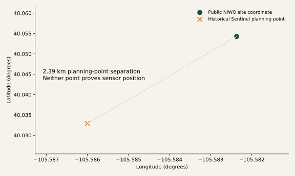

**A site coordinate is not a sensor footprint.** The existing Sentinel planning point differs from the public site coordinate by about 2.4 km. This descriptive haversine diagnostic compares planning coordinates only, not actual instrument supports or distances between matched observations.

The proposed case uses a tower air-temperature interval as environmental context for instantaneous NIR reflectance. Exact sensor/height, units, interval convention, quality flags, release/file identity and source observations remain missing. NEON authentication is absent; no observation file is downloaded.

Evidence: neon_sentinel_case.json; neon-product.json; neon-site.json; retained sentinel-stream-plan.json

Claim class: MEASURED PROJECT RESULT

## 14. The useful relationship is contextual, not equivalent

The review package includes a registered Sentinel calibration/rename recipe fragment and a deliberately unbound NEON branch.

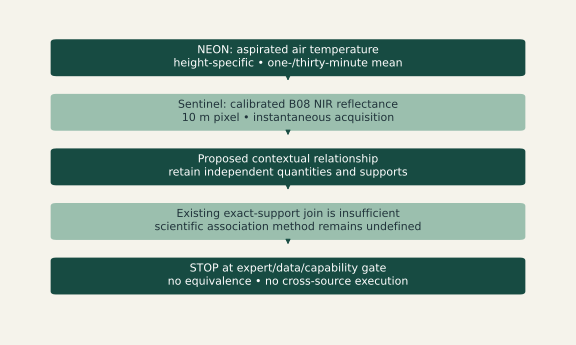

**Conceptual proposal: preserve the difference between measurements.** An exact observation join requires equal support and intervals; nearest grid sampling does not supply tower sensor support or a scientifically justified point-to-pixel relationship. Those operations cannot be repurposed silently.

A reviewed interval-to-instant contextual association is a genuinely missing capability. Its time convention, sensor selection, spatial relation, tolerance, uncertainty and scientific purpose must be defined before implementation. No operation ID or executable formula is invented to fill that gap.

Evidence: neon_sentinel_case.json.missing_deterministic_capability; sentinel_proposed_recipe.json

Claim class: CONCEPTUAL PROPOSAL

## 15. The first experiment isolates boundaries, not general model capability

100 live calls returned 98 successful responses and 2 failures; failures are preserved without repair or mocked replacement.

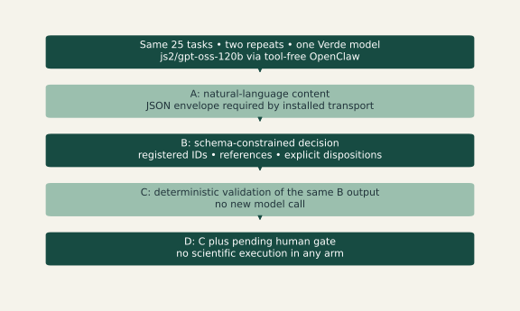

**Conceptual protocol, backed by retained exact calls.** A uses unconstrained prose inside a mandatory JSON text envelope, so it is not a fully unconstrained provider baseline. B restricts decisions; C and D re-evaluate the same B response deterministically rather than drawing extra samples.

Only the configured Verde model is tested. The smaller-local-model hypothesis and inter-model disagreement remain untested. Draft reference answers are assistant-authored project assessments, not human gold; expert scientific accuracy and unsafe-proposal rates remain unknown.

Evidence: data/model_experiment/calls.jsonl; summary.json.protocol; decision_tasks.json

Claim class: CONCEPTUAL PROPOSAL

## 16. Valid JSON did not establish an evidence-grounded decision

All 50 B decisions were schema-valid; 14 failed the scenario’s deterministic scientific/reference checks.

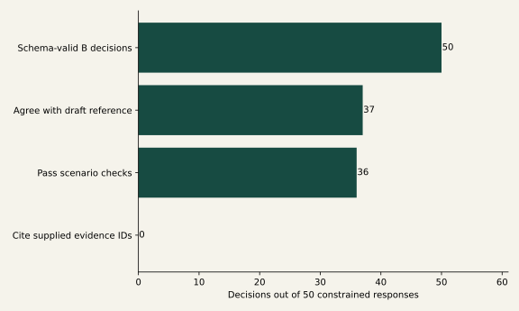

**The backbone rejected selected plans with no evidence citations.** None of the 50 constrained decisions cited a supplied evidence ID. Passing scenario checks includes abstention/review dispositions; it does not mean that 36 scientific transformations were validated or executed. Citation membership is a syntactic check, not proof of factual grounding.

Agreement with the draft oracle is reported only as a development diagnostic. Human-adjudicated accuracy is unavailable. The human gate blocks every execution because no approval is supplied; zero executions are enforced by the experiment, not evidence that the model is scientifically competent.

Evidence: data/model_experiment/evaluations.json; summary.json; decision_experiment.py

Claim class: MEASURED PROJECT RESULT

## 17. Repeatability needs more than temperature zero

The pilot retains latency and exact normalized responses for every call. Token usage, cost and provider weight hashes are not exposed by this plugin and remain unknown.

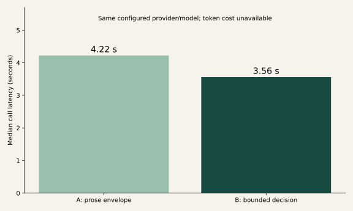

**Different wording and different decisions are separate questions.** Across successful repeat pairs, exact normalized-response matches were 0/23 for A and 0/25 for B. Structured action/operation/concept/reference stability was 17/25 for B.

Latency is exploratory for one run, not a speed or cost superiority claim. Pairing and task types must be retained in later statistical comparisons. The original started_at field was recorded after receipt in this runner version; elapsed_seconds records duration and the caveat is retained.

Evidence: data/model_experiment/summary.json latency_seconds, reproducibility and protocol

Claim class: MEASURED PROJECT RESULT

## 18. Unknowns define the next scientific work

The largest gaps are not automatically gaps in existing ontologies; they are gaps in this project’s evidence and reviewed measurement design.

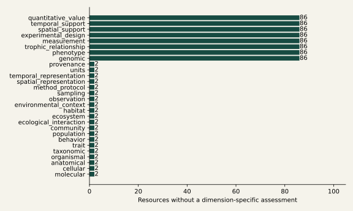

**Do not turn unmeasured scope into an invented absence claim.** The next semantic experiment needs exact term witnesses, expert mappings and a human-authored canonical gold set. The next model experiment needs blinded prose coding, expert decisions, more models and a pre-specified policy for malformed/unsafe proposals.

The next cross-source case needs bounded authenticated NEON observations, actual sensor-position metadata and an approved contextual association method. Independent ecological outcome data are required before claiming scientific validity of MOSAIKS representations. No new scientific operation was added in this pass.

Evidence: resource_breadth.json; expert_gold_template.json; neon_sentinel_case.json; AGENTS.md

Claim class: PROJECT ASSESSMENT
